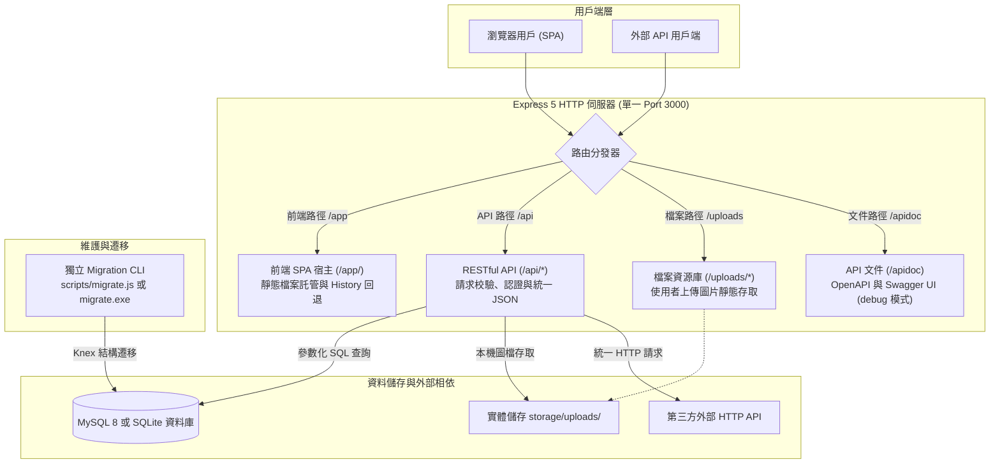

# 0. 架構總覽

本專案是一套現代化、可重複使用的全端基礎架構：前端採用 **Vue 3 (Vite)**，後端採用 **Express 5**，資料庫可選用 **MySQL 8 或 SQLite**，並支援 **Node.js (PM2)** 與 **Bun 單一二進位執行檔** 雙軌執行型態。

本篇作為專案的全局架構地圖，綜整前後端協同流程、路由分區設計、目錄佈局與全套文件指引。

---

## 一、核心設計哲學

1. **同 Port 前後端一體化**：
   前端 Vue 3 SPA、後端 RESTful API、靜態上傳圖檔與 Swagger 文件統一由 Express 監聽同一個 HTTP 通訊埠（預設 3000），消除本機開發與同源部署時的跨域（CORS）複雜度。
2. **雙軌運行模式自由切換**：
   - **開發時期**：採用 Node.js + PM2 搭配 Vite Watch Build，享受前後端獨立熱加載與即時重編體驗。
   - **生產交付**：支援透過 `bun build --compile` 編譯為獨立二進位單一執行檔，目標伺服器免安裝 Node.js、PM2 或依賴套件即可開箱即用。
3. **模組化 Module 設計**：
   - **分層架構與責任分離**：後端不採用將所有 Controller、Service 混在全域目錄的傳統水平切分，而是統一組織在 `src/http/module/<domain>/` 下（如 `auth`、`health`、`post`）各業務領域自成獨立、高內聚的 Module，隨插即用，在新專案複製時極易擴充或抽換。
   - **模組內部職責邊界**：
     - **`route.js`**：定義 HTTP Method 與端點，專職編排各 `middleware`中介層管線，再將請求分發至 Controller，不寫業務判斷。
     - **`request.js`**：集中定義請求結構與驗證規則，保證進入 Controller 的資料皆合法、型別正確。
     - **`controller.js`**：專注於 HTTP 協定層，解構 Request 參數並調用 Service，透過 `response.success()` 或拋出錯誤完成回應。
     - **`service.js`**：純粹的業務邏輯核心，執行資料庫操作、調用 Helper 工具，並負責將資料庫 `snake_case` 轉換為對外 `camelCase`（DTO Mapping），**不接觸 Express 的 `req` / `res` 物件**，確保業務邏輯具備 100% 獨立單元測試能力。
   - **全域環境設定隔離**：環境設定統一由專案根目錄 `.env` 與 `src/config/` 設定模組集中管理與防呆轉譯，業務層與模組內部嚴禁直接讀取 `process.env`。

---

## 二、系統運作架構與請求流向

### 2.1 系統架構圖



### 2.2 核心路由分區規劃

| 網址前綴 | 負責內容 | 行為特性說明 |
| --- | --- | --- |
| `/` 或 `/app/` | 前端 Vue 3 SPA | 根路徑自動 302 導向至 `/app/`，支援 HTML5 History 模式回退（回傳 `index.html`）。 |
| `/api/*` | 後端 JSON API | 提供 RESTful API，未定義之路徑回傳 JSON 404，不回退至 SPA 頁面。 |
| `/uploads/*` | 使用者上傳檔案 | 直接對應實體磁碟目錄 `storage/uploads/` 提供圖片靜態讀取。 |
| `/apidoc` | Swagger UI | 僅在 `APP_MODE=debug` 或 `test` 模式下啟用，提供互動式 API 文件。 |

---

## 三、技術棧與模組分工

| 領域 | 採用技術 | 主要責任範圍 |
| --- | --- | --- |
| **前端應用** | Vue 3、Vite 7、Vue Router 4、TypeScript | 使用者介面呈現、路由導航、表單驗證、同源 API 呼叫。 |
| **後端核心** | Node.js 22+、Express 5 | HTTP 伺服器、中介軟體管線、業務邏輯、安全防護與例外處理。 |
| **資料儲存** | MySQL 8／SQLite、`mysql2/promise`／內建 SQLite 模組 | 依 `DB_CLIENT` 選擇資料庫，提供參數化查詢與交易，MySQL 使用連線池。 |
| **結構遷移** | Knex 3、自訂靜態 Registry | 資料庫版本控管、資料表結構建立、修改與安全回滾。 |
| **日誌追蹤** | Winston 3、Daily Rotate File | 全域 Request ID 追蹤、HTTP 存取日誌、應用程式分級日誌。 |
| **認證機制** | JWT (`jsonwebtoken`)、`bcryptjs` | 雙軌支援：同源 Cookie Session（含 CSRF 防護）與 Bearer Token 認證。 |
| **單檔編譯** | Bun 1.1+ Compile | 將後端服務與遷移工具編譯為免 Node 環境之獨立可執行二進位檔。 |

---

## 四、專案目錄結構

```text
nodejs-base/
├─ frontend/                    # 前端獨立專案（具獨立 package.json）
│  ├─ dist/                     # Vite 前端建置產物（由 pnpm build:frontend 產出）
│  ├─ public/                   # 前端靜態公開資源（如 favicon.ico）
│  ├─ src/
│  │  ├─ api/                   # 後端 API 呼叫模組（authApi、postApi）
│  │  ├─ composables/           # Vue 組合式邏輯（useAuth 等）
│  │  ├─ config/                # 前端設定（API 網址、分頁大小等）
│  │  ├─ helper/                # 前端工具函式（統一 fetch 封裝 request.js）
│  │  ├─ router/                # 前端路由定義與導航守衛
│  │  ├─ styles/                # 前端樣式檔（main.css 等）
│  │  ├─ views/                 # 頁面視圖元件（文章清單、詳情、編輯、登入等）
│  │  ├─ app.vue                # Vue 根元件（導覽列與全域版面）
│  │  └─ main.js                # 前端進入點
│  ├─ index.html                # 前端 SPA 頁面模版
│  ├─ vite.config.js            # Vite 建置、base 與 outDir 設定
│  ├─ tsconfig.json             # 前端 TypeScript / Vue SFC 型別檢查設定
│  └─ package.json              # 前端相依套件與建置指令
├─ src/                         # 後端原始碼（Node.js / Express）
│  ├─ app.js                    # HTTP 服務啟動入口與開機安全檢查
│  ├─ config/                   # 環境變數集中解析與設定模組（app、auth、db、frontend、log 等）
│  ├─ db/                       # MySQL／SQLite 雙引擎資料庫介面與交易抽象
│  ├─ error/                    # 領域錯誤類別（400/401/403/404/409/422 等自訂例外）
│  ├─ helper/                   # 共用工具函式（檔案路徑、圖片處理、分頁、請求上下文、第三方請求）
│  ├─ http/
│  │  ├─ app.js                 # Express Application 核心實例化、中介層組裝與錯誤兜底
│  │  ├─ asset/                 # 靜態與內嵌資產目錄
│  │  │  └─ embeddedAssets.js   # 前端內嵌靜態資產字典模組（由 buildEmbedded.js 生成）
│  │  ├─ common/                # HTTP 共通規格與輔助工具
│  │  │  ├─ request.js          # 共用請求分頁與 ID 驗證器
│  │  │  └─ response.js         # 統一 JSON 回應封裝
│  │  ├─ route/                 # 統一路由管理層
│  │  │  ├─ index.js            # 路由總匯入口（聚合 API、前端 SPA 與 Swagger）
│  │  │  ├─ apiRoute.js         # API 總路由（聚合業務領域模組路由）
│  │  │  └─ frontendRoute.js    # 前端 SPA 雙模託管（實體目錄與內嵌記憶體）與歷史模式回退
│  │  ├─ middleware/            # 全域中介軟體（存取日誌、追蹤、CORS、CSRF、驗證、錯誤）
│  │  └─ module/                # 業務領域模組（auth、health、post）
│  ├─ logger/                   # Winston 日誌工廠、每日滾動輪替與實例通道
│  ├─ migrate/                  # Knex 自訂 Migration Runner、靜態註冊表與遷移腳本
│  └─ swagger/                  # OpenAPI 3.0 YAML 規範與 Swagger UI 裝配
├─ scripts/                     # 維護與建置腳本（buildBun、buildEmbedded、checkSyntax、migrate 等）
├─ test/                        # 自動化測試（unit 單元測試、api 契約測試、fixture 模擬資源）
├─ docs/                        # 專案系統架構與開發部署文件（0 至 11 篇）
├─ release/                     # 純淨單檔發布交付目錄（僅含 app.exe、migrate.exe，無外部前端雜物）
├─ storage/                     # 執行期動態資料（日誌 log/、上傳圖檔 uploads/、SQLite 資料庫 database/）
├─ .agents/skills/              # 專案規範與 AI 代理技能說明
├─ .env.example                 # 環境變數設定範本
├─ .env.test                    # 自動化測試專用環境設定
├─ ecosystem.config.js          # PM2 程序管理設定檔
├─ knexfile.js                  # Knex Migration 設定檔
└─ package.json                 # 專案根目錄依賴套件與管理指令
```

---

## 五、執行與部署型態對比

專案支援多種執行方式，適應從本地開發到正式環境的各種場景：

| 執行模式 | 觸發指令 | 執行機制 | 特性與適用情境 |
| --- | --- | --- | --- |
| **整合熱加載** | `pnpm dev` | Vite Watch Build + PM2 Watch | **本機開發推薦**，前後端共用同一通訊埠，熱加載體驗。 |
| **前景除錯** | `pnpm start:node` | 原生 Node.js 前景直出 | 原生 Node.js 執行程式，適合排查啟動期錯誤。 |
| **傳統常駐** | `pnpm start` | PM2 背景守護程序 | 正式環境傳統部署，提供記憶體超限防護與異常自動重啟（以 `pnpm stop` 停止）。 |
| **Bun 單檔交付** | `pnpm build:bun` | `bun build --compile` | **免 Node 環境交付**，產出免安裝之單一二進位執行檔（`app.exe`），極速啟動、極低資源佔用。 |

---

## 六、文件導覽與推薦閱讀路徑

建議依序閱讀以下專題文件，深入掌握專案各模組細節：

| 文件 | 核心主題與說明 |
| --- | --- |
| [1. 環境設定與啟動](1-環境設定與啟動.md) | 快速啟動、環境變數（`.env`）架構、生命週期檢查與全部 pnpm 指令。 |
| [2. 同源架構、CORS 與 CSRF 機制](2-同源架構、CORS與CSRF機制.md) | 同源架構本質、CORS 跨來源配置、Cookie 安全性與 CSRF 防護。 |
| [3. 請求處理、日誌與錯誤](3-請求處理、日誌與錯誤.md) | HTTP 請求生命週期、Request ID 鏈路追蹤、統一回應結構與自訂錯誤類別。 |
| [4. 資料庫與 Migration](4-資料庫與Migration.md) | MySQL／SQLite 資料庫介面、交易管理、Knex 自訂靜態遷移註冊與結構回滾機制。 |
| [5. Swagger 與 API 契約](5-Swagger.md) | OpenAPI 3.0 規格維護與互動式 Swagger UI 文件。 |
| [6. 登入與認證](6-登入與認證.md) | 雙軌認證設計（Cookie Session + CSRF 與 Bearer Token）、權限保護與 Token 生命週期。 |
| [7. 後端模組與圖片儲存](7-後端模組與圖片儲存.md) | 業務模組分層實踐（以文章 CRUD 為例）、分頁處理與圖片 Base64 儲存。 |
| [8. 測試說明](8-測試說明.md) | Jest 單元測試、API 測試、前端型別檢查與測試執行指南。 |
| [9. 前端開發](9-前端開發.md) | Vue 3 SFC 分層、路由導航守衛、Vite 建置機制與前端 `.env` 限制規範。 |
| [10. Bun 打包與部署](10-Bun打包說明.md) | Bun 二進位編譯管線、發布目錄規範、Windows/Linux 系統常駐服務設定。 |
| [11. 正式部署與反向代理](11-正式部署與反向代理.md) | Nginx 反向代理配置、HTTPS (SSL) 憑證設定、轉送標頭與上線排查。 |

> **開發規範注意**：所有程式碼變更與擴充，請務必嚴格遵循根目錄之 [AGENTS.md](../AGENTS.md) 規範。
