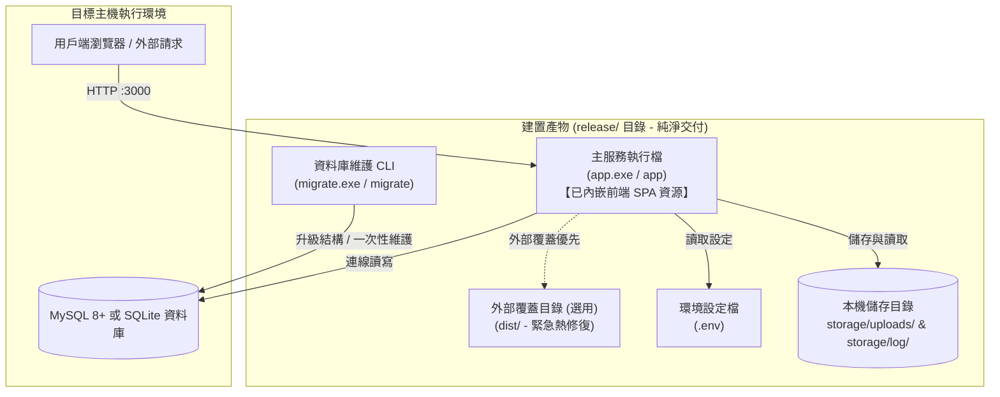
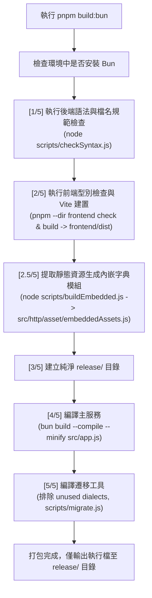

# 10. Bun 打包與部署

本篇說明專案如何透過 Bun 將後端 Express 服務與資料庫遷移工具編譯為免安裝環境之獨立二進位執行檔（Standalone Executable），並詳述發布目錄結構、Windows / Linux 系統常駐服務設定、版本更新與現場故障排查 SOP。

---

## 一、單檔交付架構與雙執行檔體系

本專案支援將後端完整封裝為獨立執行檔，目標伺服器**無須預先安裝 Node.js、pnpm 或部署龐大的 `node_modules` 目錄**。資料庫可使用 MySQL，或以 `DB_CLIENT=sqlite` 使用本機 SQLite 檔案。

### 1.1 交付架構視覺化



### 1.2 進入點與二進位產物對照表

專案將 HTTP 服務、資料庫維護工具及前端靜態資源整合為獨立執行檔，支援 Windows 與 Linux 部署。

| 原始進入點 | Windows 產物 | Linux 產物 | 執行職責與生命週期 |
| :--- | :--- | :--- | :--- |
| `src/app.js` | `app.exe` | `app` | **長駐 HTTP 伺服器**：負責 RESTful API、前端 SPA 託管（支援外部目錄 dist/ 優先覆蓋內嵌前端資源）、圖片讀取與請求日誌。 |
| `scripts/migrate.js` | `migrate.exe` | `migrate` | **一次性維護 CLI**：資料庫升級（`up`）、回滾（`rollback`）、解鎖（`unlock`）與重置（`fresh`）。 |
| `frontend/dist/` | 內嵌至執行檔 | 內嵌至執行檔 | **前端靜態產物**：透過 `scripts/buildEmbedded.js` 於編譯時嵌入 Vite 建置產物，無須額外部署前端目錄。 |

### 1.3 核心架構優勢：純淨單檔交付與雙模容錯

1. **極致單檔交付（All-in-One）**：前端 SPA 資源於打包期完整編譯進入 `app.exe`，`release/` 目錄純淨無雜物，目標伺服器只需單一執行檔與 `.env` 即可開箱即用。
2. **職責分離**：主服務專注於長駐高並發 HTTP 請求，資料庫遷移屬於離線維護工具，避免多節點啟動時發生競爭鎖死。
3. **雙模容錯彈性（Hybrid Fallback）**：預設由執行檔直接從記憶體提供 SPA 服務，若現場維運有緊急需求，只要在執行檔旁放置 `dist/` 目錄，系統即自動優先載入外部實體檔案，**保留免重編執行檔即可熱更新前端的維運彈性**。

---

## 二、建置環境與全自動打包管線

### 2.1 建置前置需求

建置主機需具備以下環境：
* **Node.js**：22.5.0 以上
* **套件管理器**：pnpm 10+
* **Bun Runtime**：可執行之 Bun（請至 [bun.sh](https://bun.sh) 安裝）
* 前後端相依套件已安裝齊全（於專案根目錄已執行 `pnpm install` 與 `pnpm --dir frontend install`）。

### 2.2 打包管線流程圖（`scripts/buildBun.js`）

透過封裝好的建置腳本，一鍵完成語法檢查、前端編譯、內嵌模組生成與雙二進位檔案打包：



### 2.3 建置指令集與參數規範

所有打包指令均於專案根目錄執行：

| 執行指令 | 目標平台 | 底層編譯 Target 標記 | 產物說明 |
| :--- | :---: | :--- | :--- |
| `pnpm build:bun` | 自動偵測 | 當前平台 | 依目前作業系統自動編譯對應平台產物。 |
| `pnpm build:bun:windows` | Windows x64 | `bun-windows-x64-modern` | 產出 `release/app.exe` 與 `release/migrate.exe`，並嘗試套用 `frontend/public/favicon.ico`。 |
| `pnpm build:bun:linux` | Linux x64 | `bun-linux-x64-modern` | 產出 `release/app` 與 `release/migrate`。 |

#### 進階 CLI 參數呼叫

```powershell
# 1. 指定目標平台
node scripts/buildBun.js --target=windows
node scripts/buildBun.js --target=linux

# 2. 跳過前端編譯（僅快速重編後端二進位執行檔）
node scripts/buildBun.js --target=windows --skip-frontend
```

> [!TIP]
> `--skip-frontend` 適用於「已手動完成前端建置，僅修改後端邏輯」的情境，可縮短打包時間。

Windows 執行檔圖示設定： 建置時若存在 `frontend/public/favicon.ico` 存在且符合未壓縮 DIB/BMP 格式，則自動透過 `--windows-icon` 為 `app.exe` 與 `migrate.exe` 設定圖示；若檔案不存在或使用不支援的 PNG 壓縮格式，則顯示提示並改用 Bun 預設圖示，確保建置流程不中斷。

注意： `--windows-icon` 須在 Windows 環境下編譯才能使用。

### 2.4 Knex 多方言 External 排除優化

Knex 預設支援多種資料庫驅動（PostgreSQL、SQLite、Oracle 等），但本專案僅使用 MySQL 與 SQLite。為避免 Bun 編譯時嘗試打包未安裝的驅動套件 ，於 [`scripts/buildBun.js`](../scripts/buildBun.js) 將不需要的資料庫方言標記為 `--external`，以減少不必要的依賴打包與編譯錯誤，確保資料庫 Migration 工具能順利封裝為獨立執行檔
```javascript
const knexUnusedDialects = [
    "pg", "sqlite3", "tedious", "oracledb",
    "mariadb", "mysql", "pgnative", "better-sqlite3"
];
```
編譯原則：
* **MySQL**：保留 `mysql2` 驅動，確保資料庫連線功能正常。
* **SQLite**：使用 `node:sqlite` 或 `bun:sqlite` 原生驅動，無須額外套件。
* **其他方言**：透過 `--external` 排除未使用的驅動，避免編譯期間發生模組缺失錯誤。

[!IMPORTANT]
> `--external` 僅排除編譯器對指定模組的打包處理，不代表移除 Knex 的相關程式碼；若執行時實際載入被排除的驅動，仍可能發生模組缺失錯誤。

### 2.5 OpenAPI 與 Swagger YAML 靜態內嵌（Embedding）

專案透過 `src/swagger/swagger.js` 使用 `require("./openapi.yaml")` 載入 OpenAPI 3.0 規範文檔，並由 Bun 在編譯時將 YAML 內容內嵌至獨立執行檔，確保 Bun 單檔執行模式下仍能正常提供 API 文件。

運作特點：
* **靜態內嵌**：OpenAPI 規範隨執行檔一同封裝，無須額外部署 `openapi.yaml`。
* **環境控制**：僅在 `APP_MODE=debug` 或 `APP_MODE=test` 時啟用 Swagger UI。
* **單檔部署**：Swagger UI 可直接使用內嵌的 API 規範，減少外部檔案依賴。
  

### 2.6 前端 SPA 靜態資產內嵌（Embedded Assets）

透過 [scripts/buildEmbedded.js](../scripts/buildEmbedded.js)  自動掃描 `frontend/dist/`，將 HTML、JavaScript、CSS、SVG 及圖片等靜態資源，連同 MIME Type 與 ETag 資訊，轉換為 [src/http/asset/embeddedAssets.js](../src/http/asset/embeddedAssets.js) 字典模組，並於編譯時內嵌至 app.exe。

運作特點：
* **零外部資源依賴**：前端資源直接封裝於執行檔，部署時無須額外提供 `dist/` 目錄。
* **外部資源優先載入**：若執行檔同層存在 `dist/`，服務啟動時優先使用外部前端資源，支援緊急更新。
* **雙模式容錯**：未提供外部 `dist/` 時，使用內嵌資源，確保 SPA 正常運作。
  
設計目的：實現前後端單檔部署，同時保留前端獨立更新的彈性，降低部署與維護成本。

---

## 三、發布目錄結構與權限規範

### 3.1 標準發布目錄樹（`release/`）

建置完成後，`release/` 目錄維持極致純淨，僅包含編譯後執行檔，`.env` 是需求於部署時手動建立。應用程式會在首次寫入日誌或圖片時建立相應的 `storage/` 子目錄，若使用下方 NSSM 標準輸出設定，須於啟動服務前建立 `storage/log/`：

```text
release/
├─ app.exe (或 app)              # 主服務二進位執行檔（已內嵌前端 SPA 與 API）
├─ migrate.exe (或 migrate)      # 資料庫遷移維護 CLI
├─ .env                          # 部署時手動建立，不可簽入
├─ dist/                         # 【選用】現場維運緊急熱修復時放置，優先覆蓋內嵌版本
└─ storage/                      # 建置時不建立，部署或執行時依需要建立
   ├─ log/                       # 應用程式可自動建立，NSSM 輸出需預先建立
   ├─ uploads/                   # 首次儲存圖片時建立
   └─ database/database.sqlite   # SQLite 模式首次連線時建立
```

### 3.2 檔案與目錄存取權限要求

* **執行權限（Linux）**：Linux 環境部署後，必須確保二進位檔案具備可執行權限：
  ```bash
  chmod +x /var/www/app/app /var/www/app/migrate
  ```
* **寫入權限**：執行服務的系統使用者（例如 Linux 的 `www-data`）必須能在部署根目錄建立 `storage/`，並在其中建立 `log/`、`uploads/` 及寫入檔案。SQLite 模式還需能建立與寫入資料庫檔案及其 WAL 檔。若部署時已存在 `storage/`，也須確保該使用者對其具有相應權限。

### 3.3 執行期工作目錄（CWD）與 `.env` 載入原則

Bun 獨立執行檔會依據啟動時的工作目錄（CWD）載入 .env 環境設定，而非自動以執行檔所在目錄為準。無論手動執行或設定系統常駐服務，皆應將工作目錄設為執行檔所在目錄，**啟動前務必先切換至執行檔所在目錄**，確保 .env 正確載入，避免環境設定遺失或服務啟動異常。

---

## 四、生產環境首次部署標準流程

### 4.1 部署前置設定

1. 將建置產物（`release/` 目錄）透過 SCP、FTP 或 CI/CD 複製至生產主機（如 Windows 之 `C:\app\service` 或 Linux 之 `/var/www/app`）。
2. 若使用 MySQL，在目標伺服器預先建立專屬資料庫（如 `nodejs_base`，編碼建議 `utf8mb4`）；SQLite 模式無須此步驟。
3. 建立並編輯 `.env` 檔案（至少完成以下核心變數配置）：

```dotenv
APP_MODE=production
APP_HOST=127.0.0.1
APP_PORT=3000
APP_TRUST_PROXY=loopback

DB_CLIENT=mysql
MYSQL_HOST=127.0.0.1
MYSQL_PORT=3306
MYSQL_USER=your_db_user
MYSQL_PASSWORD=your_secure_password
MYSQL_DATABASE=nodejs_base

JWT_SECRET=please_generate_a_random_secret_at_least_32_characters_long
COOKIE_SECURE=true
```

若改用 SQLite，將上例的 MySQL 設定改為 `DB_CLIENT=sqlite` 與 `SQLITE_FILE=storage/database/database.sqlite`。先執行 `migrate` 建立資料表，再啟動主服務；部署與備份時須保留資料庫檔案。

> [!WARNING]
> 正式環境請務必將 `JWT_SECRET` 替換為至少 32 字元的隨機高強度金鑰，並將 `COOKIE_SECURE` 設為 `true`（需搭配 HTTPS 反向代理，詳見 [第 11 篇](11-正式部署與反向代理.md)）。

### 4.2 Windows 首次部署與前景驗證

首次部署時，以管理員身分開啟 PowerShell，依序執行資料庫遷移及服務啟動驗證：

```powershell
# 1. 切換至發布目錄
Set-Location C:\app\service

# 2. 執行資料庫遷移（向上套用所有結構）
.\migrate.exe up

# 3. 前景啟動主服務進行驗證
.\app.exe
```

確認終端機顯示**伺服器啟動完成**，且無異常錯誤日誌，並實際測試服務是否正常回應，驗證完成後，按 Ctrl + C 停止前景服務，即可進行 Windows 系統服務設定。

### 4.3 Linux 首次部署與前景驗證

首次部署時，透過終端機設定執行權限，完成資料庫遷移後啟動服務進行驗證：

```bash
# 1. 切換至發布目錄
cd /var/www/app

# 2. 賦予可執行權限
chmod +x app migrate

# 3. 執行資料庫遷移
./migrate up

# 4. 前景測試啟動
./app
```

確認服務正常啟動、無異常錯誤日誌，並實際測試 API 是否正常回應，驗證完成後，按 Ctrl + C 停止前景服務，即可進行 Linux 系統服務設定。

---

## 五、系統常駐服務配置（Daemon Service）

為確保伺服器重開機時自動啟動、異常崩潰時自動重啟，應將 `app` 註冊為系統服務。

### 5.1 Windows 服務化：使用 NSSM（推薦）

Windows 環境推薦使用 [NSSM (Non-Sucking Service Manager)](https://nssm.cc/)：

```powershell
# 1. 安裝服務
nssm install NodejsBaseApp "C:\app\service\app.exe"

# 2. 設定工作目錄（關鍵：確保正確載入 .env）
nssm set NodejsBaseApp AppDirectory "C:\app\service"

# 3. 設定開機自動啟動與崩潰自動重啟
nssm set NodejsBaseApp Start SERVICE_AUTO_START
nssm set NodejsBaseApp AppExit Default Restart
nssm set NodejsBaseApp AppRestartDelay 5000

# 4. 預先建立 NSSM 標準輸出的目錄，並設定輸出與錯誤日誌
New-Item -ItemType Directory -Force "C:\app\service\storage\log" | Out-Null
nssm set NodejsBaseApp AppStdout "C:\app\service\storage\log\serviceOut.log"
nssm set NodejsBaseApp AppStderr "C:\app\service\storage\log\serviceError.log"

# 5. 啟動服務
nssm start NodejsBaseApp
```

可開啟 `services.msc` 查看服務狀態，後續啟動與停止亦可透過 `nssm start NodejsBaseApp` 與 `nssm stop NodejsBaseApp` 控制。

### 5.2 Linux 服務化：使用 Systemd

建立 `/etc/systemd/system/nodejs-base.service`：

```ini
[Unit]
Description=Node.js Base Bun Standalone Service
After=network.target

[Service]
Type=simple
User=www-data
Group=www-data
WorkingDirectory=/var/www/app
ExecStart=/var/www/app/app
Restart=always
RestartSec=5
Environment=NODE_ENV=production

# 資源限制防護（依硬體調整）
LimitNOFILE=65535

[Install]
WantedBy=multi-user.target
```

啟用與啟動指令：

```bash
# 重新載入設定
sudo systemctl daemon-reload

# 啟用開機自啟
sudo systemctl enable nodejs-base

# 啟動服務
sudo systemctl start nodejs-base

# 檢查運行狀態
sudo systemctl status nodejs-base

# 查看服務輸出日誌
sudo journalctl -u nodejs-base -f
```

---

## 六、版本更新

### 6.1 標準更新步驟

版本更新前應先備份資料，並依序完成服務停止、檔案更新、資料庫遷移及啟動驗證，確保更新過程安全且可追蹤。

1. 備份資料與執行檔

   ```bash
   # 備份 MySQL 資料庫
   mysqldump -u root -p nodejs_base > backup_$(date +%Y%m%d_%H%M%S).sql

   # 備份既有執行檔
   cp app app.bak
   ```

   另須備份 `storage/uploads/` 及相關環境設定，避免更新時遺失上傳檔案與服務設定。

2. 停止服務並更新執行檔

   Linux：

   ```bash
   sudo systemctl stop nodejs-base
   cp /path/to/new/app /var/www/app/app
   cp /path/to/new/migrate /var/www/app/migrate
   chmod +x /var/www/app/app /var/www/app/migrate
   ```

   Windows（PowerShell）：

   ```powershell
   nssm stop NodejsBaseApp
   Copy-Item C:\temp\app.exe C:\app\service\app.exe -Force
   Copy-Item C:\temp\migrate.exe C:\app\service\migrate.exe -Force
   ```

3. 執行資料庫遷移並啟動服務

   若版本包含資料庫結構異動，應使用新版 Migration 工具執行遷移。

   Linux：

   ```bash
   cd /var/www/app
   ./migrate up
   sudo systemctl start nodejs-base
   ```

   Windows：

   ```powershell
   Set-Location C:\app\service
   .\migrate.exe up
   nssm start NodejsBaseApp
   ```

4. 前端獨立更新（選用）

   若僅需更新前端，可將新版 `frontend/dist/` 部署至執行檔同層的 `dist/`，並重新啟動服務，即可優先載入外部前端資源，無須重新編譯後端。

5. 更新後驗證

   - API 健康檢查：確認 `http://127.0.0.1:3000/api/health` 回傳 HTTP 200。
   - 前端功能檢查：開啟 `/app/`，確認頁面與主要功能正常運作。
   - 日誌檢查：確認服務啟動及資料庫操作無異常錯誤。

注意事項：資料庫 Migration 可能包含不可逆的結構變更，更新前應確認備份完整性及版本相容性。若更新失敗，須依 Migration 相容性評估是否回滾，不能僅替換舊版執行檔。

---

## 七、常見問題與故障排查（Troubleshooting）

| 異常現象 | 可能原因 | 排查方向與解決方案 |
| :--- | :--- | :--- |
| **瀏覽器顯示 404，找不到前端頁面** | 1. 執行檔未內嵌前端且無外部目錄。<br>2. 啟動工作目錄錯誤。 | 1. 確認打包時是否已先執行前端建置與內嵌腳本（`node scripts/buildEmbedded.js`）。<br>2. 若使用外部覆蓋目錄，確認執行檔同層是否存在 `dist/index.html`。<br>3. 檢查 Systemd 或 NSSM 之工作目錄是否設定為執行檔所在目錄。 |
| **啟動立即崩潰，提示 `JWT_SECRET 必須至少 32 字元`** | 1. `.env` 未載入。<br>2. 密鑰長度不足。 | 1. 確認 `.env` 位於啟動工作目錄下。<br>2. 檢查 `.env` 中的 `JWT_SECRET` 是否滿足 32 字元以上。 |
| **MySQL 連線逾時或拒絕存取** | 1. 帳密錯誤。<br>2. 資料庫未先建立。<br>3. 防火牆阻擋。 | 1. 使用相同帳密手動測試 `mysql -h ... -u ... -p`。<br>2. 確認已手動建立 `MYSQL_DATABASE` 指定之庫名。 |
| **圖片上傳或日誌寫入時拋出 EACCES 錯誤** | 檔案權限不足。 | 確認服務執行使用者（如 `www-data`）對 `storage/log/` 與 `storage/uploads/` 具備寫入權限。 |
| **Linux 執行提示 `No such file or directory` 或格式錯誤** | 1. 未賦予執行權限。<br>2. 平台架構不符。 | 1. 執行 `chmod +x app`。<br>2. 確認編譯目標是否為 Linux x64（`pnpm build:bun:linux`）。 |
| **執行 `./migrate up` 提示 Migration Locked** | 前次遷移非正常中斷。 | 執行 `./migrate unlock` 強制釋放鎖（詳見 [第 4 篇](4-資料庫與Migration.md#3-遷移鎖migration-lock卡死與排查-sop)）。 |
