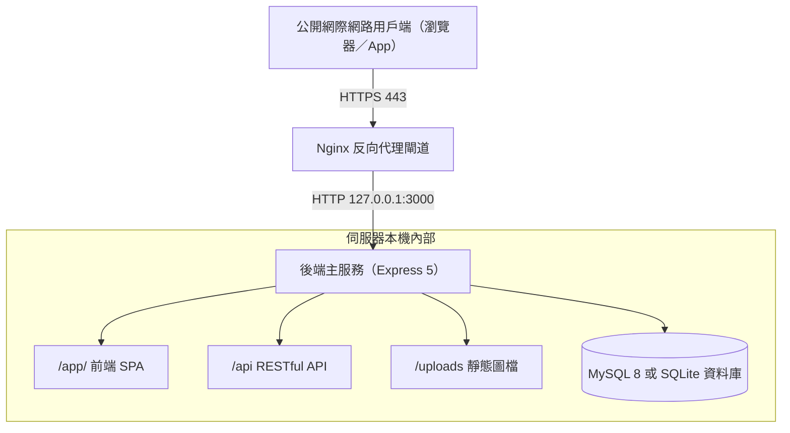

# 11. 正式部署與反向代理

本篇說明專案在正式伺服器（Production）之完整部署架構、Nginx 反向代理配置、HTTPS（SSL/TLS）終結、Let's Encrypt 憑證取得，以及進階前端靜態託管方案。

---

## 一、正式環境部署架構總覽

在正式上線環境中，**嚴禁讓 Node.js / Bun 服務直接對外開放 3000 通訊埠**，標準架構是由反向代理伺服器（如 Nginx）作為第一線對外閘道，接收公開網際網路的 HTTP (80) 與 HTTPS (443) 流量，並在內部轉發至本機後端服務。

### 1.1 反向代理協同架構



Nginx 負責 SSL/TLS 憑證終結、將 HTTP 80 重導向至 HTTPS 443，並攔截過大封包與惡意流量。

### 1.2 後端雙執行型態選擇

本專案支援兩種正式環境執行模式，皆可完美接入 Nginx 反向代理：

| 部署模式 | 執行機制 | 維運工具 | 特色說明 |
| --- | --- | --- | --- |
| **Node.js 傳統部署** | `node src/app.js` | PM2 (`ecosystem.config.js`) | 需安裝 Node.js 22+ 與 PM2，支援記憶體超限防護與守護程序管理。 |
| **Bun 二進位單檔部署** | `./app.exe` (或 `./app`) | Systemd / NSSM 系統服務 | **免 Node.js 環境**，產物獨立收整於 `release/` 目錄，極速啟動（詳見 [第 10 篇](10-Bun打包說明.md)）。 |

---

## 二、Nginx 核心反向代理配置範本

以下為最推薦之標準 Nginx 設定檔範本（通常放置於 `/etc/nginx/sites-available/app.example.com`）：

```nginx
# 1. 80 Port 自動強制重導向至 HTTPS
server {
    listen 80;
    listen [::]:80;
    server_name app.example.com;

    # 強制所有 HTTP 請求重導向至 HTTPS
    return 301 https://$host$request_uri;
}

# 2. 443 Port SSL/TLS 正式服務入口
server {
    listen 443 ssl http2;
    listen [::]:443 ssl http2;
    server_name app.example.com;

    # SSL 憑證路徑（以 Let's Encrypt 為例）
    ssl_certificate /etc/letsencrypt/live/app.example.com/fullchain.pem;
    ssl_certificate_key /etc/letsencrypt/live/app.example.com/privkey.pem;

    # 推薦的現代 TLS 安全參數
    ssl_protocols TLSv1.2 TLSv1.3;
    ssl_ciphers HIGH:!aNULL:!MD5;
    ssl_prefer_server_ciphers on;
    ssl_session_cache shared:SSL:10m;
    ssl_session_timeout 10m;

    # 代理層 Request Body 上限（必須配合後端 UPLOAD_JSON_LIMIT）
    client_max_body_size 10m;

    # 所有路徑（/app/、/api、/uploads）統一轉送至本機 Express
    location / {
        proxy_pass http://127.0.0.1:3000;
        proxy_http_version 1.1;

        # 關鍵轉送標頭（維持真實 Host、用戶端 IP 與通訊協定）
        proxy_set_header Host $http_host;
        proxy_set_header X-Real-IP $remote_addr;
        proxy_set_header X-Forwarded-For $proxy_add_x_forwarded_for;
        proxy_set_header X-Forwarded-Proto $scheme;

        # WebSocket 連線升級支援
        proxy_set_header Upgrade $http_upgrade;
        proxy_set_header Connection "upgrade";

        # 代理逾時設定（配合後端長請求或慢速網路）
        proxy_connect_timeout 60s;
        proxy_send_timeout 60s;
        proxy_read_timeout 60s;
    }
}
```

### 關鍵轉送標頭解析（極為重要）

1. **`proxy_set_header Host $http_host;`**：
   - 必須保留用戶端瀏覽器存取的原始網域名稱與埠號。
   - 後端的 `csrfMiddleware` 依賴此標頭比對 Origin/Referer，若遺漏此標頭，使用 Cookie 登入的使用者在發出 POST 寫入請求時會遭 **403 Forbidden 拒絕**。
2. **`proxy_set_header X-Forwarded-Proto $scheme;`**：
   - 通知後端外部連線協定為 `https`，後端藉此判定連線安全等級，確保 Cookie Secure 旗標正常生效。
3. **`proxy_set_header X-Forwarded-For $proxy_add_x_forwarded_for;`**：
   - 將真實的用戶端 IP 逐層附加於標頭中，配合後端 `requestContextMiddleware` 解析真實訪客位址。
4. **`client_max_body_size 10m;`**：
   - Nginx 預設 body 上限僅 1MB，若使用者上傳較大圖片，Nginx 會在第一線直接回應 `413 Request Entity Too Large`，此數值必須大於或等於後端的 `UPLOAD_JSON_LIMIT`（預設 10MB）。

---

## 三、後端配套環境變數設定（`.env`）

在 Nginx 正式環境中，後端的 `.env` 設定應如下配置：

```dotenv
APP_MODE=production
APP_HOST=127.0.0.1
APP_PORT=3000
APP_TRUST_PROXY=loopback
COOKIE_SECURE=true
```

| 設定項 | 設定值 | 目的與安全性分析 |
| --- | --- | --- |
| `APP_HOST` | `127.0.0.1` | **安全隔離**，限制後端僅監聽本機環回介面，防止外部直接透過 Port 3000 繞過 Nginx 防火牆。 |
| `APP_PORT` | `3000` | 內部通訊埠，與 Nginx 的 `proxy_pass` 對應。 |
| `APP_TRUST_PROXY` | `loopback` | **代理信任**，指示 Express 信任來自本機 Nginx 轉送的 `X-Forwarded-*` 標頭，正確取得訪客 IP。 |
| `COOKIE_SECURE` | `true` | **強制 HTTPS Cookie**，確保使用者的登入 Session Cookie 僅能透過 HTTPS 傳輸，杜絕竊聽。 |

---

## 四、免費 SSL / TLS 憑證取得與自動續期（Certbot）

在 Ubuntu / Debian Linux 伺服器上，推薦使用 Let's Encrypt 與 Certbot 自動取得並設定免費 SSL 憑證：

```bash
# 1. 安裝 Certbot 與 Nginx 插件
sudo apt update
sudo apt install -y certbot python3-certbot-nginx

# 2. 自動取得憑證並自動設定 Nginx（需先將網域 DNS A 紀錄指向伺服器 IP）
sudo certbot --nginx -d app.example.com

# 3. 測試憑證自動續期排程
sudo certbot renew --dry-run
```

Certbot 會自動在 `/etc/cron.d/` 或 systemd timer 中設定每日自動檢查續期，憑證即將過期前自動更新並平緩重載 Nginx，完全不需手動維護。

---

## 五、進階部署架構：前端靜態檔案由 Nginx 直接託管

若面對超高流量存取情境，可選擇讓 Nginx 直接從磁碟讀取前端 SPA 靜態產物，僅將 API 與圖片請求轉發給後端：

```nginx
server {
    listen 443 ssl http2;
    server_name app.example.com;

    # ... SSL 憑證設定 ...

    # 1. 前端根目錄導向至 /app/
    location = / {
        return 302 /app/;
    }

    # 2. 前端 SPA 靜態資源由 Nginx 直接託管
    location /app/ {
        alias /var/www/app/frontend/dist/;
        # SPA 歷史模式 Fallback（找不到實體檔案則回傳 index.html）
        try_files $uri $uri/ /app/index.html;

        # 靜態資源快取優化
        location ~* \.(?:css|js|jpg|jpeg|gif|png|ico|svg|woff2)$ {
            expires 1y;
            add_header Cache-Control "public, immutable";
        }
    }

    # 3. API 請求轉送至後端 Express
    location /api/ {
        proxy_pass http://127.0.0.1:3000;
        proxy_http_version 1.1;
        proxy_set_header Host $http_host;
        proxy_set_header X-Forwarded-For $proxy_add_x_forwarded_for;
        proxy_set_header X-Forwarded-Proto $scheme;
    }

    # 4. 使用者上傳圖檔轉送至後端
    location /uploads/ {
        proxy_pass http://127.0.0.1:3000;
        proxy_set_header Host $http_host;
    }
}
```

> [!NOTE]
> **Bun 單檔交付與前端實體目錄注意**：
> - 採用 [第 10 篇](10-Bun打包說明.md) 之 Bun 二進位單檔（`app` / `app.exe`）部署時，前端資源預設已完整內嵌於執行檔記憶體中，發布產物（`release/`）**預設不會包含 `dist/` 或 `frontend/dist/` 實體目錄**。
> - 若欲採用由 Nginx 直接讀取前端檔案架構，在部署時**必須額外將 `frontend/dist/` 目錄複製至伺服器對應路徑**，Nginx 才能讀取到實體檔案。

---

## 六、上線驗收檢查清單與排查 SOP

完成 Nginx 與後端配置後，請依序進行以下驗收檢查：

| 檢查項目 | 測試動作與驗證方式 | 預期正確結果 |
| --- | --- | --- |
| **80 轉 443 轉址** | 瀏覽器存取 `http://app.example.com` | 自動 301 重導向至 `https://app.example.com/app/`。 |
| **SPA 靜態頁面** | 開啟 `https://app.example.com/app/` | 正常載入 Vue 3 頁面，無破圖或樣式缺失。 |
| **SPA 深層重新整理** | 在瀏覽器網址列存取 `https://app.example.com/app/posts/create` 並強制重新整理 | 正常停留於該頁面，無 404 錯誤。 |
| **API 連線測試** | 存取 `https://app.example.com/api/health` | 回應 HTTP 200，回傳 status: "ok" 之 JSON 物件。 |
| **登入 Session Cookie** | 執行登入操作，檢查瀏覽器 Application ➔ Cookies | 收到名為 `token` 之 Cookie，且標記有 `HttpOnly` 與 `Secure`。 |
| **CSRF 寫入保護** | 於已登入狀態下發表或修改文章 | 請求成功，無 403 Forbidden 錯誤。 |
| **真實 IP 記錄驗證** | 發出任一 API 請求，檢查後端日誌 `storage/log/access-*.log` | 記錄的 `clientIp` 為真實外網訪客 IP，而非 `127.0.0.1`。 |
| **大檔案上傳防護** | 上傳接近 2MB 之圖片 | 正常上傳成功，未遭 Nginx 攔截 413。 |

