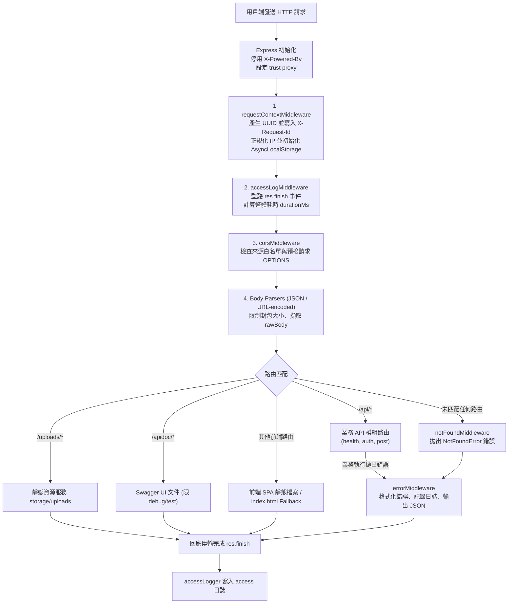
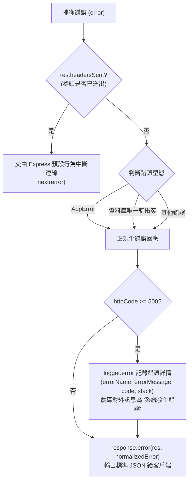

# 3. 請求處理、日誌與錯誤

本文件詳細說明本專案的 HTTP 請求生命週期、基於 `AsyncLocalStorage` 的全鏈路日誌追蹤、統一 JSON 回應協定、領域錯誤類別體系以及線上問題排查指南。

---

## 一、整體設計理念

本專案在處理 HTTP 請求時，遵循以下核心架構原則：

1. **單一職責與確定順序**：Express 中介層管道（Middleware Pipeline）依序處理環境標頭、請求追蹤、客戶端 IP、存取計時、跨來源請求（CORS）、封包解析、路由分發與錯誤捕獲。
2. **非侵入式全鏈路追蹤**：利用 Node.js 原生 `AsyncLocalStorage`，使日誌系統在非同步非阻塞執行緒中，能自動取得當前請求的 `requestId`、`clientIp` 與已認證的 `userId`，無須在業務函式層層傳遞上下文物件。
3. **協定層與資料層分離**：真正的 HTTP 狀態碼由 HTTP 協定標頭表達，回應本體（Response Body）統一維持 `{ message, data }` 的極簡高可讀結構，不重複塞入 `httpCode`、原生代碼或內部錯誤堆疊。
4. **領域錯誤強型別化**：所有可預期的業務錯誤皆繼承自 [AppError](../src/error/appError.js)，未預期例外（如資料庫連線失敗、底層程式碼 Bug）則在全域中介層被安全攔截與遮罩，避免敏感系統資訊外洩。
5. **日誌分流與生命週期感知**：將系統日誌拆分為應用程式日誌（App）、存取日誌（Access）與資料庫遷移日誌（Migrate），針對長效常駐進程與短暫 CLI 任務採取不同的檔案寫入與事件輪詢策略。

---

## 二、HTTP 請求處理管線與生命週期

全域中介層鏈與 Express 實例由 [src/http/app.js](../src/http/app.js) 負責組裝，全域路由由 [src/http/route/index.js](../src/http/route/index.js) 集中管理，並於 [src/app.js](../src/app.js) 綁定 HTTP 伺服器監聽。

### 1. 全域中介層執行順序



#### 各階段詳細職責

| 順序 | 元件 / 中介層 | 檔案路徑 | 職責與關鍵行為 |
| :--- | :--- | :--- | :--- |
| **0** | Express 基礎配置 | [src/http/app.js](../src/http/app.js) | 停用 X-Powered-By 標頭以降低指紋辨識風險，並設定 trust proxy 支援反向代理。 |
| **1** | [requestContextMiddleware](../src/http/middleware/requestContextMiddleware.js) | `src/http/middleware/` | 使用 crypto.randomUUID() 產生追蹤 ID 並設定 X-Request-Id，正規化用戶端 IP，再透過 runRequestContext() 啟用非同步追蹤。 |
| **2** | [accessLogMiddleware](../src/http/middleware/accessLogMiddleware.js) | `src/http/middleware/` | 記錄請求開始時間，並於回應完成時透過 Access Logger 記錄狀態碼與處理耗時。 |
| **3** | [corsMiddleware](../src/http/middleware/corsMiddleware.js) | `src/http/middleware/` | 依 CORS_ORIGINS 白名單設定跨來源標頭，並對 OPTIONS 預檢請求快速回應 204。 |
| **4** | 封包解析器（Body Parsers） | Express 內建 | 解析 JSON 與 URL-encoded 資料，設定請求大小限制（預設 10MB），並保留 req.rawBody 供簽名驗證。 |
| **5** | 模組業務路由 | `src/http/module/*/route.js` | 業務功能處理（詳見下方模組內部管線）。 |
| **6** | [notFoundMiddleware](../src/http/middleware/notFoundMiddleware.js) | `src/http/middleware/` | 未匹配任何路由時，透過 next() 傳遞 NotFoundError 錯誤。 |
| **7** | [errorMiddleware](../src/http/middleware/errorMiddleware.js) | `src/http/middleware/` | 錯誤攔截器，集中處理全域錯誤，進行分類、正規化、日誌記錄及 JSON 回應。 |

---

### 2. 模組內部受保護路由執行順序

進入業務模組（例如文章模組 [src/http/module/post/route.js](../src/http/module/post/route.js)）後，受保護之端點應遵循嚴格的分層守護順序，絕不在 Controller 重複編寫基礎驗證：

```javascript
// 範例：受保護之新增文章路由
router.post(
    "/posts",
    authMiddleware,       // 1. 驗證 Cookie Session 或 Bearer Token，並透過 setUserId() 寫入 Context
    csrfMiddleware,       // 2. CSRF 防護 
    request.postBody,     // 3. express-validator 欄位規格檢驗
    validateMiddleware,   // 4. 檢驗執行 (失敗拋 ValidationError 422，成功注入 req.validated)
    controller.create     // 5. 控制器執行 (自 req.validated 取值並調用 Service)
);
```

---

## 三、請求追蹤（Request Tracing）

### 1. AsyncLocalStorage 非同步上下文機制

在 Node.js 的非同步事件循環（Event Loop）中，伺服器可以同時處理多個 HTTP Request。由於每個請求可能經過多次 await、Promise 或其他非同步操作，執行流程會不斷交錯，因此很難單純依靠一般變數，判斷目前執行的程式碼屬於哪一個 HTTP Request。

為了解決這個問題，本專案在 [src/helper/requestContext.js](../src/helper/requestContext.js) 封裝了 Node.js 原生的 `AsyncLocalStorage`，讓每個 HTTP Request 都能擁有獨立的非同步上下文（Request Context）。


### 2. 上下文欄位與生命週期

| 欄位名稱 | 型態 | 檔案路徑 | 說明 |
| :--- | :--- | :--- | :--- |
| `requestId` | `string` (UUID v4) | `requestContextMiddleware`  | 自動產生唯一請求識別碼，用於追蹤請求流程，並同步寫入 X-Request-Id 回應標頭。 |
| `method` | `string` | `requestContextMiddleware`  | 記錄 HTTP 請求方法（如 GET、POST），來源為 req.method。 |
| `url` | `string` | `requestContextMiddleware`  | 記錄請求的完整相對路徑與查詢參數，優先使用 req.originalUrl，其次為 req.url。 |
| `clientIp` | `string` | `requestContextMiddleware`  | 記錄用戶端 IP，優先取自 req.ip，並統一處理 IPv4-mapped IPv6 與本機回環位址。 |
| `userId` | `number` |  `authMiddleware` 驗證 Token 成功後 | 記錄已驗證使用者的識別碼，由 req.user.id 取得並寫入請求上下文；未認證時不設定。 |

`requestContextMiddleware` 是註冊在全域路由前的第一個中介層，會一次建立包含前四個欄位的上下文。`userId` 則只會在請求進入有套用 `authMiddleware` 的路由，且 Token 驗證成功後加入。

> [!IMPORTANT]
> **安全性與非 HTTP 任務防護**：
> - 外部客戶端送入之 `X-Request-Id` 請求標頭**不會**直接作為伺服器追蹤 ID，系統一律由後端重新派發安全隨機的 UUID，防範偽造或關聯衝突。
> - 背景任務（如 CLI 排程、Migration 或單元測試）呼叫 `getRequestContext()` 時會回傳 `null`，因此日誌工具與公用模組均做了安全防護，在 context 為空時依然能安全記錄。

---

## 四、統一 JSON API 回應規格

本專案在 [src/http/common/response.js](../src/http/common/response.js) 統一定義對外輸出之 JSON 結構。

### 1. 核心回應協定

無論操作成功或失敗，對外回應之 JSON Body 永遠固定只有兩個頂層鍵值：

```json
{
  "message": "說明字串",
  "data": {}
}
```

- **真正的 HTTP 狀態碼傳遞在 HTTP 協定層**（如 `res.status(200)`、`res.status(404)`），Body 內部嚴禁冗餘包裝 `httpCode`、`code`、`status` 或 `stack`。
- `data` 永遠為物件（Object）或陣列（Array），若無特定回傳資料時預設為空物件 `{}`。

### 2. 成功回應（Success Response）

由 `response.success(res, data, message, httpCode)` 輸出：

```javascript
// 查詢成功 (預設 HTTP 200)
response.success(res, { list: items, total: 100 }, "查詢成功");

// 建立資源成功 (HTTP 201)
response.success(res, { id: newRecord.id }, "新增文章成功", 201);
```

### 3. 欄位驗證錯誤回應（HTTP 422）

當使用者送入的表單或 JSON 欄位未通過檢核時，拋出 [ValidationError](../src/error/validationError.js)，統一轉換為 HTTP 422 狀態碼，其 `data.errors` 格式規範如下：

```json
{
  "message": "輸入資料有誤",
  "data": {
    "errors": [
      { "name": "title", "message": "標題為必填欄位" },
      { "name": "content", "message": "內容長度不可少於 10 個字元" }
    ]
  }
}
```

前端表單可直接利用 `name` 欄位與畫面上的 Input 欄位進行高亮與錯誤提示綁定。

---

## 五、錯誤類別體系與集中正規化

### 1. 錯誤類別體系（Error Hierarchy）

專案在 `src/error/` 定義了一組語意清晰的自訂錯誤類別，所有自訂錯誤皆繼承自 [AppError](../src/error/appError.js)：

```
Error (JavaScript 原生)
 └─ AppError (包含 httpCode, data, cause, stack 擷取)
     ├─ ValidationError     (HTTP 422: 輸入資料有誤)
     ├─ UnauthorizedError   (HTTP 401: 請先登入)
     ├─ ForbiddenError      (HTTP 403: 沒有操作權限)
     ├─ NotFoundError       (HTTP 404: 查無該資料 / 查無該路徑)
     └─ ConflictError       (HTTP 409: 資料已存在)
```

#### 標準錯誤類別對照與使用範例

| 錯誤類別 | HTTP 碼 | 預設訊息 | 適用情境與程式碼範例 |
| :--- | :---: | :--- | :--- |
| [ValidationError](../src/error/validationError.js) | **422** | 輸入資料有誤 | 欄位不合法、必填缺失：<br/>`throw new ValidationError([{ name: "email", message: "格式不正確" }]);` |
| [UnauthorizedError](../src/error/unauthorizedError.js) | **401** | 請先登入 | 未攜帶憑證、Token 過期或已失效：<br/>`throw new UnauthorizedError("登入憑證無效");` |
| [ForbiddenError](../src/error/forbiddenError.js) | **403** | 沒有操作權限 | 身份正確但試圖越權操作他人資源，或跨站請求來源檢查失敗（CSRF 防護）：<br/>`throw new ForbiddenError("無法編輯他人文章");` |
| [NotFoundError](../src/error/notFoundError.js) | **404** | 查無該資料 | 指定 ID 的資料不存在，或未匹配之路由：<br/>`throw new NotFoundError("文章")，（輸出訊息：查無該文章） |
| [ConflictError](../src/error/conflictError.js) | **409** | 資料已存在 | 唯一值衝突、重複提交：<br/>`throw new ConflictError("此帳號已被註冊");` |
| [AppError](../src/error/appError.js) | **400~599** | 自訂訊息 | 其他通用業務錯誤：<br/>`throw new AppError("帳戶餘額不足", { httpCode: 400 });` |

---

### 2. errorMiddleware 集中正規化流程

當程式執行過程中發生錯誤時，無論錯誤來自 Controller、Middleware 或其他業務邏輯，只要錯誤進入 Express 錯誤處理流程，皆由 [src/http/middleware/errorMiddleware.js](../src/http/middleware/errorMiddleware.js) 統一接收、分類與正規化，並轉換為一致的 JSON 錯誤回應格式。



#### 系統防護三大關鍵

1. **資料庫鍵值重複轉換**：MySQL 的 `ER_DUP_ENTRY` 與 SQLite 的唯一約束錯誤會被自動轉譯為乾淨的 409 衝突回應，避免資料庫結構或 SQL 原生語法洩漏。
2. **5xx 系統異常遮罩**：凡是 HTTP 狀態碼 `>= 500` 的錯誤（包含原生例外、NullPointer 等），全域中介層一律強制將對外 `message` 替換為「系統發生錯誤」，並清空 `data`，真實的堆疊資訊（`stack`）只會記錄在伺服器本機的日誌檔案中。
3. **第三方 API 呼叫失敗**：`src/helper/request.js` 呼叫外部 API 失敗時會拋出 `RequestError`，呼叫它的 Service 應依失敗原因與業務情境，將錯誤轉為本系統適用的 `AppError`，再由 `errorMiddleware` 回應；不要直接把第三方回應內容傳給前端。若 `RequestError` 未經處理就進入 `errorMiddleware`，目前會被視為未知錯誤，對前端回傳 HTTP 500「系統發生錯誤」。

---

## 六、日誌系統架構與設定

專案日誌系統以 Winston 為核心，由 [src/logger/loggerFactory.js](../src/logger/loggerFactory.js) 建立 Logger，搭配 [dailyRotate.js](../src/logger/dailyRotate.js) 構建，實現日誌輪替，並透過設定檔 [src/config/log.js](../src/config/log.js) 統一管理日誌設定。

### 1. 四大專屬日誌通道

系統依責任邊界劃分為獨立的日誌通道，日誌預設存放於 `storage/log/`：

```
storage/log/
 ├─ app-YYYY-MM-DD.log        # 應用程式日誌 (業務邏輯、警告、系統錯誤)
 ├─ access-YYYY-MM-DD.log     # HTTP 存取日誌 (所有請求之耗時與回傳狀態碼紀錄)
 ├─ migrate-YYYY-MM-DD.log    # 資料庫遷移日誌 (Knex 結構升級/回滾紀錄)
 └─ pm2/
     └─ pm2.log               # 程序守護日誌 (PM2 程序啟動、崩潰與重啟輸出)
```

| 日誌通道 | 實例檔案 | 控制環境變數 | 輸出等級與特性 |
| :--- | :--- | :--- | :--- |
| **應用程式日誌 (App)** | [appLogger.js](../src/logger/instance/appLogger.js) | `LOG_LEVEL`（預設 `info`） | 記錄業務運行訊息，`debug` 與 `test` 模式同時輸出 Console，`test` 模式不寫實體檔案。 |
| **HTTP 存取日誌 (Access)** | [accessLogger.js](../src/logger/instance/accessLogger.js) | `LOG_ENABLE_ACCESS_LOG`（預設 `true`） | 固定 `info` 等級，由 `accessLogMiddleware` 專用，不輸出 Console。 |
| **資料庫遷移日誌 (Migrate)** | [migrateLogger.js](../src/logger/instance/migrateLogger.js) | 永久啟用 | 固定 `info` 等級，**同時寫入檔案與 Console**，特別停用檔案監看（見下方說明）。 |
| **PM2 進程日誌** | 由 PM2 管理 | `ecosystem.config.js` | 記錄伺服器程序層級 stdout / stderr，不套用 Node 本身每日輪替規則。 |

### 2. 日誌格式與 Context 自動注入機制

每行寫入檔案或終端機的日誌皆具備標準結構：

```
[YYYY-MM-DD HH:mm:ss] LEVEL: 訊息本體 {"context與附加參數JSON"}
```

#### 真實日誌範例展示

**HTTP 存取日誌（`access-*.log`）**：
```log
[2026-10-12 16:15:30] INFO: HTTP 請求完成 {"requestId":"3c1e2bf7-8f51-40c2-9e3f-67f7e9d9b01a","method":"POST","url":"/api/posts","clientIp":"192.168.1.100","userId":12,"httpCode":201,"durationMs":35}
```

**應用程式錯誤日誌（`app-*.log`）**：
```log
[2026-10-12 16:16:05] ERROR: 未預期的系統錯誤 {"requestId":"a8d7910e-55c3-41bb-b892-02fae8486b1c","method":"GET","url":"/api/posts/999","clientIp":"127.0.0.1","errorName":"TypeError","errorMessage":"Cannot read properties of undefined","code":null,"stack":"TypeError: Cannot read properties of undefined\n    at PostService.getDetail (src/http/module/post/service.js:45:12)..."}
```

> [!NOTE]
> 透過 `loggerFactory.js` 的 `enrichContext` 格式化器，呼叫者只要撰寫 `logger.info("訊息", { customKey: 123 })`，日誌格式化器會自動從當前的 `AsyncLocalStorage` 抽出 `requestId`、`method`、`url`、`clientIp` 與 `userId` 拼裝成後綴 JSON，完全不需在每處手工傳入上下文參數。

### 3. 日誌輪替與保留天數

- 設定項目：`.env` 中的 `LOG_RETENTION_DAYS`。
- 運作規則：
  - `LOG_RETENTION_DAYS=0`：預設值，永久保留歷史日誌。
  - `LOG_RETENTION_DAYS=14`：輪替器底層設定 `maxFiles: "14d"`，每天自動產生新檔案，並自動刪除超過 14 天的歷史日誌檔案。

### 4. 特別架構考量：Migration CLI 的 Event Loop 退出機制

在短暫性 CLI 任務（例如執行 `pnpm migrate` 或單元測試準備測試資料庫）中，若使用一般的檔案日誌輪替套件，底層的 `fs.watch`（FSEVENTWRAP）會維持活躍的檔案系統監聽 Handle，導致 Node.js Event Loop 永遠處於未完成狀態，造成指令執行完畢後終端機卡死無法退出。

因此，[src/logger/instance/migrateLogger.js](../src/logger/instance/migrateLogger.js) 顯式將 `watchLog` 設為 `false`：

```javascript
module.exports = createLogger({
    level: "info",
    filename: `${config.folder}/migrate-%DATE%.log`,
    retentionDays: config.retentionDays,
    consoleEnabled: true,
    requestContextEnabled: false,
    watchLog: false, // 關鍵：停用持久檔案監看，確保 CLI 任務執行完畢能自然退出進程
});
```

---

## 七、線上問題排查 SOP 與安全規範

當正式環境或測試環境回報異常時，請依照下列標準流程迅速排查定位問題：

### 1. 標準排查三部曲

1. **取得追蹤標頭**：
   - 請通報人員提供 Response Header 內的 `X-Request-Id`（或檢查瀏覽器 Network 頁籤）。
2. **查詢 Access 存取歷程**：
   - 開啟當天的 `storage/log/access-YYYY-MM-DD.log`，搜尋該 `requestId`。
   - 確認最終返回之 `httpCode` 與整體處理耗時 `durationMs`（若耗時異常長，通常為資料庫慢查詢或外部第三方 API 逾時）。
3. **查詢 App 業務錯誤堆疊**：
   - 開啟當天的 `storage/log/app-YYYY-MM-DD.log`，搜尋同一個 `requestId`。
   - 檢視系統拋出之 `errorName`、`errorMessage` 與完整程式碼行數 `stack`，直達問題根源。

---

### 2. 程序崩潰與未捕捉例外監聽

在 [src/app.js](../src/app.js) 中，伺服器進程掛載了全域事件監聽，防止程序因未捕捉的非同步例外而無聲無息地退出：

```javascript
// 捕捉同步未處理例外
process.on("uncaughtException", (error) => {
    logger.error("未捕捉的例外", { errorMessage: error.message, stack: error.stack });
    shutdown("uncaughtException");
});

// 捕捉未處理的 Promise Rejection
process.on("unhandledRejection", (error) => {
    logger.error("未處理的 Promise rejection", { errorMessage: error?.message, stack: error?.stack });
    shutdown("unhandledRejection");
});
```

若發現服務發生重啟，請第一時間檢查：
1. `storage/log/app-*.log` 是否有標記為「未捕捉的例外」之重大錯誤。
2. `storage/log/pm2/pm2.log` 查看作業系統層級是否有 OOM（Out of Memory）或非預期 Signal 中斷。

---

### 3. 日誌記錄安全與隱私規範

在新增業務程式碼調用 `logger.info()`、`logger.warn()` 或 `logger.error()` 時，必須嚴格遵守以下資安防線：

1. **禁止記錄機敏認證資訊**：
   - 嚴禁記錄密碼明文、密碼雜湊、JWT 權杖、Cookie 完整內容、金鑰或信用卡號。
2. **防止網址 Query 機敏外洩**：
   - 由於 Context 中的 `url` 會記錄完整的 `req.originalUrl`（包含 Query String），**嚴禁將 Token 或密鑰直接作為 URL Query 傳遞**，應透過 Header 或 Request Body 傳遞。
3. **敏感物件手動脫敏**：
   - Winston logger 格式化器**不會**魔法般識別業務物件中的個人隱私欄位，在傳入自訂 metadata 時，開發者有責任主動排除或遮罩（如身分證字號改為前 3 後 3 碼掩蔽）。
