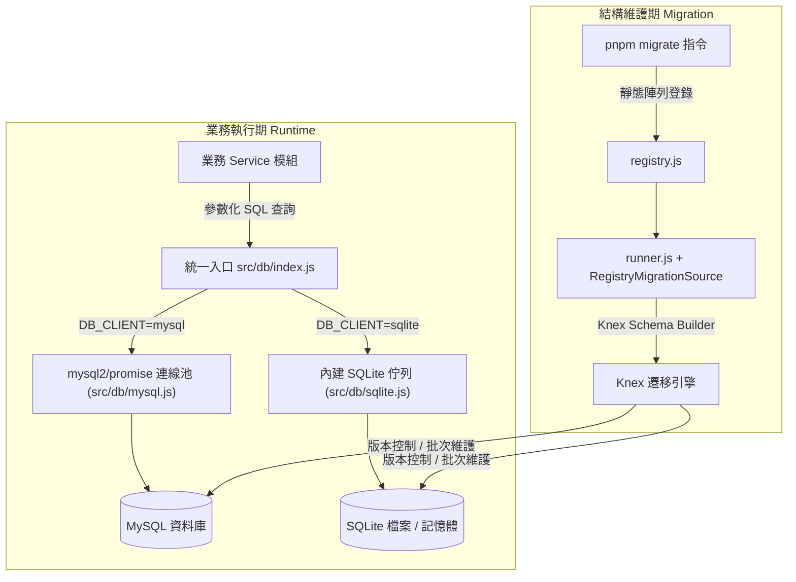
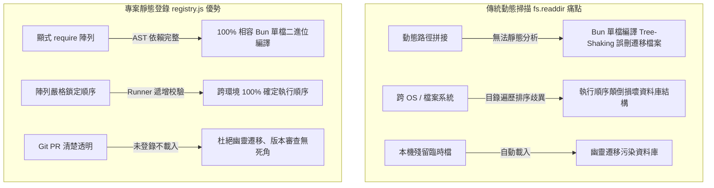

# 4. 資料庫與 Migration

本文件完整說明專案雙資料庫引擎（MySQL 與 SQLite）的架構設計、配置管理、連線池/併發控制、交易安全守則，以及供跨平台與 Bun 二進位打包使用的靜態登錄式 Knex Migration 系統。

---

## 一、雙引擎架構與設計哲學

### 1. 原生參數化 SQL 與 Knex Migration 分離主義（Dual Approach）

本專案在資料庫操作上採取清晰的**職責分離架構**：



- **日常資料庫操作**：所有 Service 統一透過 [`src/db/index.js`](../src/db/index.js) 提供的參數化查詢介面，並依 `DB_CLIENT` 選用對應的資料庫實作：
  - `mysql`：使用 [`mysql2/promise`](../src/db/mysql.js) 連線池，管理資料庫連線。
  - `sqlite`：依執行環境使用 Node.js `node:sqlite` 或 Bun `bun:sqlite`e，並透過序列化佇列確保操作順序。
- **資料庫結構版本管理**：專職交由 `Knex.js` 管理資料庫 Migration，利用 Knex Schema Builder 定義資料表結構，搭配`knex_migrations` 記錄版本及 `knex_migrations_lock` 防止並行執行衝突，確保結構變更可追蹤、可回滾。

---

### 2. MySQL 與 SQLite 特性及選型對照

專案支援 MySQL 與 SQLite 兩種資料庫引擎，可透過 DB_CLIENT 設定切換，以適應不同的開發與部署需求：

| 評估維度 | MySQL 模式（`DB_CLIENT=mysql`） | SQLite 模式（`DB_CLIENT=sqlite`） |
| :--- | :--- | :--- |
| **適用情境** | **正式環境、高併發及多服務部署** | **本機開發、輕量服務及單檔部署** |
| **連線與併發模型** | 使用連線池，支援多連線並行讀寫 | 單一連線搭配序列化佇列（Queue），確保單檔無寫入衝突 |
| **儲存形式** | 獨立資料庫伺服器 | 本機資料庫檔案或記憶體 `:memory:` |
| **底層驅動** | `mysql2/promise` |  `node:sqlite` / `bun:sqlite` |
| **交易鎖定模式** | InnoDB 行級鎖與交易隔離 | WAL 模式與 BEGIN IMMEDIATE，同時僅允許一個寫入交易 |
| **DDL 交易行為** | 多數 DDL 會觸發隱式提交 | SQLite 3.x 支援大部分 DDL 交易，但語法有限制 |
| **依賴與打包** | 需額外部署及維護 MySQL 服務 | 無須獨立資料庫服務，可搭配 Bun 封裝部署 |

---

### 3. 通用資料表設計規範與約定

為確保跨資料庫結構的一致性與擴充性，所有領域資料表皆遵循以下設計規範：

| 項目 | 規範標準 | 說明與 Knex 定義範例 |
| :--- | :--- | :--- |
| **主鍵慣例** | `id`（自增整數） | 統一使用 table.increments("id").primary()，由資料庫自動產生主鍵。 |
| **時間戳記** | `created_at`、`updated_at` | 建立時間由資料庫預設填入，更新時間由應用程式維護。 |
| **字元集與定序** | `utf8mb4_unicode_ci`、`UTF-8` | MySQL 使用 `utf8mb4`（支援 Emoji 與多國語言）；SQLite 預設使用 `UTF-8`。 |
| **唯一約束** | UNIQUE KEY | 透過唯一索引避免重複資料，違反約束時統一轉換為 HTTP 409。 |
| **外鍵與關聯** | 應用程式層邏輯關聯 | 依業務需求決定是否建立資料庫外鍵及級聯刪除規則。 |
| **預設值原則** | 明確預設值 | 字串欄位預設為空字串 `""`，數值欄位預設為 `0`；MySQL 的 `TEXT` 欄位若設預設值使用 `DEFAULT ('')`（需 MySQL 8.0.13+）。 |

---

### 4. 命名風格轉換與機敏資產防護

1. **命名風格轉換（snake_case ➔ camelCase）**：
   - **資料庫層**：嚴格遵循 **`snake_case`**（例如 `user_id`、`created_at`、`cover_image`）。
   - **應用程式與 API 層**：嚴格遵循 **`camelCase`**（例如 `userId`、`createdAt`、`passwordHash`、`coverImage`）。
   - **分層邊界**：由各領域 Service 負責轉換對映（Mapping），確保內部資料庫實體結構與對外 API 契約解耦，不在前端暴露資料庫原始欄位命名。
2. **機敏資訊安全守則**：
   - 密碼欄位僅儲存安全雜湊（如 bcrypt hash），絕對不存明文，對外回應時必須在 Service 層主動剔除，不可出現在查詢結果的 `data` 中。
3. **多媒體大物件儲存原則**：
   - 圖片、影音或上傳檔案僅儲存其相對路徑或公開 URL（例如 `/uploads/posts/abc.jpg`），**嚴禁在資料庫中直接以二進位 Blob 格式儲存大檔案**。

---

### 5. Knex 內部管理表

Knex 在執行結構版本維護時，會自動在資料庫中建立並維護兩張系統專屬資料表：

| 管理資料表 | 核心功能 |
| :--- | :--- |
| `knex_migrations` | 記錄已成功執行的 Migration 檔案識別名稱、執行批次號碼（batch）與套用時間，作為升級與回滾之依據。 |
| `knex_migrations_lock` | 單列排他鎖機制，每次執行遷移前先檢查並鎖定（`is_locked = 1`），防範叢集啟動或多個進程同時套用遷移而發生結構死鎖。 |

---

## 二、MySQL 模式深度解析

MySQL 相關配置與實作位於 [`src/config/db.js`](../src/config/db.js) 與 [`src/db/mysql.js`](../src/db/mysql.js)。

### 1. 環境變數配置項

當 `.env` 設定 `DB_CLIENT=mysql` 時，系統讀取以下環境變數：

| 環境變數 | 預設值 | 型態 | 說明 |
| :--- | :--- | :--- | :--- |
| `DB_CLIENT` | `mysql` | 字串 | 設定為 `mysql` 以啟用 MySQL 連線池模式 |
| `MYSQL_HOST` | `127.0.0.1` | 字串 | MySQL 伺服器主機名稱或 IP 位址 |
| `MYSQL_PORT` | `3306` | 數字 | MySQL 伺服器連線通訊埠 |
| `MYSQL_USER` | `root` | 字串 | 資料庫使用者帳號 |
| `MYSQL_PASSWORD` | `""` | 字串 | 資料庫使用者密碼 |
| `MYSQL_DATABASE` | `nodejs_base` | 字串 | 目標資料庫名稱 |
| `MYSQL_CONNECTION_LIMIT` | `10` | 數字 | 連線池最大連線數（依伺服器負載調校） |

---

### 2. 連線池（Connection Pool）架構與生命週期

專案透過 `mysql2/promise` 建立全域連線池實例，避免頻繁建立與釋放 TCP 連線的昂貴開銷：

```javascript
const pool = mysql.createPool({
    ...config,
    waitForConnections: true, // 當連線數達到上限時排隊等待，不立即拋出錯誤
    queueLimit: 0,            // 排隊等待佇列無上限 (0 表示無限制)
    dateStrings: true,        // 將 DATETIME/TIMESTAMP 以字串回傳，防止 JavaScript Date 時區轉換偏差
    decimalNumbers: true,     // 將 MySQL DECIMAL 欄位自動轉換為 JavaScript Number
});
```

#### 連線池運作機制與併發調校
1. **連線重用與排隊**：當請求進來時，連線池優先使用閒置連線，若目前連線數已達到 `MYSQL_CONNECTION_LIMIT`，後續請求會安全地進入等待佇列（`queueLimit: 0`），待先前請求完成並釋放連線後立即接續處理。
2. **PM2 Cluster 連線數計算**：
   - 伺服器整體對 MySQL 的總連線數為：`PM2 實例數 × MYSQL_CONNECTION_LIMIT`。
   - 例如使用 4 核 PM2 集群，每個程序設定 `MYSQL_CONNECTION_LIMIT=10`，則尖峰時段最多會佔用 MySQL 40 條連線。務必確保 MySQL 伺服器的 `max_connections` 設定大於整體叢集的上限。
3. **優雅關閉**：應用程式停止時，調用 `db.close()` 會執行 `pool.end()`，確保連線池中尚未完成的查詢執行完畢後安全關閉連線。

---

### 3. 時區防雷與精確數值設定

- **`dateStrings: true`（關鍵時區保護）**：
  - 預設情況下，Node.js 驅動會將 MySQL 的 `DATETIME` 轉換成 Node.js 的 `Date` 物件，此時會依據主機本機時區進行偏差轉換，極易造成前後端時間差 8 小時的 Bug。
  - 開啟 `dateStrings: true` 後，MySQL 取出的時間字串為 `YYYY-MM-DD HH:mm:ss`，可直接無損傳遞給前端或配合 `dayjs` 進行時區格式化。
- **`decimalNumbers: true`**：
  - 將 MySQL 的 `DECIMAL` / `NUMERIC` 欄位自動轉換為 JavaScript 的 `Number`，方便日常業務邏輯運算。
  - *註：若系統涉及微秒級高精度金融或加密貨幣計算，應評估大數精度問題。*

---

### 4. 字元集與排序規則（Collation）

專案在自動建立資料庫時（例如 `freshDatabase`），統一指定：
- **字元集**：`utf8mb4`
- **定序**：`utf8mb4_unicode_ci`

這保證了 4 位元組的 Unicode 內容（包含各國文字、特殊符號以及手機原生 Emoji 貼圖）皆能正確寫入，杜絕 `Incorrect string value` 錯誤。

---

## 三、SQLite 模式深度解析

SQLite 是專案在開發測試、本機免裝資料庫環境，以及搭配 Bun 單檔二進位交付（如桌面應用或獨立服務）時的理想引擎，相關配置與實作位於 [`src/config/db.js`](../src/config/db.js)、[`src/db/sqlite.js`](../src/db/sqlite.js) 與 [`src/db/sqliteNative.js`](../src/db/sqliteNative.js)。

### 1. 環境變數配置項

當 `.env` 設定 `DB_CLIENT=sqlite` 時，系統讀取以下環境變數：

| 環境變數 | 預設值 | 型態 | 說明 |
| :--- | :--- | :--- | :--- |
| `DB_CLIENT` | `sqlite` | 字串 | 設定為 `sqlite` 以啟用本機 SQLite 模式 |
| `SQLITE_FILE` | `storage/database/database.sqlite` | 字串 | SQLite 資料庫檔案路徑，支援相對路徑、絕對路徑或 `:memory:` |

- **目錄自動建立**：系統連線時會自動檢測並透過 `fs.mkdirSync(path.dirname(filename), { recursive: true })` 建立上層目錄結構。
- **記憶體模式**：若設為 `:memory:`，資料完全保存在記憶體中，適合高速單元測試（注意：記憶體模式不支援 `pnpm migrate:fresh`）。

---

### 2. 跨執行期原生驅動相容（Zero External Dependency）

本專案完全不使用需要 C++ 編譯器（node-gyp）的第三方 SQLite 套件，直接透過執行環境的原生 API 進行無縫相容：
- **Node.js 環境**：使用官方內建的 `node:sqlite`（`DatabaseSync`）。
- **Bun 環境**：使用 Bun 原生極速的 `bun:sqlite`（`Database`）。
- **自動判斷**：系統根據 `process.versions.bun` 自動切換驅動，保證在 Node.js 與 Bun 下均能無須安裝任何外部編譯工具即可直接啟動。

---

### 3. 單連線序列化佇列（Queue）與併發控制

SQLite 本質上是基於單一檔案的嵌入式資料庫，若多個非同步操作同時對同一連線進行寫入，容易引發資料庫鎖死（Database Locked），本專案在 [`src/db/sqlite.js`](../src/db/sqlite.js) 透過 **Promise 序列化佇列** 解決此問題：

```javascript
let queue = Promise.resolve();

const serialize = (operation) => {
    const result = queue.then(operation);
    queue = result.catch(() => {}); // 即使前一筆操作拋錯，佇列仍能接續執行
    return result;
};
```

所有日常查詢（`query`）與交易（`transaction`）皆依序進入此佇列，由單一連線依序消化，確保多工請求下檔案鎖完全受控。

---

### 4. 效能與可靠性 PRAGMA 設定

資料庫建立連線時，系統自動啟用以下核心 PRAGMA 設定：

```javascript
database.exec("PRAGMA journal_mode = WAL");       // 啟用預寫式日誌 (Write-Ahead Logging)
database.exec("PRAGMA synchronous = NORMAL");     // 平衡寫入效能與斷電資料安全性
database.exec("PRAGMA busy_timeout = 5000");      // 遇到併發鎖定時最多等待 5 秒
database.exec("PRAGMA foreign_keys = ON");        // 啟用外鍵約束檢查
```

- **WAL 模式（預寫日誌）**：大幅提升讀寫並行效能，讀取操作不會被寫入操作阻擋。
- **Busy Timeout（5000ms）**：當多行程或背景作業同時存取檔案時，驅動會自動重試等待最長 5 秒，大幅降低 `SQLITE_BUSY` 發生機率。

---

## 四、統一資料存取介面與交易機制（Runtime API）

### 1. 統一入口與抽象隔離

業務模組一律自 [`src/db/index.js`](../src/db/index.js) 引入資料庫介面：

```javascript
const db = require("@src/db/index.js");
```

介面為 MySQL 與 SQLite 提供了完全一致的四大 API：
1. `query(sql, values)`：執行參數化 SQL。
2. `transaction(callback)`：執行具 ACID 保證的交易。
3. `testConnection()`：測試連線可用性（執行 `SELECT 1 AS connected`）。
4. `close()`：釋放連線池或關閉資料庫連線。

---

### 2. 參數化查詢 `query(sql, values)`

全專案資料存取統一使用參數化查詢：
- MySQL 透過連線池執行 `pool.execute(sql, values)`。
- SQLite 透過原生語法解析並執行 `statement.all()` 或 `statement.run()`。

```javascript
// 正確範例：使用佔位符 ? 傳遞參數
const rows = await db.query(
    "SELECT id, title, status FROM posts WHERE user_id = ? AND status = ? ORDER BY id DESC LIMIT ?",
    [userId, "published", 20]
);
```

#### 回傳規格統一化
為了讓上層業務邏輯完全無感切換底層資料庫，寫入操作（`INSERT` / `UPDATE` / `DELETE`）的回傳物件皆統一格式化為：
- **`insertId`**：自增主鍵 ID（數字型態）。
- **`affectedRows`**：受影響的資料列筆數。

> [!IMPORTANT]
> **杜絕 SQL Injection 的鐵律**：
> 1. 所有來自外部的使用者輸入（Body、Query、Params）**一律透過佔位符 `?` 與 `values` 陣列傳入**，由驅動綁定。
> 2. **嚴禁字串拼接 SQL**，例如：`"WHERE user_id = " + req.query.id` 是絕對禁止的高危險行為。

---

### 3. 動態欄位與白名單過濾守則

佔位符 `?` 只能用於 SQL 的**數值（Values）**，無法用於表名、欄位名稱或 `ORDER BY` 的排序方向（`ASC` / `DESC`）。

若需要動態排序或動態篩選，必須在程式內定義 **嚴格的白名單** 比對：

```javascript
// 正確範例：白名單過濾動態欄位
const ALLOWED_SORT_FIELDS = {
    createdAt: "posts.created_at",
    title: "posts.title",
    id: "posts.id",
};

const sortField = ALLOWED_SORT_FIELDS[req.query.sort] ?? "posts.id";
const sortOrder = req.query.order?.toUpperCase() === "ASC" ? "ASC" : "DESC";

const sql = `SELECT * FROM posts ORDER BY ${sortField} ${sortOrder} LIMIT ?`;
const rows = await db.query(sql, [limit]);
```

---

### 4. 交易機制 `transaction(callback)` 與引擎實作對比

在涉及多個關聯寫入時，必須使用資料庫交易確保原子性。`db.transaction()` 為兩種資料庫封裝了相同的呼叫介面，但底層實作因應特性各有不同：

| 引擎 | 底層交易實作機制 | 生命週期管理 |
| :--- | :--- | :--- |
| **MySQL** | 從連線池借出專屬連線，執行 `beginTransaction()`，完成後 `commit()`，失敗則 `rollback()`。 | 在 `finally` 區塊保證調用 `connection.release()` 將連線歸還連線池，杜絕連線洩漏。 |
| **SQLite** | 排入單一連線佇列，執行 `BEGIN IMMEDIATE`（立即排他鎖定），完成後 `COMMIT`，失敗則 `ROLLBACK`。 | 回呼函式獲得專屬查詢方法，在該連線上直接執行，不重新排入佇列以避免自身死鎖。 |

#### 正確使用範例
交易回呼函式接收一個專屬的查詢函式 `transactionQuery`：

```javascript
const db = require("@src/db/index.js");

const newPost = await db.transaction(async (transactionQuery) => {
    // 步驟 1：寫入文章
    const insertResult = await transactionQuery(
        "INSERT INTO posts (title, content, status, user_id) VALUES (?, ?, ?, ?)",
        [title, content, "published", userId]
    );

    // 步驟 2：利用剛產生的自增 ID 進行關聯操作
    const postId = insertResult.insertId;
    await transactionQuery(
        "INSERT INTO post_tags (post_id, tag_id) VALUES (?, ?)",
        [postId, tagId]
    );

    // 步驟 3：回傳結果（此處 return 的內容即為 transaction() 的回傳值）
    return { postId };
});
```

#### 兩大交易致命陷阱
1. **陷阱一：在交易內部誤用全域 `db.query()`**
   - **MySQL 下**：`db.query()` 會從連線池另外借出獨立連線，導致該 SQL 不在交易保護下，無法隨交易回滾。
   - **SQLite 下**：`db.query()` 會重新嘗試排入單連線佇列，但目前連線正處於交易鎖定中，導致互相等待造成程式永久凍結死鎖！
   - **鐵律：交易內部所有 SQL 必須一律使用回呼傳入的 `transactionQuery`！**
2. **陷阱二：吞掉例外導致未回滾**
   - 兩種資料庫都需要讓錯誤從交易回呼拋出，才能觸發回滾。
   - 若在交易 Callback 內部自行寫了 `try/catch` 卻把錯誤吃掉（例如回傳 `null`），`transaction()` 會誤以為操作成功並執行 `commit()`。
   - **鐵律：交易業務失敗時，必須保證向上拋出錯誤（`throw error`）以觸發自動回滾。**

---

## 五、靜態登錄式 Migration 系統

### 1. 為什麼採用「靜態登錄」而非傳統動態目錄掃描？

本專案之所以不採一般框架的目錄動態掃描（`fs.readdir`），改由 [`src/migrate/registry.js`](../src/migrate/registry.js) 顯式靜態登錄，解決了三個核心問題：



1. **Bun 單檔二進位編譯相容性（最關鍵）**：
   - 專案支援將系統編譯為單一可執行檔（如 `app.exe`），打包器依賴靜態 AST 語意分析追蹤依賴，若使用動態目錄掃描，編譯器會將所有遷移檔案判定為未引用死碼而剔除。
   - 單檔部署在生產環境時根本沒有 `migrations/` 原始碼資料夾，動態讀取目錄會立即引發 `ENOENT` 崩潰。
2. **跨平台執行順序的絕對確定性**：
   - `fs.readdir` 的排序依賴底層檔案系統（Windows NTFS 與 Linux ext4 排序規則不同），極易發生遷移順序顛倒。
   - 靜態陣列在程式碼層面鎖定順序，並由 Runner 嚴格比對時間戳記遞增。
3. **版本控制審計與防幽靈遷移**：
   - 開發時未提交或備份的暫存檔不會被意外載入。
   - Git PR 審查時，直接檢視 `registry.js` 即可明確確認本次變更的遷移項目。

---

### 2. 遷移檔案規範與 DDL 隱式提交解析

每個遷移檔案必須匯出四個標準屬性：

```javascript
const name = "20261012173000_add_post_tags_table";

const up = (knex) => knex.schema.createTable("post_tags", (table) => {
    table.increments("id").primary();
    table.integer("post_id").unsigned().notNullable();
    table.integer("tag_id").unsigned().notNullable();
});

const down = (knex) => knex.schema.dropTable("post_tags");

module.exports = { name, transaction: false, up, down };
```

| 匯出屬性 | 型態 | 規範說明 |
| :--- | :--- | :--- |
| `name` | `string` | 唯一遞增字串，格式為 `<14位時間戳記>_<snake_case>`，Knex 會將此名稱寫入 `knex_migrations`。 |
| `transaction` | `boolean` | **必須明確設為 `false`**，深入解析見下文。 |
| `up` | `function` | 向上升級遷移函式，接收 `knex` 實例，回傳或 `await` Promise。 |
| `down` | `function` | 向下回滾遷移函式，接收 `knex` 實例，實作精確相反的結構還原操作。 |

#### 為什麼 `transaction` 必須設為 `false`？（MySQL DDL 隱式提交特性）
在關聯式資料庫中：
- **MySQL 的 DDL 特性**：MySQL 在執行任何結構變更指令（如 `CREATE TABLE`、`ALTER TABLE`、`DROP TABLE`）時，會強制觸發**隱式提交（Implicit Commit）**。即使將 DDL 包裹在 `START TRANSACTION` 之中，MySQL 也會在執行 DDL 的瞬間自動提交交易，無法回滾！若 Knex 外層試圖管理交易，容易因狀態衝突引發未預期異常。
- **SQLite 的相容考量**：雖然 SQLite 支援部分 DDL 交易，但為了維持跨資料庫的一致性與可預期性，所有遷移檔案統一宣告 `transaction: false`。當遷移中途失敗時，開發人員與維運人員應檢視資料庫並進行標準排查。

---

### 3. Runner 執行期完整性防護

在 [`src/migrate/core/runner.js`](../src/migrate/core/runner.js) 中，執行任何遷移前會強制調用 `validateRegistry()` 進行防呆檢查：
1. **介面完整性**：驗證每筆遷移物件皆包含 `name`、`up`、`down`，且 `transaction` 為布林值。
2. **名稱唯一性**：檢查 `registry.js` 中是否有重複的 `name`。
3. **嚴格遞增性**：比對相鄰 Migration 的名稱，保證 `current.name > previous.name`。若陣列順序顛倒將立即中斷並拋錯，杜絕版本號失序導致的結構污染。

---

## 六、端到端 Migration 開發與跨庫相容性實踐

當需要新增或變更資料表結構時，請遵循標準 4 步驟：

### 步驟 1：指令生成樣板檔案
使用專用指令建立標準命名之遷移檔案骨架（名稱必須為 `camelCase`）：
```bash
pnpm migrate:create addPostCategory
```
系統會自動以目前年月日時分秒（14 位）生成檔案：
`src/migrate/migrations/m20261012173500AddPostCategory.js`。

### 步驟 2：實作跨資料庫相容 Schema 邏輯
編輯遷移檔案，撰寫具體的結構操作：

```javascript
const name = "20261012173500_add_post_category";

const up = (knex) => knex.schema.alterTable("posts", (table) => {
    table.string("category", 100).nullable();
});

const down = (knex) => knex.schema.alterTable("posts", (table) => {
    table.dropColumn("category");
});

module.exports = { name, transaction: false, up, down };
```

#### 跨庫語法注意事項
- **欄位位置**：MySQL 支援 `.after("field")`，但 SQLite 不支援。為了相容雙資料庫，遷移腳本中請避免指定欄位擺放位置。
- **方言分支處理**：若遇到特定資料庫專屬語法，可透過 `knex.client.dialect` 進行條件判斷：
  ```javascript
  const isMysql = knex.client.dialect === "mysql" || knex.client.dialect === "mysql2";
  ```

### 步驟 3：登錄至 registry.js
打開 [`src/migrate/registry.js`](../src/migrate/registry.js)，引入新檔案並追加至陣列最後：

```javascript
// ...既有引入
const addPostCategory = require("@src/migrate/migrations/m20261012173500AddPostCategory.js");

module.exports = [
    // ...既有遷移清單
    addPostCategory, // 確保按照時間順序放在最後
];
```

### 步驟 4：執行升級並驗證
在終端機執行遷移套用：
```bash
pnpm migrate
```
系統會比對目標資料庫的 `knex_migrations`，僅執行新加入的遷移，並將執行時間記錄於專屬日誌中。

---

## 七、完整 CLI 指令集與安全防呆

專案透過自訂的 [`scripts/migrate.js`](../scripts/migrate.js) 封裝 Knex 遷移引擎：

### 1. 指令清單與參數規範

| 指令 | 底層執行動作 | 使用情境與關鍵選項 |
| :--- | :--- | :--- |
| `pnpm migrate` | 執行 `scripts/migrate.js up` | 套用所有尚未執行的遷移，無須手動確認，自動批次執行。 |
| `pnpm migrate:rollback` | 執行 `scripts/migrate.js rollback` | 向下回滾 **最後一批** 遷移，預設需鍵入 `yes` 確認，支援 `--yes` 自動確認。 |
| `pnpm migrate:rollback -- --step=N` | 附加 `--step=N` 參數 | **逐筆回滾** 指定數量的遷移（可跨批次），`--step=N` 必須為大於 0 之整數。 |
| `pnpm migrate:unlock` | 執行 `scripts/migrate.js unlock` | 強制釋放遷移鎖（Free Migration Lock），用於程序異常中斷後鎖死之手動解鎖。 |
| `pnpm migrate:fresh` | 執行 `scripts/migrate.js fresh` | **刪除所選資料庫並重新建立、執行全部遷移**，僅限 `debug`/`test` 模式。 |
| `pnpm migrate:create <name>` | 執行 `scripts/createMigration.js` | 建立標準命名之遷移檔案骨架（`<name>` 必須為 camelCase，建立後需手動登錄至 `registry.js`）。 |

> [!TIP]
> **自動化執行**：在 CI/CD 自動化建置流程中若需略過終端機互動確認，可附加 `--yes` 參數（例如 `pnpm migrate:rollback -- --step=1 --yes`）。

---

### 2. `fresh` 指令在雙資料庫的安全防護與實作

`pnpm migrate:fresh` 會完全清空並重建目標資料庫：
- **MySQL 模式**：執行 `DROP DATABASE IF EXISTS`，接著以 `utf8mb4` 重建全新資料庫。
- **SQLite 模式**：物理刪除資料庫檔案本體及其暫存檔（`.sqlite`、`-wal`、`-shm`）。

#### 雙重防呆安全阻斷
1. **環境模式硬性阻斷**：
   - 程式內部強制檢核 `appConfig.mode`。
   - **若非 `debug` 或 `test` 模式，程式將立即拋出錯誤拒絕執行**，即使帶了 `--yes` 參數也絕對無法繞過，杜絕生產資料被清空的災難。
2. **名稱校驗與互動確認**：
   - MySQL 模式強制檢驗 `MYSQL_DATABASE` 僅允許英數字與底線，防止 SQL 注入。
   - SQLite 記憶體模式（`:memory:`）不支援 `fresh`。
   - 終端機預設會要求手動鍵入 `yes` 確認後才執行。

---

### 3. 遷移鎖（Migration Lock）卡死與排查 SOP

當執行 Migration 過程中發生突發狀況（如網路斷線、伺服器重開、手動 Ctrl+C 中斷），`knex_migrations_lock` 表中的 `is_locked` 欄位可能會維持為 `1`。

後續執行任何 `pnpm migrate` 都會拋出 `Migration table is already locked` 錯誤。

**安全排查標準流程**：
1. **確認無並行進程**：先確認當前沒有其他工程師、程序或 CI/CD 排程正在對該資料庫執行遷移。
2. **手動解除鎖定**：執行 `pnpm migrate:unlock`，Runner 會調用 Knex 原生方法強制將 `is_locked` 重設為 `0`。
3. **檢查結構現況**：解鎖後切勿盲目重跑，請先檢查資料庫的遷移紀錄與實際資料表，確認最後一個遷移是否只執行了一半，手動修正後再重新執行 `pnpm migrate`。

---

## 八、運維日誌與正式環境升級 SOP

### 1. 專屬日誌通道與 Event Loop 自然退出設計

Migration 擁有獨立的日誌通道：`storage/log/migrate-YYYY-MM-DD.log`（實例位於 [`src/logger/instance/migrateLogger.js`](../src/logger/instance/migrateLogger.js)）：
- 永久記錄每次執行升級與回滾的 Migration 名稱與精確執行耗時（`executionMs`）。
- **關鍵架構設計**：設定了 `watchLog: false`，在短暫性 CLI 工具中停用底層的 `fs.watch` 檔案監聽 Handle，確保指令執行完畢後 Node.js 能順利退出程序，不會懸掛在終端機。

---

### 2. 正式環境結構升級標準作業流程（Production SOP）

在正式環境部署含有資料表變更的新版本時，請嚴格遵守以下流程：

```
[1. 預先備份] ➔ [2. 評估向下相容性] ➔ [3. 部署程式] ➔ [4. 執行遷移] ➔ [5. 驗證服務]
```

#### 步驟 1：完整資料庫備份（依引擎執行）
- **MySQL 環境**：使用 `mysqldump` 產生時間戳備份檔：
  ```bash
  mysqldump -u root -p nodejs_base > backup_$(date +%Y%m%d_%H%M%S).sql
  ```
- **SQLite 環境**：**必須先停止所有存取該資料庫的服務**，接著將 `.sqlite` 本體以及同目錄下的 `-wal` 與 `-shm` 檔案一併複製備份。

#### 步驟 2：評估向下相容性（Backward Compatibility）
- 儘量採取「擴充式變更」（新增欄位、新增表），避免直接刪除或重命名生產中的欄位。
- 若必須刪除舊欄位，應分兩階段發布：先停用舊程式對該欄位的存取，下一版本再執行遷移刪除欄位。

#### 步驟 3：部署新版本檔案
- 更新後端程式碼或複製 Bun 新版二進位執行檔至發布目錄。

#### 步驟 4：執行遷移指令
```bash
# 正式環境載入生產 .env 執行向上套用
node --env-file=.env scripts/migrate.js up
```
*（若使用 Bun 單檔交付，則執行對應的編譯後 CLI 工具）*

#### 步驟 5：檢驗日誌與驗收
1. 檢查 `storage/log/migrate-*.log` 確認所有遷移皆標記「Migration 執行完成」。
2. 重啟或重載 PM2 後端服務：
   ```bash
   pm2 reload ecosystem.config.js
   ```
3. 測試核心業務 API 運作是否正常。
