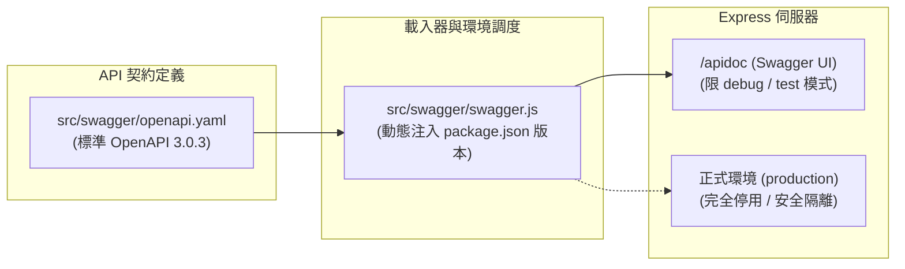
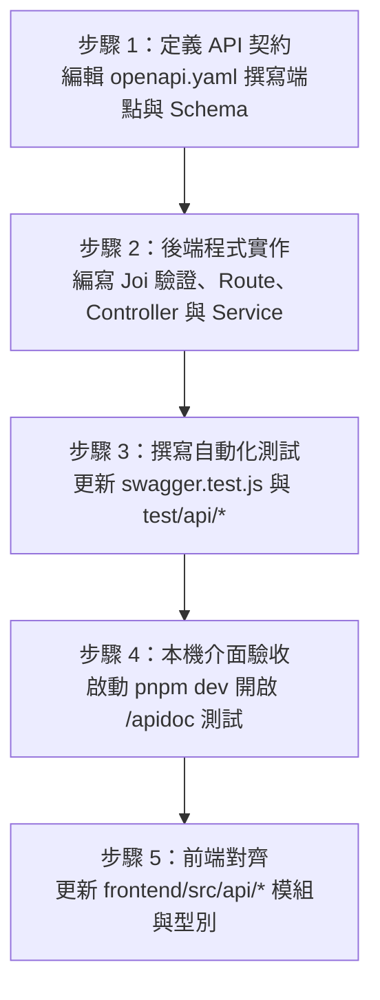

# 5. Swagger 與 API 契約

本文件說明本專案的 OpenAPI 3.0 規範架構、Swagger UI 互動式文件的運作機制、雙軌認證於介面中的測試操作、文檔共用元件復用原則，以及端到端 API 契約維護開發流程。

---

## 一、API 契約核心架構與設計哲學

### 1. 獨立維護 openapi.yaml 檔案

本專案的 API 文件是直接維護 **[src/swagger/openapi.yaml](../src/swagger/openapi.yaml)** 這個檔案，遵循標準 OpenAPI 3.0 規範。



**開發規範**：不在程式碼中撰寫 Swagger JSDoc 註解，所有端點的路徑、參數、RequestBody 與回應格式，一律直接在 `src/swagger/openapi.yaml` 進行新增與修改。

---

### 2. Swagger 載入器機制（[src/swagger/swagger.js](../src/swagger/swagger.js)）

載入器負責在應用啟動時讀取並裝配 OpenAPI 規格：

```javascript
const fs = require("fs");
const YAML = require("yaml");
const { resolveAppPath } = require("@src/helper/file.js");
const { version } = require("@src/config/app.js");

const loadOpenApiDocument = () => {
    if (process.versions?.bun) {
        try {
            return require("./openapi.yaml"); // Bun 原生支援靜態打包 YAML
        } catch {
            // fallback 至檔案讀取
        }
    }
    const openApiPath = resolveAppPath("src", "swagger", "openapi.yaml");
    return YAML.parse(fs.readFileSync(openApiPath, "utf8"));
};

const openApiDocument = loadOpenApiDocument();
openApiDocument.info = openApiDocument.info || {};
openApiDocument.info.version = version; // 自動以 package.json 的版號覆蓋

module.exports = { openApiDocument };
```

- **版本自動連動**：規格中的 `info.version` 會在啟動期自動以 [package.json](../package.json) 的 `version` 動態覆蓋，保證系統發布版本與 API 文件版本 100% 一致，無須手動在兩處維護版號。
- **雙執行環境兼顧**：
  - **Node.js 模式**：執行期透過 `yaml` 解析器讀取實體檔案。
  - **Bun 編譯單檔模式**：優先使用 `require("./openapi.yaml")`，讓 Bun 打包器在編譯期直接將規格內容「靜態內嵌」至二進位執行檔中。

---

### 3. 正式環境安全隔離策略（Production Security Boundary）

在 [src/http/route/index.js](../src/http/route/index.js) 中，Swagger UI 的掛載具備嚴格的環境模式判斷：

```javascript
// 僅在 debug 或 test 模式開放 API 互動文件
if (["debug", "test"].includes(mode)) {
    app.use("/apidoc", swaggerUi.serve, swaggerUi.setup(openApiDocument));
}
```

> [!IMPORTANT]
> **安全性防禦原則**：
> 當 `APP_MODE=production`（正式正式環境）時，後端**完全不掛載 `/apidoc` 路由**，請求將直接回應 404。

---

## 二、存取 Swagger UI 與介面操作

### 1. 存取路徑與環境要求

- **存取網址**：`http://127.0.0.1:3000/apidoc`（通訊埠由 `.env` 的 `APP_PORT` 決定）。
- **可用環境**：僅在 `APP_MODE=debug` 或 `APP_MODE=test` 下可用。
- **全域前綴**：所有業務 API 統一以 `/api` 為前綴（如 `/api/health`、`/api/auth/login`），Swagger 內部伺服器位址預設設定為 `/api`。

---

### 2. 雙軌認證在 Swagger UI 的測試操作

專案支援 **Cookie Session** 與 **Bearer JWT** 雙軌認證，兩者在 Swagger UI 中的測試操作方式如下：

```
+--------------------------------------------------------------+
| Swagger UI 介面右上角  [ 🔓 Authorize ] 按鈕                  |
+--------------------------------------------------------------+
| 1. cookieAuth (apiKey in cookie: token)                      |
|    - 瀏覽器同源自動攜帶：                                      |
|      最方便的做法是直接開啟前端登入頁完成登入，                  |
|      瀏覽器即具備 Session Cookie，回到本頁即可直接測試。        |
|                                                              |
| 2. bearerAuth (http, bearerFormat: JWT)                      |
|    - 手動授權：                                               |
|      先呼叫 Bearer 登入端點取得 token 字串，                   |
|      點擊 Authorize 按鈕並貼上 Token，                        |
|      Swagger UI 後續會在請求標頭自動附加：                     |
|      Authorization: Bearer <token>                           |
+--------------------------------------------------------------+
```

1. **Cookie 認證模式（瀏覽器同源原生，推薦最快方式）**：
   - **快速測試捷徑**：直接在瀏覽器開啟前端登入頁（`http://127.0.0.1:3000/app/login`）完成登入，由於前端 SPA 與 Swagger UI 同源，登入成功後瀏覽器會自動寫入 Session Cookie。
   - **回到 Swagger UI**：登入完成後直接切換回 `/apidoc`，此時瀏覽器已具備登入狀態，可直接在 Swagger UI 上測試所有受保護的 API，**完全不需手動輸入或貼上任何 Token**。
   - *（亦可在 Swagger UI 直接執行 `POST /api/auth/session/login`，後端同樣會透過 `Set-Cookie` 寫入瀏覽器。）*

2. **Bearer Token 模式（跨域 / APP 模式推薦）**：
   - 於 Swagger UI 執行 `POST /api/auth/login`，在回應資料的 `data.token` 中複製 Token 字串。
   - 點擊 Swagger UI 右上角綠色的 **Authorize** 按鈕。
   - 在 `bearerAuth` 欄位中貼上該 Token 並按確認（無需手動輸入 `Bearer ` 前綴，UI 會自動組合）。
   - 之後所有標註鎖頭圖示的受保護 API，在執行測試時都會自動帶上 `Authorization: Bearer <token>` 標頭。

---

### 3. Try it out 即時測試與副作用警示

> [!WARNING]
> Swagger UI 上的 **Try it out** 按鈕會發出**真實的 HTTP 網路請求**！
> 執行新增、修改或刪除操作會直接變更當前伺服器所連線的資料庫內容，在測試或展示時，請確保連線的是開發用或測試用資料庫，避免對正式資料造成不可逆的破壞。

---

## 三、OpenAPI 3.0 規範結構與 Components 復用

為了維持規格簡潔並遵循 DRY（Don't Repeat Yourself）原則，所有通用回應結構與常用參數一律定義於 `components` 中供各端點引用：

### 1. 通用回應結構（Components Schemas）

遵循專案第 3 篇規範，所有 API 回應 Body 永遠維持 `{ message, data }` 結構：

```yaml
components:
  schemas:
    # 成功回應基底
    SuccessResponse:
      type: object
      required: [message, data]
      properties:
        message:
          type: string
          example: 操作成功
        data:
          type: object

    # 錯誤回應基底
    ErrorResponse:
      allOf:
        - $ref: "#/components/schemas/SuccessResponse"

    # 422 欄位驗證錯誤回應
    ValidationErrorResponse:
      allOf:
        - $ref: "#/components/schemas/ErrorResponse"
        - type: object
          properties:
            data:
              type: object
              properties:
                errors:
                  type: array
                  items:
                    type: object
                    properties:
                      name:
                        type: string
                        example: email
                      message:
                        type: string
                        example: 電子郵件格式不正確
```

---

### 2. 常用 HTTP 錯誤回應模板（Components Responses）

端點可直接透過 `$ref` 引用預先定義好的標準錯誤回應，無須重複描述錯誤結構：

| 元件名稱 | HTTP 狀態碼 | 業務含義 | 引用路徑 |
| :--- | :---: | :--- | :--- |
| `ValidationError` | **422** | 輸入欄位驗證失敗 | `#/components/responses/ValidationError` |
| `Unauthorized` | **401** | 未登入或 Token 已失效 | `#/components/responses/Unauthorized` |
| `Forbidden` | **403** | 無操作權限或 CSRF 失敗 | `#/components/responses/Forbidden` |
| `NotFound` | **404** | 找不到指定資料或路由 | `#/components/responses/NotFound` |
| `Conflict` | **409** | 資料重複衝突（如唯一鍵違規） | `#/components/responses/Conflict` |

---

### 3. 通用分頁參數與分頁物件（Pagination）

專案標準分頁規範已抽象為共用 Parameters 與 Schema：

```yaml
components:
  parameters:
    Page:
      name: page
      in: query
      description: 當前頁碼（預設為 1）
      schema:
        type: integer
        minimum: 1
        default: 1
    PerPage:
      name: perPage
      in: query
      description: 每頁筆數（預設 100，最大上限 100）
      schema:
        type: integer
        minimum: 1
        maximum: 100
        default: 100

  schemas:
    Pagination:
      type: object
      required: [total, perPage, currentPage, lastPage]
      properties:
        total:
          type: integer
          description: 資料總筆數
        perPage:
          type: integer
          description: 每頁筆數
        currentPage:
          type: integer
          description: 當前頁碼
        lastPage:
          type: integer
          description: 最後一頁頁碼
```

---

## 四、端到端 API 契約維護開發流程

當專案需要新增 API 或修改現有端點行為時，請遵循標準 5 步驟生命週期：



### 1. 端點編寫標準 YAML 範本

在 `openapi.yaml` 中新增端點時，必須包含完整的摘要、參數、RequestBody（若有）、200/201 成功回應與可能之錯誤代碼：

```yaml
paths:
  /posts:
    post:
      tags: [Posts]
      summary: 建立新文章
      description: 需登入。支援 Cookie Session 或 Bearer Token。
      security:
        - cookieAuth: []
        - bearerAuth: []
      requestBody:
        required: true
        content:
          application/json:
            schema:
              $ref: "#/components/schemas/PostInput"
      responses:
        "201":
          description: 建立成功
          content:
            application/json:
              schema:
                $ref: "#/components/schemas/PostResponse"
        "401":
          $ref: "#/components/responses/Unauthorized"
        "422":
          $ref: "#/components/responses/ValidationError"
```

### 2. 契約維護規範細則

1. **命名一致性**：
   - JSON 傳輸欄位一律遵循 **`camelCase`**（如 `authorName`、`coverImage`、`perPage`）。
   - 說明文字、Summary 與 Description 一律使用結構清晰之**繁體中文**。
2. **範例真實性**：
   - 範例資料請提供合理的假資料（如測試信箱、合理的標題長度），便於前端工程師參照與介面直觀展示。
3. **重用優先**：
   - 只要重複出現兩次以上的資料型態或錯誤結構，務必收斂至 `components/schemas`，避免同一結構在多處複製貼上造成未來維護遺漏。

---

## 五、多執行環境相容性與打包機制

### 1. Node.js 執行期

在一般開發或 PM2 運行環境中，`src/swagger/swagger.js` 會在載入時即時讀取磁碟上的 `src/swagger/openapi.yaml` 並解析為 JavaScript 物件。
- **熱加載行為說明**：在 `pnpm dev` 開發模式下，PM2 watch 已涵蓋 `src/` 目錄（包含 `openapi.yaml`），修改存檔後 PM2 會**自動重啟後端服務**以重新讀取最新規格；重啟完成後，在瀏覽器重新整理（F5）Swagger UI 頁面即可看到最新文件（僅在原生 `pnpm start:node` 等非 watch 模式下，才需手動重啟進程）。

### 2. Bun 二進位單檔內嵌機制

在執行 `pnpm build:bun` 產出單一可執行檔時：
- Bun 原生支援將 YAML/JSON 檔案作為模組，直接打包進二進位檔案內部。
- 載入器中的 `require("./openapi.yaml")` 能被 Bun 靜態解析並固化打包進執行檔中，因此交付單檔可執行檔時，**外部不需要隨附任何 YAML 原始碼檔案**即可正常開啟 `/apidoc`。

---

## 六、自動化契約測試與持續整合

專案在測試體系中建立了雙重校驗機制，確保代碼實作不會與 API 文件脫節：

### 1. 單元測試契約檢驗（[test/unit/swagger.test.js](../test/unit/swagger.test.js)）

單元測試會直接驗證 Swagger 裝配模組的核心契約：

```javascript
describe("OpenAPI 文件", () => {
    test("包含基礎 API 並使用 package.json 版本", () => {
        expect(openApiDocument.info.version).toBe(packageJson.version);
        expect(openApiDocument.paths).toEqual(
            expect.objectContaining({
                "/health": expect.any(Object),
                "/auth/register": expect.any(Object),
                "/auth/login": expect.any(Object),
                "/auth/me": expect.any(Object),
                "/posts": expect.any(Object),
                "/posts/{id}": expect.any(Object),
            }),
        );
    });
});
```

- 檢驗 `info.version` 是否忠實同步 `package.json`。
- 檢驗核心領域端點路徑（`/health`、`/auth/*`、`/posts/*`）是否完整登錄於規格中。

### 2. 整合測試雙向校驗（`test/api/`）

在 API 整合測試中，透過 Supertest 模擬真實 HTTP 請求，驗證回傳的 HTTP 狀態碼與 JSON 欄位（`message`、`data`、`data.errors`）是否嚴格符合 `openapi.yaml` 定義的 Schema 規範。
