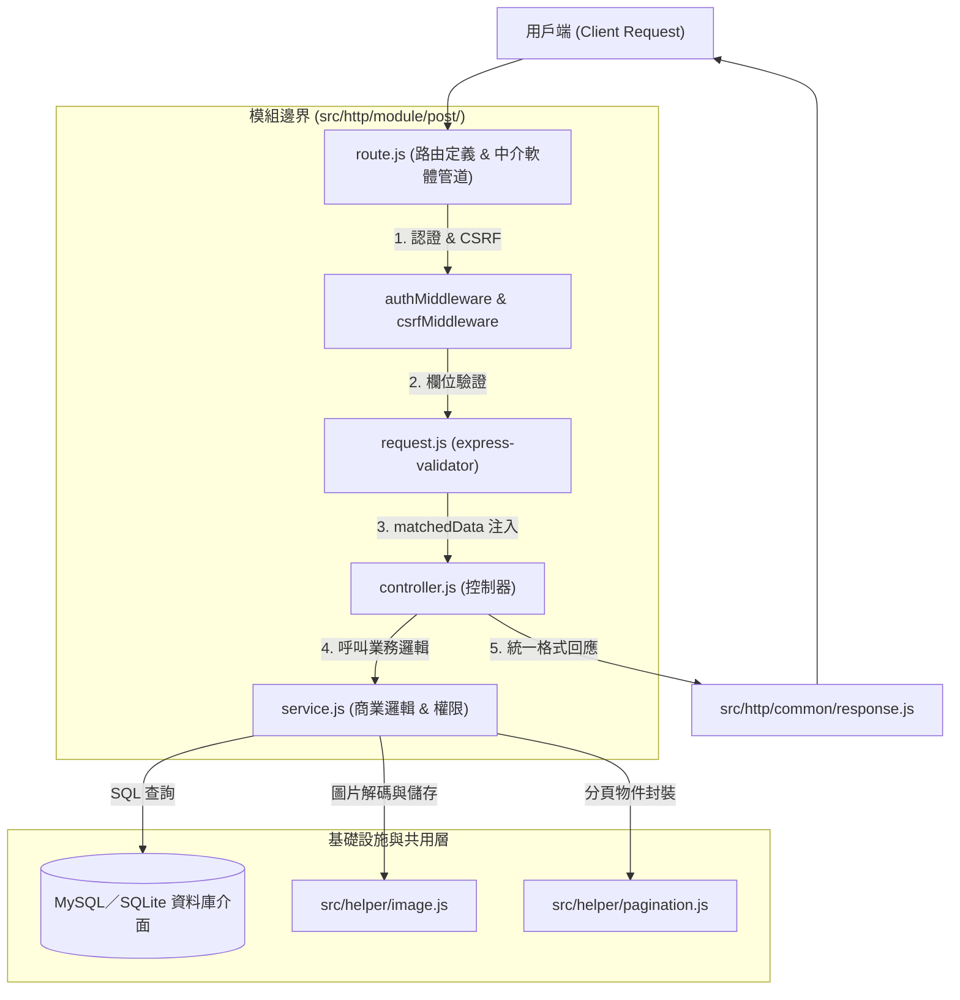
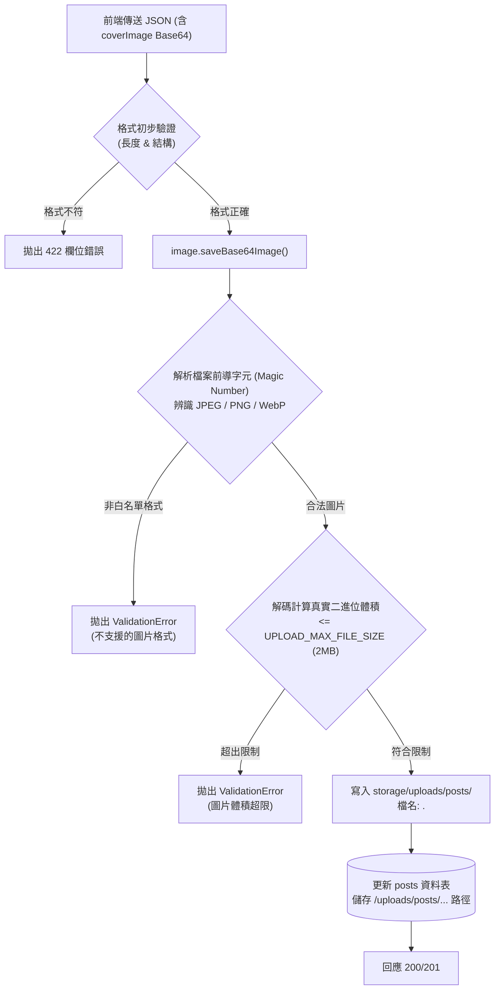

# 7. 後端模組與圖片儲存

本篇以文章 post 模組為範例，說明專案後端業務模組之四層分層架構、輸入校驗、作者權限防護、分頁處理與 Base64 封面圖片儲存機制。

---

## 一、後端模組分層架構與職責邊界

後端業務功能集中於 `src/http/module/<moduleName>/` 目錄下，遵循高內聚、低耦合的**四層分工架構**：

### 1.1 模組分層調用流程圖



### 1.2 四層核心檔案職責

| 檔案名稱 | 核心責任與規範 |
| :--- | :--- |
| `route.js` | 定義 HTTP Method、URL 路徑與 Middleware 執行順序，**只負責組裝路由並匯出 Express Router，不撰寫商業邏輯**。 |
| `request.js` | 基於 `express-validator` 定義請求輸入欄位之驗證規則、轉型（Sanitizer）與錯誤提示。 |
| `controller.js` | **接收已校驗資料（`req.validated`）**、呼叫對應 Service 方法、捕獲異常交由 `next(error)`，並使用 `response.success()` 輸出統一回應，**嚴禁直接撰寫 SQL 語句**。 |
| `service.js` | **純商業邏輯與資料存取核心**，執行作者身分與權限檢查、呼叫資料庫介面查詢、領域物件轉換（snake_case 轉 camelCase）、呼叫圖片儲存，**嚴禁操作 Express 之 `req` 或 `res` 物件**。 |

### 1.3 命名規範與共用 Helper 原則

- **駝峰命名（camelCase）**：所有 JavaScript 檔案名稱、函式名稱以及 API 回應之 JSON 欄位一律使用 `camelCase`。
- **資料庫命名轉換**：MySQL 與 SQLite 資料表欄位採 `snake_case`，在 `service.js` 中必須完成欄位雙向轉譯，保持 Controller 與外部輸出的一致性。
- **路徑別名**：全專案統一使用 `@src/*` 引入模組，維持簡潔與跨環境相容。
- **優先使用共用 Helper**：
  - 資料庫存取：`@src/db/index.js`
  - 圖片處理：`@src/helper/image.js`
  - 檔案操作：`@src/helper/file.js`
  - 分頁處理：`@src/helper/pagination.js`
  - 非同步鏈路追蹤：`@src/helper/requestContext.js`

---

## 二、輸入驗證與 Controller 規範

### 2.1 驗證中介軟體與安全取值（`req.validated`）

為避免未經驗證的惡意參數滲透至業務邏輯層，專案嚴格落實白名單校驗：

1. `request.js` 定義各端點之檢驗規則陣列（可組合 `@src/http/common/request.js` 提供的 `idParam` 與 `paginationQuery`）。
2. 全域 `validateMiddleware` 統一處理驗證結果：
   - 驗證失敗：拋出 `ValidationError`（HTTP 422），回傳各欄位的詳細錯誤資訊。
   - 驗證成功：透過 `matchedData(req)` 擷取符合驗證規則的白名單欄位，並存入 `req.validated`，避免未定義欄位進入業務邏輯。。
3. `controller.js` 統一從 `req.validated` 取得已驗證的白名單資料，避免未授權欄位被寫入，降低 Mass Assignment 漏洞風險。

### 2.2 身分權限取值原則（信任 `req.user.id`）

- **唯一信任來源**：在受保護端點中，目前使用者的 ID 永遠自 `req.user.id`（由 `authMiddleware` 驗證 JWT 後注入）取得。
- **嚴禁漏洞**：**絕對禁止**自 `req.body.userId`、`req.query.userId` 或 URL 參數中讀取當前使用者身分，防止身分偽造（BOLA/IDOR）。

### 2.3 寫入路由之中介軟體鏈（Middleware Pipeline）

對於涉及寫入（POST/PUT/DELETE）的受保護路由，中介軟體掛載順序必須嚴格維持：

```javascript
router.post(
    "/posts",
    authMiddleware,       // 1. 身分認證 (JWT 簽章與過期核對)
    csrfMiddleware,       // 2. CSRF 防護 (Origin / Referer 來源比對)
    createPostRequest,    // 3. express-validator 欄位規則
    validateMiddleware,   // 4. 檢驗執行 (失敗拋 422，成功注入 req.validated)
    controller.create,    // 5. 控制器執行
);
```

---

## 三、文章端點與作者權限隔離

### 3.1 端點契約與權限矩陣

| 端點 | Method | 認證要求 | 權限與過濾行為 | 成功狀態碼 |
| :--- | :--- | :---: | :--- | :---: |
| `/api/posts` | `GET` | 公開 | 固定只查詢已發布文章。 | 200 |
| `/api/posts/:id` | `GET` | 公開 | 查詢單篇，若該文章為草稿或不存在，一律回傳 404。 | 200 |
| `/api/posts/mine` | `GET` | 需登入 | 僅查詢當前登入者自己建立的所有文章，包含草稿與已發布。 | 200 |
| `/api/posts/mine/:id` | `GET` | 需登入 | 查詢當前登入者自己的特定文章，非作者或不存在回傳 404。 | 200 |
| `/api/posts` | `POST` | 需登入 | 建立新文章，自動將 `author_id` 綁定為當前 `req.user.id`。 | 201 |
| `/api/posts/:id` | `PUT` | 需登入 | 完整更新文章，文章不存在回傳 404，非作者回傳 403 Forbidden。 | 200 |
| `/api/posts/:id` | `DELETE` | 需登入 | 刪除文章，文章不存在回傳 404，非作者回傳 403 Forbidden。 | 200 |

### 3.2 路由宣告順序保護

在 Express 路由比對中，靜態具體路徑必須宣告在動態參數路徑之前：

```javascript
// 正確：先註冊 mine 專屬路徑
router.get("/posts/mine", authMiddleware, controller.listMine);
router.get("/posts/mine/:id", authMiddleware, controller.getMineById);

// 再註冊通用動態參數路徑，防止 "mine" 被誤判為文章 ID 查詢
router.get("/posts/:id", controller.getById);
```

### 3.3 資源修改權限檢驗（Service 層防線）

在 `service.update()` 與 `service.delete()` 中，必須先查詢資料庫取得現有紀錄，比對作者 ID：

```javascript
const post = await getPostById(postId);
if (!post) throw new NotFoundError("找不到文章");
if (post.authorId !== currentUserId) throw new ForbiddenError("您無權操作此文章");
```

---

## 四、分頁機制與查詢規範

### 4.1 分頁參數與預設值

專案提供標準通用分頁驗證規則（`@src/http/common/request.js` 的 `paginationQuery`）：

| 參數 | 型態 | 預設值 | 說明與限制 |
| :--- | :--- | :---: | :--- |
| `page` | `integer` | `1` | 頁碼，必須為大於或等於 1 之整數。 |
| `perPage` | `integer` | `100` | 每頁筆數，限制在 1 至 100 之間。 |

### 4.2 分頁回傳結構

清單 API 一律使用 `@src/helper/pagination.js` 的 `format()` 產生標準分頁包裹物件：

```json
{
  "message": "取得文章列表成功",
  "data": {
    "posts": [
      {
        "id": 1,
        "title": "範例文章",
        "coverImage": "/uploads/posts/uuid-string.png",
        "status": "published",
        "createdAt": "2026-01-01 00:00:00"
      }
    ],
    "pagination": {
      "total": 42,
      "perPage": 12,
      "currentPage": 1,
      "lastPage": 4
    }
  }
}
```


---

## 五、圖片儲存與生命週期管理

### 5.1 `src/config/upload.js` 設定與圖片儲存位置

文章封面圖片透過 coverImage 接收 Base64 資料，統一儲存於**程式根目錄的 `storage/uploads/posts/`**，並以 UUID 命名，副檔名依圖片實際格式決定（`.jpg`、`.png` 或 `.webp`）。

資料庫 `posts.cover_image` 儲存的是 `/uploads/posts/<UUID>.<ext>` 公開路徑，不是磁碟絕對路徑，由 Express 將 `/uploads/*` 映射至 `storage/uploads/*`，提供圖片存取。

根目錄與部署管理：
- **Node.js / Bun 一般執行**：以程式啟動時的工作目錄為根目錄。
- **Bun 獨立執行檔**：以執行檔所在目錄為根目錄。
根目錄由 resolveAppPath() 統一解析。部署、更新與備份時須保留 `storage/uploads/`，避免圖片資料遺失。

圖片上傳設定統一由 [`src/config/upload.js`](../src/config/upload.js) 管理，包含儲存路徑、支援格式及檔案大小限制：
```js
module.exports = {
    storageDir: "storage/uploads",
    publicUrlPrefix: "/uploads",
    allowedMimeTypes: ["image/jpeg", "image/png", "image/webp"],
    maxFileSizeBytes: Number(process.env.UPLOAD_MAX_FILE_SIZE ?? 2 * 1024 * 1024), // 預設 2MB
    jsonLimit: process.env.UPLOAD_JSON_LIMIT ?? "10mb",
};
```

其中 `storageDir` 決定磁碟儲存根目錄，文章模組呼叫圖片 helper 時另其下的 `posts` 子目錄，因此實際存放於 `storage/uploads/posts/`，`publicUrlPrefix` 決定圖片公開網址的開頭，搭配同一個子目錄後形成 `/uploads/posts/<UUID>.<ext>`。

| 設定欄位 | 預設值 | 用途 |
| :--- | :--- | :--- |
| `storageDir` |  `storage/uploads` | 圖片實體儲存根目錄，文章封面存放於其下的 `posts/`。 |
| `publicUrlPrefix` |  `/uploads` | 靜態公開網址前綴，同時作為資料庫儲存的路徑前綴。 |
| `allowedMimeTypes` |  JPEG、PNG、WebP | 限制允許上傳的圖片格式，並透過檔案簽章驗證。 |
| `maxFileSizeBytes` | 2 MiB | 單張圖片解碼後的大小上限，可透過 UPLOAD_MAX_FILE_SIZE 調整。 |
| `jsonLimit` | 10mb | HTTP 請求本文大小上限，可透過 UPLOAD_JSON_LIMIT 調整。 |

設定注意事項：
- `storageDir`、`publicUrlPrefix` 與 `allowedMimeTypes` 為程式固定設定，不提供 `.env` 修改，調整時須同步確認圖片儲存、靜態路由及既有資料庫路徑。
- Base64 編碼會增加請求本文大小，因此 jsonLimit 應高於預期圖片傳輸量。
- 若使用 Nginx 反向代理，須確認 client_max_body_size 足以容納請求本文。

### 5.2 Base64 圖片處理流程圖



### 5.3 安全檢驗機制

圖片儲存邏輯封裝於 [`src/helper/image.js`](../src/helper/image.js)，具備多層防禦：

1. **檔案特徵簽章檢驗（Magic Number）**：
   - 拒絕依賴副檔名或 Content-Type 宣稱，直接讀取解碼後的二進位 Buffer 前導位元組。
   - 僅允許合法的 **JPEG (`0xFFD8FF`)**、**PNG (`0x89504E47`)** 與 **WebP (`RIFF....WEBP`)**。
2. **解碼後真實體積檢核**：
   - Base64 字串會比原始圖片體積大約 33%。系統在解碼還原為 Buffer 後嚴格檢查是否超過 `UPLOAD_MAX_FILE_SIZE`（預設 2 MiB）。
3. **隨機 UUID 檔名隔離**：
   - 檔名完全由系統透過 `crypto.randomUUID()` 重新生成，副檔名依特徵簽章自動補齊，徹底杜絕路徑穿越（Path Traversal）與檔名覆寫攻擊。

### 5.4 圖片生命週期（新增、更新與刪除）

| 操作場景 | `coverImage` 傳入值 | 系統執行動作 |
| :--- | :--- | :--- |
| **新增文章** | 合法 Base64 | 解碼儲存新圖，路徑寫入 DB。 |
| **新增文章** | `null` / 未提供 | 欄位存入 `null`。 |
| **更新文章** | 未提供該欄位 | 保留原始封面路徑不變。 |
| **更新文章** | 新 Base64 | 儲存新圖，DB 更新成功後**嘗試刪除舊本機圖片**。 |
| **更新文章** | `null` 或空字串 | 清空封面欄位，DB 更新成功後**嘗試刪除舊本機圖片**。 |
| **刪除文章** | — | 刪除 DB 文章紀錄後，若該文章擁有本機圖片（`/uploads/` 開頭），一併嘗試自磁碟中刪除。 |

---

## 六、新增業務模組標準作業步驟（New Module SOP）

若專案需要擴充新的業務領域模組（例如商品 `product` 模組）：

1. **資料表定義**：於 `src/migrate/migrations/` 新增遷移檔並登錄於 `registry.js`（見 [第 4 篇](4-資料庫與Migration.md)）。
2. **建立模組目錄**：建立 `src/http/module/<moduleName>/`。
3. **實作四大核心檔案**：
   - `request.js`：定義欄位驗證規則。
   - `service.js`：實作業務與資料庫 CRUD。
   - `controller.js`：呼叫 service 並以 `response.success` 格式化輸出。
   - `route.js`：串接認證、CSRF、驗證與 Controller。
4. **主路由掛載**：在 `src/http/route/apiRoute.js` 中將該模組 Router 掛載至 `/api`。
5. **API 文件與測試契約**：
   - 在 `src/swagger/openapi.yaml` 增補該模組 API 規格（見 [第 5 篇](5-Swagger.md)）。
   - 撰寫對應單元測試（`test/unit/`）與 API 契約測試（`test/api/`）（見 [第 8 篇](8-測試說明.md)）。
6. **合規檢查**：執行 `pnpm check` 確認 JS 語法與命名合規。
