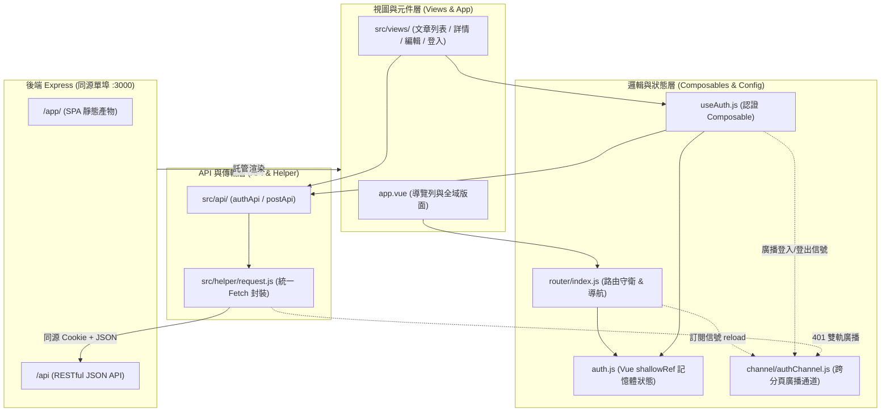
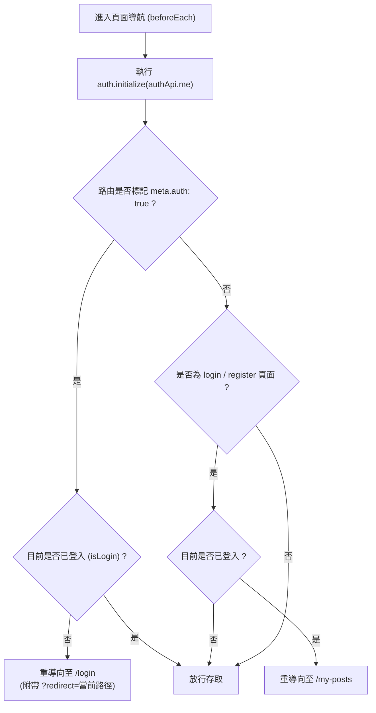

# 9. 前端開發

本篇說明專案前端之技術選型、目錄結構、同源單埠整合架構、共用 HTTP 請求封裝（`request.js`）、登入狀態管理與路由導航守衛機制。

---

## 一、前端系統架構與分層職責

前端採用 **Vue 3 (Composition API) + Vue Router + Vite**，原始碼位於 `frontend/` 目錄中，後端 `Express` 則負責靜態檔案託管與 API 服務。

### 1.1 前端分層架構圖



### 1.2 目錄結構與模組職責

前端採用模組化架構，將頁面、路由、API 請求、設定與狀態管理分離，確保程式碼具備良好的可維護性與擴充性。

| 目錄 / 檔案 | 模組職責說明 |
| :--- | :--- |
| `src/main.js`、`src/app.vue` | 啟動 Vue 應用、掛載路由、提供全域 Navbar 導覽與版面骨架。 |
| `src/views/` | 頁面級元件：管理文章列表、詳情、新增／編輯、登入、註冊及 404 等頁面元件。 |
| `src/router/index.js` | 集中管理路由、登入驗證守衛（`meta.auth`）、頁面捲動、跨分頁重載監聽及認證過期事件。 |
| `src/channel/authChannel.js` | 跨分頁廣播通道：封裝原生 BroadcastChannel，負責登入、登出、過期事件之全分頁即時通知與自動刷新。 |
| `src/api/` | 封裝各業務模組的 API 端點與呼叫介面。 |
| `src/helper/request.js` | 統一處理 HTTP 請求、Cookie 攜帶、認證過期 401 事件、欄位驗證錯誤 422 事件及逾時控制。 |
| `src/config/config.js` | 前端公開設定中心（API 基礎路徑、分頁設定、圖片大小限制及請求逾時設定）。 |
| `src/config/auth.js` | 集中維護記憶體中的使用者認證狀態（`shallowRef(null)`）與防抖初始化邏輯。 |
| `src/composables/useAuth.js` | 提供登入、登出及使用者響應式狀態等共用功能。 |

> [!IMPORTANT]
> **開發規範原則**：所有畫面元件一律透過 `src/api/` 模組發起請求，嚴禁在元件內部自行呼叫原生 `fetch` 或其他套件，跨頁面的共享狀態與邏輯優先收斂至既有的 config 或 composable。

---

## 二、同源架構整合

### 2.1 路由前綴與路徑劃分

本專案前後端**共用同一個 HTTP 通訊埠**（預設 `:3000`），透過路由前綴進行責任切分：

| 路由前綴 | 服務型態 | 處理主體與說明 |
| :--- | :--- | :--- |
| `/app/` | 前端 SPA 頁面 | Express 託管前端靜態資源，未比對到具體檔案時 Fallback 回 `index.html`。 |
| `/api/` | 商業邏輯 API | Express RESTful API，回應統一之 `{ message, data }` JSON 結構。 |
| `/uploads/` | 使用者上傳資產 | 伺服器本地圖片檔案儲存目錄（見 [第 7 篇](7-後端模組與圖片儲存.md)）。 |
| `/apidoc/` | 互動式 API 文件 | Swagger UI 文件介面（僅限 `debug` / `test` 模式開放）。 |

### 2.2 熱加載流程（`pnpm dev`）

執行 `pnpm dev` 時，系統會串聯前後端開發程序：

1. **前端先行建置**：先執行一次前端建置，產出初始產物。
2. **後端 PM2 守護**：啟動 PM2 並監聽後端 `src/` 檔案變更，自動重啟後端進程。
3. **前端持續監看**：前台執行 `vite build --watch`，檔案變更時秒級重新編譯至 `frontend/dist/`。
4. **瀏覽器存取**：工程師直接開啟 `http://127.0.0.1:3000/app/` 即可進行除錯，前端修改後重新整理瀏覽器即可載入最新產物。

### 2.3 Express SPA 回退（Fallback）託管機制

- **路由基底前綴**：`vite.config.js` 設定 `base: "/app/"`，前端 Vue Router 配置 `createWebHistory(config.url.view)`，因此文章路由在 Vue 內定義為 `/posts/:id`，瀏覽器實際網址為 `/app/posts/:id`。
- **深層路由支援**：Express 遇到以 `/app` 開頭且不含副檔名（副檔名檢查防護）的 GET 請求時，會自動回傳 `index.html`，將路由掌控權交還給前端 Vue Router。
- **安全隔離**：缺少 assets、副檔名不符或非 HTML 請求絕不 Fallback，防止靜態 404 誤吞或遮蔽 API 錯誤。

---

## 三、共用 HTTP 請求工具（`src/helper/request.js`）

前端封裝了輕量、健壯且高聚合的 [`frontend/src/helper/request.js`](../frontend/src/helper/request.js)，統一處理全站 HTTP 通訊。

### 3.1 核心介面規範

```javascript
request(method, path, data = null, options = {})
```

- **自動補全 API 路徑**：傳入相對路徑（如 `posts` 或 `/auth/me`）會自動接在 `config.url.api`（預設 `/api`）之後。
- **同源 Cookie 自動攜帶**：預設啟用 `credentials: "include"`，瀏覽器會自動附帶 `HttpOnly` 的 Session Cookie，無須手動設定 Authorization 標頭。
- **預設標頭**：自動設定 `Accept: application/json`。

### 3.2 參數處理與序列化規範

| HTTP Method / 資料型別 | 資料處理行為 | Content-Type 處理 |
| :--- | :--- | :--- |
| `GET` / `HEAD`（物件） | 自動呼叫 `appendQuery` 轉換為 URL Query String。自動過濾 `null`、`undefined` 與空字串，陣列以重複鍵展開。 | 無 Request Body。 |
| `POST` / `PUT` / `PATCH`（一般物件） | 自動以 `JSON.stringify(data)` 序列化為 JSON 字串。 | 自動設定為 `application/json`。 |
| `POST` / `PUT` / `PATCH`（`FormData`） | 直接透傳 `FormData` 物件。 | **主動移除** `Content-Type`，交由瀏覽器自動計算包含 `boundary` 的標頭。 |

### 3.3 401 認證過期與跨分頁同步機制

當後端回傳 HTTP 401 時，前端會自動清除登入狀態，並透過事件通知與 BroadcastChannel，確保所有分頁的認證狀態一致：

1. **清除登入狀態**：若目前前端處於已登入狀態（`auth.isLogin()` 為 true），立即調用 `auth.clearUser()` 清除記憶體中的使用者資訊。後端已經判定過期了，但前端記憶體還留著舊的登入資訊，所以只有原本處於已登入狀態的前端，才需要執行清空並跳轉回登入頁。
2. **跨分頁與認證過期通知**：透過 [`src/channel/authChannel.js`](../frontend/src/channel/authChannel.js) 呼叫 `broadcastAuthSignal(AuthSignal.EXPIRED, true)`：
   - **其他分頁**：透過瀏覽器 `BroadcastChannel` 接收通知並重新載入頁面，同步最新認證狀態。
   - **當前分頁**：觸發 `auth-expired` 事件，由 Router 處理頁面導向。
3. **路由即時導向**：[`src/router/index.js`](../frontend/src/router/index.js) 監聽到 `auth-expired` 事件後，若當前非登入頁，會立即以 SPA 平滑導向登入頁並攜帶跳轉參數：
```javascript
router.push({
    name: "login",
    query: { redirect: currentPath, expired: "1" },
});
```
4. **跨分頁登入／登出同步**：使用者於任何分頁主動登入、註冊或登出時，[`src/composables/useAuth.js`](../frontend/src/composables/useAuth.js) 會呼叫 `broadcastAuthSignal(AuthSignal.REFRESH)`，通知其他分頁自動重載，無縫切換為已登入或訪客狀態。
5. **例外處理**：若特定請求不希望觸發全域 401 過期處理（例如登入 API 本身輸入錯誤時），呼叫端可傳入 `{ handleAuthError: false }` 關閉此行為。

### 3.4 422 欄位驗證錯誤解析

後端欄位驗證失敗時會回傳包含 `data.errors` 陣列的 422 錯誤結構，前端 helper 自動將其扁平化轉換為鍵值對字典（`fields`）：

```javascript
// 後端格式：{ errors: [{ name: "email", message: "電子郵件格式不正確" }] }
// 拋出之 Error 物件：
error.fields = { email: "電子郵件格式不正確" };
```

這讓 Vue 表單元件可直接透過 `fieldErrors.email` 取得錯誤訊息並展示在對應輸入框下方。

### 3.5 逾時控制與請求取消

```javascript
const timeoutSignal = AbortSignal.timeout(options.timeout ?? config.requestTimeoutMs);
const signal = options.signal ? AbortSignal.any([options.signal, timeoutSignal]) : timeoutSignal;
```

- **自動逾時中斷**：預設逾時為 8000 ms（由 `config.requestTimeoutMs` 定義），超時自動拋出 `error.type = "timeout"`。
- **主動取消支援**：可傳入呼叫端的 `options.signal`，利用 `AbortSignal.any()` 自動與逾時信號合併，使用者離開頁面取消請求時拋出 `error.type = "cancelled"`。
- **網路斷線分類**：無法連線時拋出 `error.type = "network"`，方便 UI 呈現精確的錯誤提示。

---

## 四、登入狀態管理與路由導航守衛

### 4.1 記憶體認證狀態（`src/config/auth.js`）

遵循專案架構原則，JWT 存放於後端簽發之 `HttpOnly` Cookie 中，前端 JavaScript 無法存取 Token，亦**完全不使用 `localStorage` 或 `sessionStorage` 儲存登入憑證**：

- **響應式狀態**：使用 Vue 的 `user = shallowRef(null)` 保存目前使用者物件。
- **狀態管理方法**：
  - `auth.setUser(nextUser)`：寫入使用者資料並標記初始化完成。
  - `auth.clearUser()`：清空使用者資料（設為 `null`）並標記初始化完成。
  - `auth.isLogin()`：以 `Boolean(user.value)` 判定是否處於登入狀態。
- **防抖初始化（Promise Cache）**：`auth.initialize(fetchUser)` 內部維護 `initializePromise`，在同一次頁面生命週期中多次呼叫時共用同一 Promise，徹底杜絕多個路由守衛並行重複呼叫 `/api/auth/me` 的問題。

### 4.2 路由守衛決策流程圖



### 4.3 守衛執行邏輯

在 [`frontend/src/router/index.js`](../frontend/src/router/index.js) 中定義全域前置守衛：

```javascript
router.beforeEach(async (to) => {
    // 1. 先確認登入狀態（若已初始化過則秒級直接返回）
    await auth.initialize(authApi.me);

    // 2. 受保護路由防護，需登入才能存取的路由
    if (to.meta.auth && !auth.isLogin()) {
        return { name: "login", query: { redirect: to.fullPath } };
    }

    // 3. 已登入防重複訪問登入/註冊頁
    if ((to.name === "login" || to.name === "register") && auth.isLogin()) {
        return { name: "myPosts" };
    }
});
```

- **狀態還原**：使用者按 F5 重新整理瀏覽器時，路由守衛自動向後端 `/api/auth/me` 確認 Cookie 是否有效，有效則無縫還原登入狀態，使用者無需重新登入。
- **離線與網路錯誤防禦**：若初始化載入失敗（網路中斷或 Cookie 失效），系統預設視為未登入。

### 4.4 跨分頁狀態自動同步機制（BroadcastChannel）

為避免不同瀏覽器分頁出現認證狀態不一致的情況（如分頁 A 登出，分頁 B 仍顯示登入），系統透過 [`src/channel/authChannel.js`](../frontend/src/channel/authChannel.js) 實作跨分頁事件通知，確保登入、登出及認證過期時，各分頁能同步更新狀態：

#### 1. 零 Payload 傳遞原（Zero-Payload Signaling）
* **Cookie 共享**：後端簽發之 `HttpOnly` Cookie 本身由瀏覽器跨分頁即時共享，任何分頁對外發起請求皆會自動攜帶最新 Cookie。
* **單一真理來源（SSOT）**：認證狀態的來源永遠為後端與 Cookie，廣播通道**完全不傳遞任何使用者資料或 Token**，僅發送純動作信號（`AUTH_REFRESH`、`AUTH_EXPIRED`），徹底杜絕資料脫節與安全洩漏風險。

#### 2. 雙軌事件處理機制
* **其他分頁**：透過 `subscribeAuthSignal(() => window.location.reload())` 接收到信號後，全頁純淨重載。重載啟動生命週期中既有的 `router.beforeEach` 並執行 `auth.initialize(authApi.me)`，自動校準最新登入或訪客身分，並依路由權限自動跳轉。
* **當前分頁（觸發端）**：認證過期（401）時，透過 `broadcastAuthSignal(AuthSignal.EXPIRED, true)` 發送 `auth-expired` 事件，發送端透過本機事件發布進行 SPA 平滑導向（`router.push`），避免白畫面強制重載打斷使用者的視覺體驗。

---

## 五、前端設定與環境變數規範

### 5.1 靜態建置與設定檔（`src/config/config.js`）

SPA 前端建置產物為純靜態檔案（HTML / JS / CSS），**無法在正式環境運行時動態讀取伺服器的 `.env` 檔案**：

* 正式預設值一律寫入 [`src/config/config.js`](../frontend/src/config/config.js) 的 fallback 預設值中。
* 即使伺服器完全未提供環境變數，前端產物亦能直接以預設設定正常運作。

### 5.2 `VITE_*` 環境變數安全規範

| 變數名稱 | 預設值 | 用途與說明 |
| :--- | :--- | :--- |
| `VITE_APP_NAME` | `"Nodejs Base"` | 前端應用標題與頁面 title。 |
| `VITE_API_BASE_URL` | `"/api"` | 後端 API 根路徑（預設同源 `/api`）。 |

> [!CAUTION]
> **前端環境變數安全禁令**：所有以 `VITE_*` 開頭的環境變數，在執行建置時皆會被 **靜態內嵌（Inlined）** 至 JavaScript 原始碼中，任何使用者皆可透過瀏覽器開發者工具直接查看，**嚴禁在任何前端檔案或 `VITE_*` 中放置資料庫密碼、私鑰、JWT Secret 或第三方 API Secret！**

---

## 六、建置、型別檢查與部署驗收

### 6.1 前端指令清單

所有指令均於專案根目錄執行：

```powershell
# 1. 執行前端 Vue / TypeScript 靜態型別檢驗（不產出檔案）
pnpm --dir frontend check

# 2. 執行 Vite 正式建置（輸出產物至 frontend/dist/）
pnpm build:frontend

# 3. 本機僅監看前端變更並自動重編（需搭配後端 Express 運行）
pnpm dev:frontend
```

### 6.2 上線驗收檢核清單

前端檔案更新後，請依序進行以下驗收：

1. **同源與 SPA 路由驗證**：造訪首頁（`/app/`）並點擊各頁面，在深層路徑（如 `/app/posts/1`）手動重新整理瀏覽器，確認頁面能正常顯示且不出現 404。
2. **認證狀態還原**：登入後重新整理瀏覽器，確認使用者資訊能自 `/api/auth/me` 正常還原，未發生閃退至登入頁。
3. **過期自動跳轉**：Cookie 過期或清除後發起操作，確認全域跳轉至 `/app/login?expired=1`。
4. **表單與圖片驗證**：測試新增文章，確認封面圖片上傳預覽正常，且欄位格式錯誤時能在對應欄位精確呈現 422 提示。
5. **跨分頁狀態同步驗證**：同時開啟兩個分頁，在分頁 A 登入或登出，分頁 B 應自動重新載入並無縫切換登入/訪客狀態；在分頁 A 遇 401 逾期時，分頁 B 應自動重新整理並轉向登入頁。
6. **部署檔案完整性與快取驗證**：
   - **Bun 單檔部署模式**：前端資源已於編譯期完整內嵌於執行檔（`app.exe` / `app`），目標主機無須發布 `dist/` 目錄，保證靜態資源之完整性與原子性；僅在啟用「外部 `dist/` 目錄熱修復覆蓋」時，才需確保外部檔案完整。
   - **Node.js 傳統部署／Nginx 獨立靜態託管**：務必確保 `frontend/dist/` 下的 `index.html` 與 `assets/` 完整發布，並確認反向代理已將 `index.html` 設為不快取（`no-cache`），避免瀏覽器快取舊版 HTML 參照到已過期的 Hash 檔案導致載入失敗。
