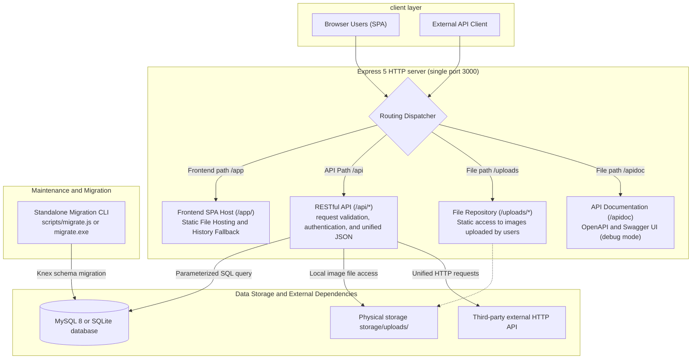

# 0. Architecture Overview

This project is a modern, reusable, full-stack foundation: the front-end uses **Vue 3 (Vite)**, the back-end uses **Express 5**, the database can use **MySQL 8 or SQLite**, and supports **Node.js (PM2)** and **Bun single binary execution file** dual-track execution types.

This article serves as the global architecture map of the project, integrating the front-end and back-end collaboration processes, routing partition design, directory layout and a full set of document guidelines.

---

## 1. Core design philosophy

1. **Same-port front-end and back-end integration**:
   The front-end Vue 3 SPA, back-end RESTful API, static uploaded image files, and Swagger files are all monitored by Express on the same HTTP communication port (default 3000), eliminating cross-origin (CORS) complexity during local development and same-origin deployment.
2. **Free switching of dual-track operating modes**:
   - **Development period**: Using Node.js + PM2 with Vite Watch Build, you can enjoy independent hot loading and instant re-editing experience on the front and back ends.
   - **Production Delivery**: Supports compiling into an independent binary single executable file through `bun build --compile`. The target server can be used out of the box without installing Node.js, PM2 or dependent packages.
3. **Modular Module Design**:
   - **Hierarchical architecture and separation of responsibilities**: The backend does not adopt the traditional horizontal segmentation of mixing all Controllers and Services in the global directory, but is instead organized uniformly under `src/http/module/<domain>/` (such as `auth`, `health`, `post`). Each business area is an independent, highly cohesive Module, which is plug-and-play and can be easily expanded or replaced when new projects are copied.
   - **Internal responsibility boundaries within the module**:
     - **`route.js`**: Define HTTP Method and endpoints, orchestrate each `middleware` middleware pipeline, and then distribute requests to the Controller without writing business judgments.
     - **`request.js`**: Centrally define the request structure and verification rules to ensure that the data entering the Controller is legal and of the correct type.
     - **`controller.js`**: Focus on the HTTP protocol layer, deconstruct Request parameters and call Service, complete the response through `response.success()` or throw an error.
     - **`service.js`**: Pure business logic core, performs database operations, calls Helper tools, and is responsible for converting database `snake_case` to external `camelCase` (DTO Mapping). **Does not touch Express's `req` / `res` objects**, ensuring that business logic has 100% independent unit testing capabilities.
   - **Global environment setting isolation**: The environment settings are unified and centrally managed and fool-proofed by the project root directory `.env` and `src/config/` setting modules. Direct reading of `process.env` is strictly prohibited within the business layer and modules.

---

## 2. System operation architecture and request flow

### 2.1 System architecture diagram



### 2.2 Core routing partition planning

|URL prefix|Responsible for content|Description of behavioral characteristics|
| --- | --- | --- |
|`/` or `/app/`|Front-end Vue 3 SPA|The root path automatically 302 directs to `/app/`, supporting HTML5 History mode fallback (returning `index.html`).|
| `/api/*` |Backend JSON API|Provides RESTful API, returns JSON 404 for undefined paths, and does not fall back to the SPA page.|
| `/uploads/*` |User uploads files|Directly corresponds to the physical disk directory `storage/uploads/` to provide static reading of images.|
| `/apidoc` | Swagger UI |Only enabled in `APP_MODE=debug` or `test` mode, provides interactive API documentation.|

---

## 3. Technology Stack and Module Responsibilities

|field|Adopt technology|Main areas of responsibility|
| --- | --- | --- |
|**Front-end application**| Vue 3、Vite 7、Vue Router 4、TypeScript |User interface rendering, route navigation, form validation, same-origin API calls.|
|**Backend Core**| Node.js 22+、Express 5 |HTTP server, middleware pipeline, business logic, security and exception handling.|
|**Data Storage**|MySQL 8/SQLite, `mysql2/promise`/built-in SQLite module|Select the database according to `DB_CLIENT` to provide parameterized queries and transactions. MySQL uses connection pools.|
|**Structure Migration**|Knex 3. Customized static Registry|Database version control, data table structure creation, modification and safe rollback.|
|**Log Tracking**| Winston 3、Daily Rotate File |Global Request ID tracking, HTTP access logs, application level logs.|
|**Authentication Mechanism**| JWT (`jsonwebtoken`)、`bcryptjs` |Dual-track support: same-origin Cookie Session (including CSRF protection) and Bearer Token authentication.|
|**Single file compilation**| Bun 1.1+ Compile |Compile backend services and migration tools into independent executable binaries without Node environment.|

---

## 4. Project directory structure

```text
nodejs-base/
├─ frontend/                    # Frontend standalone project (with a standalone package.json)
│  ├─ dist/                     # Vite frontend build artifact (generated by pnpm build:frontend)
│  ├─ public/                   # Front-end static public resources (e.g., favicon.ico)
│  ├─ src/
│  │  ├─ api/                   # Backend API call modules (authApi, postApi)
│  │  ├─ composables/           # Vue Composition API (useAuth, etc.)
│  │  ├─ config/                # Front-end settings (API URL, page size, etc.)
│  │  ├─ helper/                # Front-end tool function (unified fetch encapsulation request.js)
│  │  ├─ router/                # Front-end routing definitions and navigation guards
│  │  ├─ styles/                # Front-end stylesheet (main.css, etc.)
│  │  ├─ views/                 # Page view components (article list, details, edit, login, etc.)
│  │  ├─ app.vue                # Vue root component (navigation bar and global layout)
│  │  └─ main.js                # Front-end entry point
│  ├─ index.html                # Front-end SPA page template
│  ├─ vite.config.js            # Vite build, base, and outDir settings
│  ├─ tsconfig.json             # Frontend TypeScript / Vue SFC Type Checking Configuration
│  └─ package.json              # Front-end dependency packages and build commands
├─ src/                         # Backend source code (Node.js/Express)
│  ├─ app.js                    # HTTP Service Startup Portal and Boot Security Check
│  ├─ config/                   # Environment variable centralized parsing and configuration module (app, auth, db, frontend, log, etc.)
│  ├─ db/                       # MySQL/SQLite dual-engine database interface and transaction abstraction
│  ├─ error/                    # Domain error categories (custom exceptions such as 400/401/403/404/409/422, etc.)
│  ├─ helper/                   # Utility functions (file paths, image processing, pagination, request context, third-party requests)
│  ├─ http/
│  │  ├─ app.js                 # Express Application core instantiation, middleware assembly, and error handling
│  │  ├─ asset/                 # Static and Embedded Asset Directory
│  │  │  └─ embeddedAssets.js   # Front-end embedded static asset dictionary module (generated by buildEmbedded.js)
│  │  ├─ common/                # HTTP Common Specifications and Accessibility Tools
│  │  │  ├─ request.js          # Shared Request Page and ID Verifier
│  │  │  └─ response.js         # Standardized JSON response wrapper
│  │  ├─ route/                 # Unified Routing Management Layer
│  │  │  ├─ index.js            # Routing hub gateway (aggregating APIs, front-end SPAs, and Swagger)
│  │  │  ├─ apiRoute.js         # API Main Routing (Aggregation of Business Domain Module Routing)
│  │  │  └─ frontendRoute.js    # Front-end SPA dual-mode hosting (physical directory and in-memory) with fallback to history mode
│  │  ├─ middleware/            # Global middleware (access logs, tracking, CORS, CSRF, authentication, errors)
│  │  └─ module/                # Business Domain Modules (auth, health, post)
│  ├─ logger/                   # Winston Logging Factory, Daily Rotation, and Instance Channels
│  ├─ migrate/                  # Knex custom Migration Runner, static registry, and migration scripts
│  └─ swagger/                  # OpenAPI 3.0 YAML Specification and Swagger UI Integration
├─ scripts/                     # Maintenance and build scripts (buildBun, buildEmbedded, checkSyntax, migrate, etc.)
├─ test/                        # Automated testing (unit testing, API contract testing, fixture mock resources)
├─ docs/                        # Project System Architecture and Development Deployment Documents (0 to 11)
├─ release/                     # Clean, single-file release delivery catalog (containing only app.exe and migrate.exe, with no external front-end clutter)
├─ storage/                     # Runtime dynamic data (log/, uploads/, SQLite database/)
├─ .agents/skills/              # Project Specifications and AI Agent Skill Descriptions
├─ .env.example                 # Environment Variable Configuration Template
├─ .env.test                    # Environment Configuration for Automated Testing
├─ ecosystem.config.js          # PM2 Process Manager Configuration File
├─ knexfile.js                  # Knex Migration Configuration File
└─ package.json                 # Project root directory dependency packages and management commands
```

---

## 5. Comparison of Runtime and Deployment Modes

The project supports multiple execution methods and adapts to various scenarios from local development to production environments:

|execution mode|Trigger command|Execution mechanism|Characteristics and applicable situations|
| --- | --- | --- | --- |
|**Integrated hot loading**| `pnpm dev` | Vite Watch Build + PM2 Watch |**Recommended for local development**, the front and back ends share the same communication port, hot loading experience.|
|**Foreground Bugfix**| `pnpm start:node` |The prospect of native Node.js comes straight out|Native Node.js executable, suitable for troubleshooting startup errors.|
|**Traditional resident**| `pnpm start` |PM2 background daemon|Traditional deployment in the production environment provides memory over limit protection and abnormal automatic restart (stop with `pnpm stop`).|
|**Bun single delivery**| `pnpm build:bun` | `bun build --compile` |**Node-free environment delivery**, produces a single binary executable file (`app.exe`) that requires no installation, extremely fast startup, and extremely low resource usage.|

---

## 6. Document Navigation and Recommended Reading Paths

It is recommended to read the following special documents in order to gain an in-depth understanding of the details of each module of the project:

|document|Core themes and descriptions|
| --- | --- |
|[1. Environment setting and startup](1-environment-setup-and-startup.md)|Fast startup, environment variable (`.env`) architecture, lifecycle checks and all pnpm commands.|
|[2. Same-origin architecture, CORS and CSRF mechanism](2-same-origin-cors-and-csrf.md)|The essence of same-origin architecture, CORS cross-origin configuration, cookie security and CSRF protection.|
|[3. Request processing, logs and errors](3-request-processing-logging-and-errors.md)|HTTP request life cycle, Request ID link tracking, unified response structure and custom error categories.|
|[4. Database and Migration](4-database-and-migration.md)|MySQL/SQLite database interface, transaction management, Knex custom static migration registration and structure rollback mechanism.|
|[5. Swagger and API Contract](5-swagger-and-api-contract.md)|OpenAPI 3.0 specification maintenance and interactive Swagger UI documentation.|
|[6. Login and authentication](6-login-and-authentication.md)|Dual-track authentication design (Cookie Session + CSRF and Bearer Token), permission protection and Token life cycle.|
|[7. Backend module and image storage](7-backend-modules-and-image-storage.md)|Business module layering practice (taking article CRUD as an example), paging processing and image Base64 storage.|
|[8. Test instructions](8-testing-guide.md)|Jest unit testing, API testing, front-end type checking and test execution guide.|
|[9. Front-end development](9-frontend-development.md)|Vue 3 SFC layering, route navigation guard, Vite construction mechanism and front-end `.env` restriction specification.|
|[10. Bun packaging and deployment](10-bun-packaging.md)|Bun binary compilation pipeline, release directory specification, Windows/Linux system resident service settings.|
|[11. Production deployment and reverse proxy](11-production-deployment-and-reverse-proxy.md)|Nginx reverse proxy configuration, HTTPS (SSL) certificate settings, forwarding headers and online troubleshooting.|

> **Development Specification Note**: All code changes and expansions must strictly follow the [AGENTS.md](../../AGENTS.md) specifications in the root directory.
