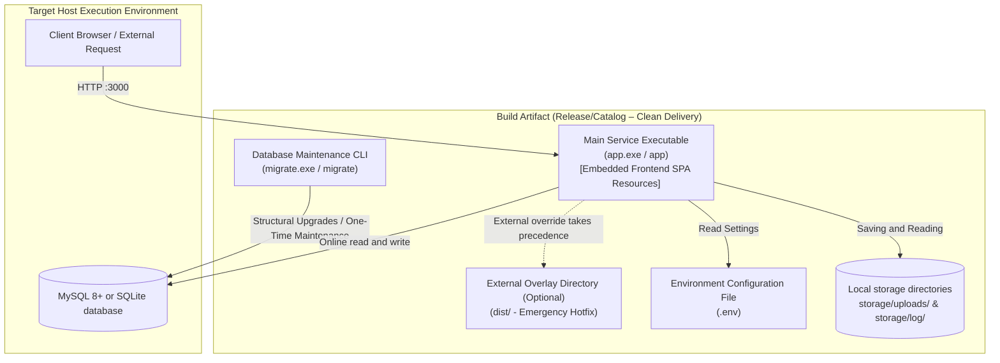
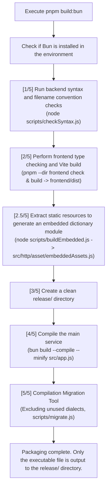

# 10. Bun packaging and deployment

This article explains how the project uses Bun to compile the back-end Express service and database migration tool into a standalone binary executable file (Standalone Executable) that requires no installation environment. It also details the release directory structure, Windows/Linux system resident service settings, version updates, and on-site troubleshooting SOPs.

---

## 1. Single-File Delivery Architecture and Two Executables

This project supports packaging the entire backend as a standalone executable. The target server **does not need Node.js or pnpm installed, or a large `node_modules` directory deployed**. The database can use MySQL or a local SQLite file with `DB_CLIENT=sqlite`.

### 1.1 Visualization of delivery architecture



### 1.2 Comparison table of entry points and binary products

The project integrates HTTP services, database maintenance tools and front-end static resources into independent execution files, supporting Windows and Linux deployment.

|original entry point|Windows products|Linux products|Execution responsibilities and life cycle|
| :--- | :--- | :--- | :--- |
| `src/app.js` | `app.exe` | `app` |**Resident HTTP server**: Responsible for RESTful API, front-end SPA hosting (supports external directory dist/ and gives priority to covering embedded front-end resources), image reading and request logs.|
| `scripts/migrate.js` | `migrate.exe` | `migrate` |**One-time maintenance CLI**: database upgrade (`up`), rollback (`rollback`), unlock (`unlock`) and reset (`fresh`).|
| `frontend/dist/` |Embed into executable file|Embed into executable file|**Front-end static products**: Embed Vite-built products at compile time through `scripts/buildEmbedded.js`, without the need to deploy additional front-end directories.|

### 1.3 Core architectural advantages: pure single-file delivery and dual-mode fault tolerance

1. **Ultimate single-file delivery (All-in-One)**: The front-end SPA resources are completely compiled into `app.exe` during the packaging period. The `release/` directory is pure and free of debris. The target server only needs a single executable file and `.env` to be used out of the box.
2. **Separation of duties**: The main service focuses on long-term high-concurrency HTTP requests, and database migration is an offline maintenance tool to avoid contention locks when multiple nodes are started.
3. **Dual-mode fault-tolerant flexibility (Hybrid Fallback)**: By default, the executable file provides SPA services directly from the memory. If there is an emergency need for on-site maintenance, just place the `dist/` directory next to the executable file, and the system will automatically load the external entity file first. **Keep the executable file without re-editing to hot-update the front-end maintenance flexibility**.

---

## 2. Build Environment and Automated Packaging Pipeline

### 2.1 Establish pre-requisites

The following environment is required to build a host:
* **Node.js**: 22.5.0 or above
* **Package Manager**: pnpm 10+
* **Bun Runtime**: executable Bun (please go to [bun.sh](https://bun.sh) to install)
* The front-end and back-end dependent packages have been fully installed (`pnpm install` and `pnpm --dir frontend install` have been executed in the project root directory).

### 2.2 Packaging pipeline flow chart (`scripts/buildBun.js`)

Through the packaged build script, syntax checking, front-end compilation, embedded module generation and dual-binary file packaging can be completed with one click:



### 2.3 Build instruction set and parameter specifications

All packaging instructions are executed in the project root directory:

|Execute instructions|target platform|Low-level compilation of Target tags|Product description|
| :--- | :---: | :--- | :--- |
| `pnpm build:bun` |automatic detection|Current platform|Automatically compile corresponding platform products according to the current operating system.|
| `pnpm build:bun:windows` | Windows x64 | `bun-windows-x64-modern` |Produces `release/app.exe` and `release/migrate.exe`, and tries to apply `frontend/public/favicon.ico`.|
| `pnpm build:bun:linux` | Linux x64 | `bun-linux-x64-modern` |Outputs `release/app` and `release/migrate`.|

#### Advanced CLI parameter call

```powershell
# 1. Specify the target platform
node scripts/buildBun.js --target=windows
node scripts/buildBun.js --target=linux

# 2. Skip frontend compilation (only quickly recompile the backend binary executable)
node scripts/buildBun.js --target=windows --skip-frontend
```

> [!TIP]
> `--skip-frontend` is suitable for situations where "the frontend build has been completed manually and only the back-end logic has been modified", which can shorten the packaging time.

Windows executable file icon setting: If `frontend/public/favicon.ico` exists and conforms to the uncompressed DIB/BMP format during construction, the icon will be automatically set for `app.exe` and `migrate.exe` through `--windows-icon`; if the file does not exist or uses an unsupported PNG compression format, a prompt will be displayed and the Bun default icon will be used instead to ensure that the build process is not interrupted.

Note: `--windows-icon` must be compiled in a Windows environment to be used.

### 2.4 Knex multi-dialect External exclusion optimization

Knex supports multiple database drivers (PostgreSQL, SQLite, Oracle, etc.) by default, but this project only uses MySQL and SQLite. In order to prevent Bun from trying to package uninstalled driver packages during compilation, the unnecessary database dialect is marked as `--external` in [`scripts/buildBun.js`](../../scripts/buildBun.js) to reduce unnecessary dependency packaging and compilation errors and ensure that the database migration tool can be successfully packaged as an independent executable file
```javascript
const knexUnusedDialects = [
    "pg", "sqlite3", "tedious", "oracledb",
    "mariadb", "mysql", "pgnative", "better-sqlite3"
];
```
Compilation principles:
* **MySQL**: Keep the `mysql2` driver to ensure that the database connection function is normal.
* **SQLite**: Use `node:sqlite` or `bun:sqlite` native driver, no additional packages are required.
* **Other dialects**: Use `--external` to exclude unused drivers to avoid missing module errors during compilation.

[!IMPORTANT]
> `--external` only excludes the compiler from packaging the specified module, and does not mean removing Knex-related code; if the excluded driver is actually loaded during execution, a missing module error may still occur.

### 2.5 OpenAPI and Swagger YAML static embedding (Embedding)

The project uses `require("./openapi.yaml")` to load the OpenAPI 3.0 specification document through `src/swagger/swagger.js`, and Bun embeds the YAML content into an independent execution file during compilation, ensuring that the API document can still be provided normally in Bun's single-file execution mode.

Operational features:
* **Static Embedding**: The OpenAPI specification is packaged with the executable file, and no additional deployment of `openapi.yaml` is required.
* **Environment Control**: Enable Swagger UI only when `APP_MODE=debug` or `APP_MODE=test`.
* **Single file deployment**: Swagger UI can directly use embedded API specifications to reduce dependence on external files.
  

### 2.6 Front-end SPA static assets embedded (Embedded Assets)

Automatically scan `frontend/dist/` through [scripts/buildEmbedded.js](../../scripts/buildEmbedded.js), convert static resources such as HTML, JavaScript, CSS, SVG and images, together with MIME Type and ETag information, into the [src/http/asset/embeddedAssets.js](../../src/http/asset/embeddedAssets.js) dictionary module, and embed it into app.exe during compilation.

Operational features:
* **Zero external resource dependence**: Front-end resources are directly encapsulated in the execution file, and there is no need to provide an additional `dist/` directory during deployment.
* **External resources are loaded first**: If `dist/` exists in the same layer of the executable file, external front-end resources will be used first when the service is started to support emergency updates.
* **Dual-mode fault tolerance**: When external `dist/` is not provided, embedded resources are used to ensure normal operation of SPA.
  
Design purpose: To achieve single-stage deployment of front-end and back-end, while retaining the flexibility of independent front-end updates and reducing deployment and maintenance costs.

---

## 3. Publish directory structure and permission specifications

### 3.1 Standard release directory tree (`release/`)

After the build is completed, the `release/` directory remains extremely pure and contains only compiled executable files. `.env` needs to be created manually during deployment. The application will create the corresponding `storage/` subdirectory when writing logs or images for the first time. If the following NSSM standard output settings are used, `storage/log/` must be created before starting the service:

```text
release/
├─ app.exe (or app)              # Main Service Binary Executable (with embedded frontend SPA and API)
├─ migrate.exe (or migrate)      # Database Migration Maintenance CLI
├─ .env                          # Created manually during deployment; cannot be checked in
├─ dist/                         # [Optional] To be placed during on-site maintenance and emergency hotfixes, with priority given to overriding the embedded version.
└─ storage/                      # Not created during setup; created as needed during deployment or execution.
   ├─ log/                       # The application can be created automatically, but the NSSM output needs to be created beforehand.
   ├─ uploads/                   # Created when the image is first saved
   └─ database/database.sqlite   # SQLite schema created on first connection
```

### 3.2 File and directory access permission requirements

* **Execution permissions (Linux)**: After deploying the Linux environment, you must ensure that the binary file has executable permissions:
  ```bash
  chmod +x /var/www/app/app /var/www/app/migrate
  ```
* **Write permission**: The system user executing the service (such as `www-data` on Linux) must be able to create `storage/` in the deployment root directory, create `log/`, `uploads/` and write files in it. SQLite mode also requires the ability to create and write database files and their WAL files. If `storage/` already exists during deployment, you must also ensure that the user has corresponding permissions for it.

### 3.3 Execution working directory (CWD) and `.env` loading principle

The Bun independent executable file will load the .env environment settings based on the working directory (CWD) at startup, rather than automatically based on the directory where the executable file is located. Regardless of manual execution or setting of system resident services, the working directory should be set to the directory where the executable file is located. **Be sure to switch to the directory where the executable file is located before starting** to ensure that the .env is loaded correctly to avoid loss of environment settings or abnormal service startup.

---

## 4. Standard process for first deployment in production environment

### 4.1 Deployment pre-configuration

1. Copy the build product (`release/` directory) to the production host (such as `C:\app\service` for Windows or `/var/www/app` for Linux) via SCP, FTP or CI/CD.
2. If using MySQL, pre-create a dedicated database (such as `nodejs_base`, encoding recommendation `utf8mb4`) on the target server; this step is not required for SQLite mode.
3. Create and edit the `.env` file (at least complete the following core variable configuration):

```dotenv
APP_MODE=production
APP_HOST=127.0.0.1
APP_PORT=3000
APP_TRUST_PROXY=loopback

DB_CLIENT=mysql
MYSQL_HOST=127.0.0.1
MYSQL_PORT=3306
MYSQL_USER=your_db_user
MYSQL_PASSWORD=your_secure_password
MYSQL_DATABASE=nodejs_base

JWT_SECRET=please_generate_a_random_secret_at_least_32_characters_long
COOKIE_SECURE=true
```

If you use SQLite instead, change the MySQL settings in the above example to `DB_CLIENT=sqlite` and `SQLITE_FILE=storage/database/database.sqlite`. First execute `migrate` to create the data table, and then start the main service; the database file must be retained during deployment and backup.

> [!WARNING]
> In the production environment, please be sure to replace `JWT_SECRET` with a random high-strength key of at least 32 characters, and set `COOKIE_SECURE` to `true` (requires an HTTPS reverse proxy, see [Part 11](11-production-deployment-and-reverse-proxy.md) for details).

### 4.2 Windows first deployment and prospect verification

When deploying for the first time, open PowerShell as an administrator and perform database migration and service startup verification in sequence:

```powershell
# 1. Switch to the release directory
Set-Location C:\app\service

# 2. Perform database migration (apply all structures upwards)
.\migrate.exe up

# 3. Start the main service in the foreground for verification
.\app.exe
```

Confirm that the terminal displays **Server startup completed** and there are no abnormal error logs, and actually test whether the service responds normally. After the verification is completed, press Ctrl + C to stop the foreground service and you can set up Windows system services.

### 4.3 Linux first deployment and prospect verification

When deploying for the first time, set execution permissions through the terminal, complete the database migration and start the service for verification:

```bash
# 1. Switch to the release directory
cd /var/www/app

# 2. Granting executable permissions
chmod +x app migrate

# 3. Perform database migration
./migrate up

# 4. Test startup in the foreground
./app
```

Confirm that the service starts normally, there are no abnormal error logs, and actually test whether the API responds normally. After the verification is completed, press Ctrl + C to stop the foreground service, and then you can set the Linux system service.

---

## 5. System resident service configuration (Daemon Service)

In order to ensure that the server starts automatically when it is restarted and restarts automatically when it crashes abnormally, `app` should be registered as a system service.

### 5.1 Windows Servitization: Using NSSM (Recommended)

It is recommended to use [NSSM (Non-Sucking Service Manager)](https://nssm.cc/) for Windows environment:

```powershell
# 1. Installation Service
nssm install NodejsBaseApp "C:\app\service\app.exe"

# 2. Set the working directory (Key point: Ensure that the .env file is loaded correctly)
nssm set NodejsBaseApp AppDirectory "C:\app\service"

# 3. Configure automatic startup at boot and automatic restart after a crash
nssm set NodejsBaseApp Start SERVICE_AUTO_START
nssm set NodejsBaseApp AppExit Default Restart
nssm set NodejsBaseApp AppRestartDelay 5000

# 4. Pre-create a directory for NSSM's standard output and configure the output and error logs.
New-Item -ItemType Directory -Force "C:\app\service\storage\log" | Out-Null
nssm set NodejsBaseApp AppStdout "C:\app\service\storage\log\serviceOut.log"
nssm set NodejsBaseApp AppStderr "C:\app\service\storage\log\serviceError.log"

# 5. Activate the service
nssm start NodejsBaseApp
```

You can open `services.msc` to check the service status, and subsequent start and stop can also be controlled through `nssm start NodejsBaseApp` and `nssm stop NodejsBaseApp`.

### 5.2 Linux servitization: using Systemd

Create `/etc/systemd/system/nodejs-base.service`:

```ini
[Unit]
Description=Node.js Base Bun Standalone Service
After=network.target

[Service]
Type=simple
User=www-data
Group=www-data
WorkingDirectory=/var/www/app
ExecStart=/var/www/app/app
Restart=always
RestartSec=5
Environment=NODE_ENV=production

# Resource Limitation Protection (adjusted based on hardware)
LimitNOFILE=65535

[Install]
WantedBy=multi-user.target
```

Enable and start instructions:

```bash
# Reload profile
sudo systemctl daemon-reload

# Enable Auto-Start at System Startup
sudo systemctl enable nodejs-base

# Activate Job
sudo systemctl start nodejs-base

# Check operating status
sudo systemctl status nodejs-base

# View Service Output Log
sudo journalctl -u nodejs-base -f
```

---

## 6. Version update

### 6.1 Standard update steps

Before version update, data should be backed up, and service stop, file update, database migration and startup verification should be completed in order to ensure that the update process is safe and traceable.

1. Back up data and executable files

   ```bash
   # Back up MySQL database
   mysqldump -u root -p nodejs_base > backup_$(date +%Y%m%d_%H%M%S).sql

   # Back up existing executable files
   cp app app.bak
   ```

   It is also necessary to back up `storage/uploads/` and related environment settings to avoid losing uploaded files and service settings during updates.

2. Stop the service and update the executable file

   Linux：

   ```bash
   sudo systemctl stop nodejs-base
   cp /path/to/new/app /var/www/app/app
   cp /path/to/new/migrate /var/www/app/migrate
   chmod +x /var/www/app/app /var/www/app/migrate
   ```

   Windows（PowerShell）：

   ```powershell
   nssm stop NodejsBaseApp
   Copy-Item C:\temp\app.exe C:\app\service\app.exe -Force
   Copy-Item C:\temp\migrate.exe C:\app\service\migrate.exe -Force
   ```

3. Perform database migration and start the service

   If the version contains changes to the database structure, the new version of the Migration tool should be used to perform migration.

   Linux：

   ```bash
   cd /var/www/app
   ./migrate up
   sudo systemctl start nodejs-base
   ```

   Windows：

   ```powershell
   Set-Location C:\app\service
   .\migrate.exe up
   nssm start NodejsBaseApp
   ```

4. Front-end independent update (optional)

   If you only need to update the front-end, you can deploy the new version of `frontend/dist/` to `dist/` at the same level as the executable file, and restart the service. External front-end resources will be loaded first without recompiling the back-end.

5. Verify after update

   - API health check: Confirm `http://127.0.0.1:3000/api/health` returns HTTP 200.
   - Front-end function check: Open `/app/` and confirm that the page and main functions are functioning normally.
   - Log check: Confirm that there are no abnormal errors in service startup and database operations.

Note: Database migration may contain irreversible structural changes. The backup integrity and version compatibility should be confirmed before updating. If the update fails, it must be rolled back based on the Migration compatibility evaluation. It cannot just replace the old version of the executable file.

---

## 7. Common problems and troubleshooting (Troubleshooting)

|abnormal phenomenon|Possible reasons|Troubleshooting directions and solutions|
| :--- | :--- | :--- |
|**Browser displays 404, front-end page not found**|1. The executable file does not have a front-end embedded and has no external directory. <br>2. Error in starting working directory.|1. Confirm whether the frontend build and embedded script (`node scripts/buildEmbedded.js`) have been executed before packaging. <br>2. If using an external overlay directory, confirm whether `dist/index.html` exists in the same layer as the executable file. <br>3. Check whether the working directory of Systemd or NSSM is set to the directory where the executable file is located.|
|**Crash immediately upon startup, prompting `JWT_SECRET 必須至少 32 字元`**|1. `.env` is not loaded. <br>2. The key length is insufficient.|1. Confirm that `.env` is located in the startup working directory. <br>2. Check whether `JWT_SECRET` in `.env` is longer than 32 characters.|
|**MySQL connection timed out or access denied**|1. The account password is wrong. <br>2. The database has not been created first. <br>3. Firewall blocking.|1. Manually test `mysql -h ... -u ... -p` using the same password. <br>2. Confirm that the library name specified by `MYSQL_DATABASE` has been manually created.|
|**An EACCES error is thrown when uploading images or writing logs**|Insufficient file permissions.|Confirm that the service execution user (such as `www-data`) has write permissions for `storage/log/` and `storage/uploads/`.|
|**Linux execution prompt `No such file or directory` or format error**|1. No execution permission is granted. <br>2. The platform architecture does not match.|1. Execute `chmod +x app`. <br>2. Confirm whether the compilation target is Linux x64 (`pnpm build:bun:linux`).|
|**Execute `./migrate up` prompt Migration Locked**|The previous migration was abnormally interrupted.|Execute `./migrate unlock` to force the lock to be released (see [Part 4](4-database-and-migration.md#3-migration-lock-stuck-and-troubleshooting-sop) for details).|
