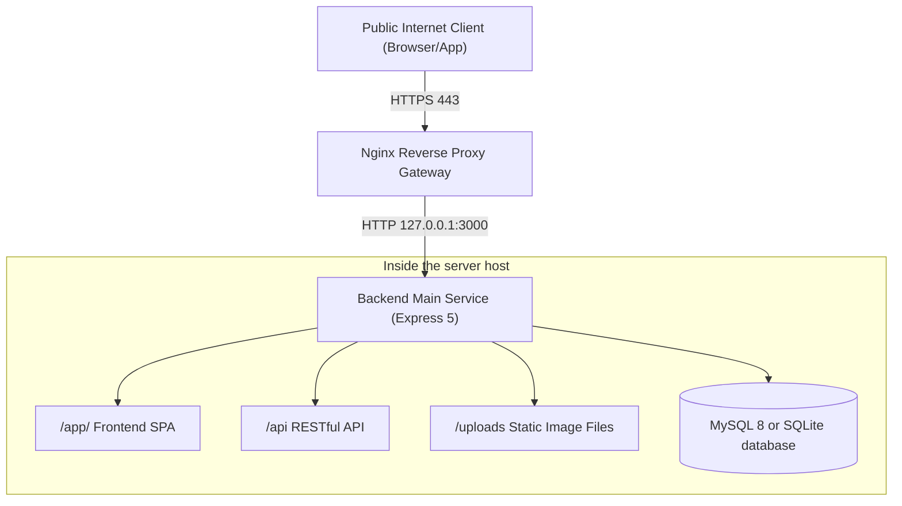

# 11. Production Deployment and Reverse Proxy

This article explains the project's complete deployment architecture on the official server (Production), Nginx reverse proxy configuration, HTTPS (SSL/TLS) termination, Let's Encrypt certificate acquisition, and advanced front-end static hosting solutions.

---

## 1. Overview of production environment deployment architecture

In production, **never expose the Node.js / Bun service's port 3000 directly to the Internet**. The standard architecture uses a reverse proxy server such as Nginx as the public gateway. It receives HTTP (80) and HTTPS (443) traffic and forwards it internally to the local backend service.

### 1.1 Reverse proxy collaboration architecture



Nginx is responsible for SSL/TLS certificate termination, redirecting HTTP 80 to HTTPS 443, and blocking oversized packets and malicious traffic.

### 1.2 Backend dual execution type selection

This project supports two production environment execution modes, both of which can be perfectly connected to Nginx reverse proxy:

|Deployment mode|Execution mechanism|Maintenance tools|Feature description|
| --- | --- | --- | --- |
|**Node.js Traditional Deployment**| `node src/app.js` | PM2 (`ecosystem.config.js`) |Requires Node.js 22+ and PM2 to be installed, supports memory over limit protection and daemon management.|
|**Bun single-binary deployment**|`./app.exe` (or `./app`)|Systemd / NSSM system services|**No Node.js environment is required**. The output is packaged separately in the `release/` directory and starts quickly (see [Part 10](10-bun-packaging.md) for details).|

---

## 2. Nginx core reverse proxy configuration template

The following is the most recommended standard Nginx configuration file template (usually placed in `/etc/nginx/sites-available/app.example.com`):

```nginx
# 1. Port 80 automatically forces redirection to HTTPS
server {
    listen 80;
    listen [::]:80;
    server_name app.example.com;

    # Force all HTTP requests to be redirected to HTTPS
    return 301 https://$host$request_uri;
}

# 2. Port 443 SSL/TLS production entry point
server {
    listen 443 ssl http2;
    listen [::]:443 ssl http2;
    server_name app.example.com;

    # SSL certificate path (using Let's Encrypt as an example)
    ssl_certificate /etc/letsencrypt/live/app.example.com/fullchain.pem;
    ssl_certificate_key /etc/letsencrypt/live/app.example.com/privkey.pem;

    # Recommended modern TLS security parameters
    ssl_protocols TLSv1.2 TLSv1.3;
    ssl_ciphers HIGH:!aNULL:!MD5;
    ssl_prefer_server_ciphers on;
    ssl_session_cache shared:SSL:10m;
    ssl_session_timeout 10m;

    # Proxy Layer Request Body Limit (must match the backend UPLOAD_JSON_LIMIT)
    client_max_body_size 10m;

    # All paths (/app/, /api, /uploads) are uniformly forwarded to the local Express server.
    location / {
        proxy_pass http://127.0.0.1:3000;
        proxy_http_version 1.1;

        # Key forwarding headers (preserve the actual Host, client IP, and protocol)
        proxy_set_header Host $http_host;
        proxy_set_header X-Real-IP $remote_addr;
        proxy_set_header X-Forwarded-For $proxy_add_x_forwarded_for;
        proxy_set_header X-Forwarded-Proto $scheme;

        # WebSocket connection upgrade support
        proxy_set_header Upgrade $http_upgrade;
        proxy_set_header Connection "upgrade";

        # Proxy timeout settings (for long backend requests or slow networks)
        proxy_connect_timeout 60s;
        proxy_send_timeout 60s;
        proxy_read_timeout 60s;
    }
}
```

### Critical forwarding header parsing (extremely important)

1. **`proxy_set_header Host $http_host;`**：
   - The original domain name and port number accessed by the client browser must be retained.
   - The backend's `csrfMiddleware` relies on this header to compare Origin/Referer. If this header is omitted, users who log in using cookies will be rejected with **403 Forbidden** when making POST write requests.
2. **`proxy_set_header X-Forwarded-Proto $scheme;`**：
   - Notify the backend that the external connection protocol is `https`, and the backend uses this to determine the connection security level and ensure that the Cookie Secure flag takes effect normally.
3. **`proxy_set_header X-Forwarded-For $proxy_add_x_forwarded_for;`**：
   - Attach the real client IP to the header layer by layer, and cooperate with the backend `requestContextMiddleware` to resolve the real visitor address.
4. **`client_max_body_size 10m;`**：
   - Nginx's default body limit is only 1MB. If the user uploads a larger image, Nginx will directly respond with `413 Request Entity Too Large` on the first line. This value must be greater than or equal to the backend's `UPLOAD_JSON_LIMIT` (default 10MB).

---

## 3. Backend supporting environment variable setting (`.env`)

In the official Nginx environment, the `.env` setting of the backend should be configured as follows:

```dotenv
APP_MODE=production
APP_HOST=127.0.0.1
APP_PORT=3000
APP_TRUST_PROXY=loopback
COOKIE_SECURE=true
```

|Setting items|set value|Purpose and safety analysis|
| --- | --- | --- |
| `APP_HOST` | `127.0.0.1` |**Security Isolation** restricts the backend to only listen to the local loopback interface, preventing external parties from directly bypassing the Nginx firewall through Port 3000.|
| `APP_PORT` | `3000` |Internal communication port, corresponding to Nginx's `proxy_pass`.|
| `APP_TRUST_PROXY` | `loopback` |**Proxy Trust**, instructs Express to trust the `X-Forwarded-*` header forwarded from the local Nginx to correctly obtain the guest IP.|
| `COOKIE_SECURE` | `true` |**Mandatory HTTPS Cookie** ensures that the user's login session cookie can only be transmitted through HTTPS to prevent eavesdropping.|

---

## 4. Free SSL/TLS certificate acquisition and automatic renewal (Certbot)

On Ubuntu / Debian Linux servers, it is recommended to use Let's Encrypt and Certbot to automatically obtain and set up free SSL certificates:

```bash
# 1. Install Certbot and the Nginx plugin
sudo apt update
sudo apt install -y certbot python3-certbot-nginx

# 2. Automatically obtain certificates and configure Nginx (the domain's DNS A record must first be pointed to the server's IP address)
sudo certbot --nginx -d app.example.com

# 3. Test certificate auto-renewal schedule
sudo certbot renew --dry-run
```

Certbot will automatically set up daily automatic renewal checks in `/etc/cron.d/` or systemd timer. It will automatically update and gracefully reload Nginx before the certificate is about to expire. No manual maintenance is required at all.

---

## 5. Advanced deployment architecture: front-end static files are directly hosted by Nginx

If faced with ultra-high traffic access scenarios, you can choose to let Nginx read the front-end SPA static products directly from the disk, and only forward API and image requests to the back-end:

```nginx
server {
    listen 443 ssl http2;
    server_name app.example.com;

    # ... SSL Certificate Configuration ...

    # 1. The frontend root directory is directed to /app/
    location = / {
        return 302 /app/;
    }

    # 2. The front-end SPA static resources are directly hosted by Nginx.
    location /app/ {
        alias /var/www/app/frontend/dist/;
        # SPA History Mode Fallback (returns index.html if the physical file is not found)
        try_files $uri $uri/ /app/index.html;

        # Static Resource Caching Optimization
        location ~* \.(?:css|js|jpg|jpeg|gif|png|ico|svg|woff2)$ {
            expires 1y;
            add_header Cache-Control "public, immutable";
        }
    }

    # 3. API requests are forwarded to the backend Express
    location /api/ {
        proxy_pass http://127.0.0.1:3000;
        proxy_http_version 1.1;
        proxy_set_header Host $http_host;
        proxy_set_header X-Forwarded-For $proxy_add_x_forwarded_for;
        proxy_set_header X-Forwarded-Proto $scheme;
    }

    # 4. The image file uploaded by the user is forwarded to the backend.
    location /uploads/ {
        proxy_pass http://127.0.0.1:3000;
        proxy_set_header Host $http_host;
    }
}
```

> [!NOTE]
> **Bun single file delivery and front-end entity directory note**:
> - When deploying the Bun binary single file (`app` / `app.exe`) of [Part 10](10-bun-packaging.md), the front-end resources are fully embedded in the executable memory by default, and the released product (`release/`) **will not contain the `dist/` or `frontend/dist/` entity directory by default**.
> - If Nginx serves frontend files directly, you **must also copy the `frontend/dist/` directory to the corresponding server path** during deployment so Nginx can read the files.

---

## 6. Online acceptance checklist and troubleshooting SOP

After completing Nginx and backend configuration, please perform the following acceptance checks in sequence:

|Check items|Test actions and verification methods|expected correct result|
| --- | --- | --- |
|**80 forward 443 forward**|Browser access `http://app.example.com`|Automatic 301 redirect to `https://app.example.com/app/`.|
|**SPA static page**|Turn on `https://app.example.com/app/`|The Vue 3 page loads normally, with no broken images or missing styles.|
|**SPA Deep Refresh**|Access `https://app.example.com/app/posts/create` in the browser address bar and force a refresh|Stay on this page normally, no 404 error.|
|**API connection test**|Access `https://app.example.com/api/health`|Respond to HTTP 200 and return a JSON object with status: "ok".|
|**Login Session Cookie**|Perform the login operation and check the browser Application ➔ Cookies|Received a cookie named `token` and tagged `HttpOnly` and `Secure`.|
|**CSRF Write Protection**|Publish or modify articles while logged in|The request was successful with no 403 Forbidden error.|
|**Real IP record verification**|Make any API request and check the backend log `storage/log/access-*.log`|The recorded `clientIp` is the real external network visitor IP, not `127.0.0.1`.|
|**Large file upload protection**|Upload images close to 2MB|The normal upload was successful and was not intercepted by Nginx 413.|

