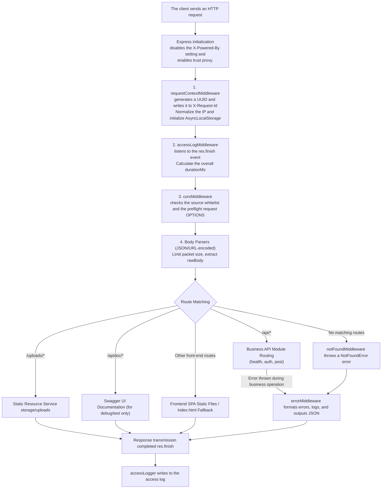
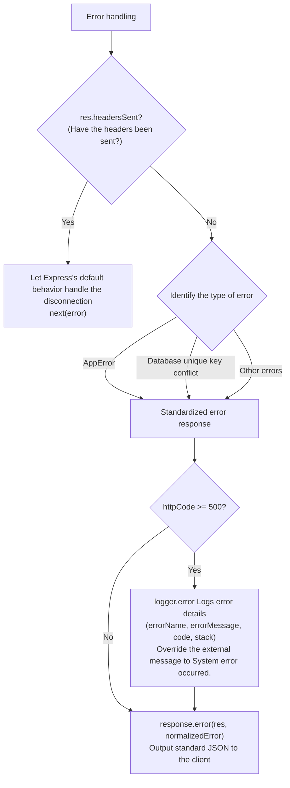

# 3. Request processing, logs and errors

This document details the HTTP request life cycle of this project, full-link log tracking based on `AsyncLocalStorage`, unified JSON response protocol, domain error category system, and online troubleshooting guide.

---

## 1. Overall design concept

This project follows the following core architectural principles when processing HTTP requests:

1. **Single Responsibility and Determined Order**: The Express Middleware Pipeline handles environment headers, request tracking, client IP, access timing, cross-origin requests (CORS), packet parsing, route distribution, and error catching in order.
2. **Non-intrusive full-link tracing**: Using the Node.js native `AsyncLocalStorage`, the log system can automatically obtain the currently requested `requestId`, `clientIp` and authenticated `userId` in a non-synchronized non-blocking thread, without passing context objects layer by layer in business functions.
3. **Separation of protocol layer and data layer**: The real HTTP status code is expressed by the HTTP protocol header, and the response body (Response Body) uniformly maintains the minimalist and highly readable structure of `{ message, data }` without repeatedly inserting `httpCode`, native code or internal error stacking.
4. **Strong typing of domain errors**: All expected business errors are inherited from [AppError](../../src/error/appError.js). Unexpected exceptions (such as database connection failures, underlying program code bugs) are safely intercepted and masked in the global middleware to avoid the leakage of sensitive system information.
5. **Log offloading and life cycle awareness**: Split system logs into application logs (App), access logs (Access) and database migration logs (Migrate), and adopt different file writing and event polling strategies for long-term resident processes and short-lived CLI tasks.

---

## 2. HTTP request processing pipeline and life cycle

The global middleware chain and Express instance are assembled by [src/http/app.js](../../src/http/app.js), the global route is centrally managed by [src/http/route/index.js](../../src/http/route/index.js), and the HTTP server listener is bound to [src/app.js](../../src/app.js).

### 1. Global middleware execution sequence



#### Detailed responsibilities at each stage

|order|Component/Interposer|File path|Responsibilities and Key Behaviors|
| :--- | :--- | :--- | :--- |
| **0** |Express basic configuration| [src/http/app.js](../../src/http/app.js) |Disable the X-Powered-By header to reduce fingerprinting risks, and configure the trust proxy to support reverse proxies.|
| **1** | [requestContextMiddleware](../../src/http/middleware/requestContextMiddleware.js) | `src/http/middleware/` |Use crypto.randomUUID() to generate a tracking ID and set the X-Request-Id, normalize the client IP, and enable asynchronous tracking through runRequestContext().|
| **2** | [accessLogMiddleware](../../src/http/middleware/accessLogMiddleware.js) | `src/http/middleware/` |Record the request start time, and use Access Logger to record the status code and processing time when the response is completed.|
| **3** | [corsMiddleware](../../src/http/middleware/corsMiddleware.js) | `src/http/middleware/` |Set cross-origin headers according to the CORS_ORIGINS whitelist and respond quickly with 204 to OPTIONS preflight requests.|
| **4** |Body Parsers|Express built-in|Parse JSON and URL-encoded data, set request size limit (default 10MB), and reserve req.rawBody for signature verification.|
| **5** |Module business routing| `src/http/module/*/route.js` |Business function processing (see module internal pipeline below for details).|
| **6** | [notFoundMiddleware](../../src/http/middleware/notFoundMiddleware.js) | `src/http/middleware/` |When no route is matched, a NotFoundError error is passed through next().|
| **7** | [errorMiddleware](../../src/http/middleware/errorMiddleware.js) | `src/http/middleware/` |Error interceptor, centralized processing of global errors, classification, normalization, logging and JSON response.|

---

### 2. Execution sequence of protected routing within the module

After entering the business module (such as the article module [src/http/module/post/route.js](../../src/http/module/post/route.js)), the protected endpoints should follow a strict hierarchical guarding sequence and never repeat basic verification in the Controller:

```javascript
// Example: Protected New Post Routing
router.post(
    "/posts",
    authMiddleware,       // 1. Validate the Cookie Session or Bearer Token, and write it to the Context using setUserId().
    csrfMiddleware,       // 2. CSRF Protection
    request.postBody,     // 3. express-validator field specification validation
    validateMiddleware,   // 4. Validation execution (throw ValidationError 422 on failure, inject req.validated on success)
    controller.create     // 5. Controller execution (retrieve value from req.validated and call Service)
);
```

---

## 3. Request Tracing

### 1. AsyncLocalStorage asynchronous context mechanism

In Node.js's asynchronous event loop (Event Loop), the server can handle multiple HTTP Requests at the same time. Since each request may go through multiple await, Promise or other asynchronous operations, the execution process will continue to be interleaved, so it is difficult to determine which HTTP Request the currently executing code belongs to simply relying on general variables.

In order to solve this problem, this project encapsulates the Node.js native `AsyncLocalStorage` in [src/helper/requestContext.js](../../src/helper/requestContext.js), so that each HTTP Request can have an independent asynchronous context (Request Context).


### 2. Context fields and life cycle

|Field name|type|File path|illustrate|
| :--- | :--- | :--- | :--- |
| `requestId` | `string` (UUID v4) | `requestContextMiddleware`  |Automatically generate a unique request identification code to track the request process and write the X-Request-Id response header synchronously.|
| `method` | `string` | `requestContextMiddleware`  |Log HTTP request methods (such as GET, POST) from req.method.|
| `url` | `string` | `requestContextMiddleware`  |To record the complete relative path and query parameters of the request, req.originalUrl is used first, followed by req.url.|
| `clientIp` | `string` | `requestContextMiddleware`  |Record the client IP, preferably taken from req.ip, and process IPv4-mapped IPv6 and local loopback addresses uniformly.|
| `userId` | `number` |After `authMiddleware` successfully verified Token|Record the identification code of the authenticated user, obtained from req.user.id and written into the request context; not set when not authenticated.|

`requestContextMiddleware` is the first middleware registered before global routing, and a context containing the first four fields will be created at once. `userId` will only be added after the request enters a route that applies `authMiddleware` and the Token verification is successful.

> [!IMPORTANT]
> **Security and Non-HTTP Task Protection**:
> - The `X-Request-Id` header supplied by an external client **is not** used directly as the server tracking ID. The backend always issues a new, secure random UUID to prevent forgery or correlation conflicts.
> - When background tasks (such as CLI scheduling, migration or unit testing) call `getRequestContext()`, `null` will be returned. Therefore, the logging tool and the public module have implemented security protection and can still record safely when the context is empty.

---

## 4. Standard JSON API Response Format

This project uniformly defines the JSON structure for external output in [src/http/common/response.js](../../src/http/common/response.js).

### 1. Core Response Agreement

Regardless of whether the operation succeeds or fails, the JSON Body of the external response will always have only two top-level key values:

```json
{
  "message": "說明字串",
  "data": {}
}
```

- **The real HTTP status code is transmitted at the HTTP protocol layer** (such as `res.status(200)`, `res.status(404)`). Redundant packaging of `httpCode`, `code`, `status` or `stack` is strictly prohibited within the Body.
- `data` is always an object or array. If no specific data is returned, it defaults to an empty object `{}`.

### 2. Success Response

Output by `response.success(res, data, message, httpCode)`:

```javascript
// Query successful (HTTP 200 by default)
response.success(res, { list: items, total: 100 }, "查詢成功");

// Resource created successfully (HTTP 201)
response.success(res, { id: newRecord.id }, "新增文章成功", 201);
```

### 3. Field validation error response (HTTP 422)

When the form or JSON field entered by the user fails the check, [ValidationError](../../src/error/validationError.js) will be thrown and uniformly converted to HTTP 422 status code. Its `data.errors` format specification is as follows:

```json
{
  "message": "輸入資料有誤",
  "data": {
    "errors": [
      { "name": "title", "message": "標題為必填欄位" },
      { "name": "content", "message": "內容長度不可少於 10 個字元" }
    ]
  }
}
```

The front-end form can directly use the `name` field and the Input field on the screen to bind highlighting and error prompts.

---

## 5. Error Classes and Centralized Normalization

### 1. Error Hierarchy

The project defines a set of custom error categories with clear semantics in `src/error/`. All custom errors inherit from [AppError](../../src/error/appError.js):

```
Error (JavaScript 原生)
 └─ AppError (包含 httpCode, data, cause, stack 擷取)
     ├─ ValidationError     (HTTP 422: 輸入資料有誤)
     ├─ UnauthorizedError   (HTTP 401: 請先登入)
     ├─ ForbiddenError      (HTTP 403: 沒有操作權限)
     ├─ NotFoundError       (HTTP 404: 查無該資料 / 查無該路徑)
     └─ ConflictError       (HTTP 409: 資料已存在)
```

#### Standard error category comparison and usage examples

|Error category|HTTP code|Default message|Applicable scenarios and code examples|
| :--- | :---: | :--- | :--- |
| [ValidationError](../../src/error/validationError.js) | **422** |Incorrect data entered|The field is illegal and required:<br/>`throw new ValidationError([{ name: "email", message: "格式不正確" }]);`|
| [UnauthorizedError](../../src/error/unauthorizedError.js) | **401** |Please log in first|No credentials are provided, the Token has expired or has expired:<br/>`throw new UnauthorizedError("登入憑證無效");`|
| [ForbiddenError](../../src/error/forbiddenError.js) | **403** |No operation permission|The identity is correct but attempts to operate other people's resources without authorization, or the cross-site request source check fails (CSRF protection):<br/>`throw new ForbiddenError("無法編輯他人文章");`|
| [NotFoundError](../../src/error/notFoundError.js) | **404** |No information found|The data with the specified ID does not exist, or does not match the path:<br/>`throw new NotFoundError("article"), (output message: No article found)|
| [ConflictError](../../src/error/conflictError.js) | **409** |Data already exists|Unique value conflict, duplicate submission:<br/>`throw new ConflictError("此帳號已被註冊");`|
| [AppError](../../src/error/appError.js) | **400~599** |Custom message|Other general business errors:<br/>`throw new AppError("帳戶餘額不足", { httpCode: 400 });`|

---

### 2. errorMiddleware centralized normalization process

When an error occurs during program execution, whether the error comes from the Controller, Middleware or other business logic, as long as the error enters the Express error handling process, it will be uniformly received, classified and normalized by [src/http/middleware/errorMiddleware.js](../../src/http/middleware/errorMiddleware.js), and converted into a consistent JSON error response format.



#### Three keys to system protection

1. **Database key value duplicate conversion**: MySQL's `ER_DUP_ENTRY` and SQLite's unique constraint errors will be automatically translated into clean 409 conflict responses to avoid database structure or SQL native syntax leaks.
2. **5xx System Exception Mask**: For any HTTP status code `>= 500` error (including native exceptions, NullPointer, etc.), the global middleware will force the external `message` to be replaced by "System Error" and clear `data`. The real stacking information (`stack`) will only be recorded in the log file of the server itself.
3. **Third-party API call failure**: `RequestError` will be thrown when `src/helper/request.js` fails to call the external API. The Service that calls it should convert the error to `AppError` applicable to this system based on the failure reason and business situation, and then respond with `errorMiddleware`; do not directly pass the third-party response content to the front end. If `RequestError` enters `errorMiddleware` without processing, it will currently be regarded as an unknown error and HTTP 500 "System Error" will be returned to the front end.

---

## 6. Log system architecture and settings

The project log system uses Winston as the core. Logger is created by [src/logger/loggerFactory.js](../../src/logger/loggerFactory.js) and built with [dailyRotate.js](../../src/logger/dailyRotate.js) to implement log rotation and manage log settings in a unified manner through the configuration file [src/config/log.js](../../src/config/log.js).

### 1. Four exclusive log channels

The system is divided into independent log channels according to responsibility boundaries, and the logs are stored in `storage/log/` by default:

```
storage/log/
 ├─ app-YYYY-MM-DD.log        # 應用程式日誌 (業務邏輯、警告、系統錯誤)
 ├─ access-YYYY-MM-DD.log     # HTTP 存取日誌 (所有請求之耗時與回傳狀態碼紀錄)
 ├─ migrate-YYYY-MM-DD.log    # 資料庫遷移日誌 (Knex 結構升級/回滾紀錄)
 └─ pm2/
     └─ pm2.log               # 程序守護日誌 (PM2 程序啟動、崩潰與重啟輸出)
```

|Log channel|instance file|Control environment variables|Output levels and characteristics|
| :--- | :--- | :--- | :--- |
|**Application Log (App)**| [appLogger.js](../../src/logger/instance/appLogger.js) |`LOG_LEVEL` (default `info`)|Record business operation information. `debug` and `test` modes output the Console at the same time. `test` mode does not write physical files.|
|**HTTP Access Log (Access)**| [accessLogger.js](../../src/logger/instance/accessLogger.js) |`LOG_ENABLE_ACCESS_LOG` (default `true`)|Fixed `info` level, dedicated to `accessLogMiddleware`, does not output Console.|
|**Database Migration Log (Migrate)**| [migrateLogger.js](../../src/logger/instance/migrateLogger.js) |Enable permanently|Fixed `info` level, **writing files and Console** at the same time, specifically disabling file monitoring (see instructions below).|
|**PM2 Process Log**|Managed by PM2| `ecosystem.config.js` |Record server program level stdout / stderr, and do not apply Node's own daily rotation rules.|

### 2. Log format and Context automatic injection mechanism

Each line written to a file or terminal log has a standard structure:

```
[YYYY-MM-DD HH:mm:ss] LEVEL: 訊息本體 {"context與附加參數JSON"}
```

#### Real log example display

**HTTP access log (`access-*.log`)**:
```log
[2026-10-12 16:15:30] INFO: HTTP 請求完成 {"requestId":"3c1e2bf7-8f51-40c2-9e3f-67f7e9d9b01a","method":"POST","url":"/api/posts","clientIp":"192.168.1.100","userId":12,"httpCode":201,"durationMs":35}
```

**Application Error Log (`app-*.log`)**:
```log
[2026-10-12 16:16:05] ERROR: 未預期的系統錯誤 {"requestId":"a8d7910e-55c3-41bb-b892-02fae8486b1c","method":"GET","url":"/api/posts/999","clientIp":"127.0.0.1","errorName":"TypeError","errorMessage":"Cannot read properties of undefined","code":null,"stack":"TypeError: Cannot read properties of undefined\n    at PostService.getDetail (src/http/module/post/service.js:45:12)..."}
```

> [!NOTE]
> Through the `enrichContext` formatter of `loggerFactory.js`, the caller only needs to write `logger.info("訊息", { customKey: 123 })`, and the log formatter will automatically extract `requestId`, `method`, `url`, `clientIp` and `userId` from the current `AsyncLocalStorage` and assemble them into suffix JSON, eliminating the need to manually pass in context parameters everywhere.

### 3. Log rotation and retention days

- Setting item: `LOG_RETENTION_DAYS` in `.env`.
- Operating rules:
  - `LOG_RETENTION_DAYS=0`: Default value, keep historical log permanently.
  - `LOG_RETENTION_DAYS=14`: The underlying setting of the rotator is `maxFiles: "14d"`, which automatically generates new files every day and automatically deletes historical log files older than 14 days.

### 4. Special architectural considerations: Event Loop exit mechanism of Migration CLI

In short-lived CLI tasks (such as executing `pnpm migrate` or preparing a test database for unit tests), if a general file log rotation package is used, the underlying `fs.watch` (FSEVENTWRAP) will maintain an active file system monitoring Handle, causing the Node.js Event Loop to always be in an unfinished state, causing the terminal to freeze and be unable to exit after the command is executed.

Therefore, [src/logger/instance/migrateLogger.js](../../src/logger/instance/migrateLogger.js) explicitly sets `watchLog` to `false`:

```javascript
module.exports = createLogger({
    level: "info",
    filename: `${config.folder}/migrate-%DATE%.log`,
    retentionDays: config.retentionDays,
    consoleEnabled: true,
    requestContextEnabled: false,
    watchLog: false, // Key point: Disable persistent file monitoring to ensure that the process exits naturally after the CLI task is completed.
});
```

---

## 7. Online troubleshooting SOP and safety regulations

When the production environment or test environment reports an abnormality, please follow the following standard procedures to quickly troubleshoot and locate the problem:

### 1. Three parts of standard troubleshooting

1. **Get tracking headers**:
   - Please provide the notifying personnel with `X-Request-Id` in the Response Header (or check the browser Network tab).
2. **Query Access access history**:
   - Open the `storage/log/access-YYYY-MM-DD.log` of the day and search for the `requestId`.
   - Confirm the final returned `httpCode` and the overall processing time of `durationMs` (if it takes an abnormally long time, it is usually due to slow database query or external third-party API timeout).
3. **Query App business error stack**:
   - Open the day's `storage/log/app-YYYY-MM-DD.log` and search for the same `requestId`.
   - Check the `errorName`, `errorMessage` and complete code lines `stack` thrown by the system to get to the root of the problem.

---

### 2. Program crash and uncaught exception monitoring

In [src/app.js](../../src/app.js), the server process mounts global event monitoring to prevent the program from exiting silently due to uncaught asynchronous exceptions:

```javascript
// Catch unhandled exceptions during synchronization
process.on("uncaughtException", (error) => {
    logger.error("未捕捉的例外", { errorMessage: error.message, stack: error.stack });
    shutdown("uncaughtException");
});

// Catching Unhandled Promise Rejections
process.on("unhandledRejection", (error) => {
    logger.error("未處理的 Promise rejection", { errorMessage: error?.message, stack: error?.stack });
    shutdown("unhandledRejection");
});
```

If you find that the service has restarted, please check as soon as possible:
1. `storage/log/app-*.log` Is there a major error marked as "Uncaught Exception".
2. `storage/log/pm2/pm2.log` Check whether there are OOM (Out of Memory) or unexpected Signal interrupts at the operating system level.

---

### 3. Logging security and privacy practices

When adding new business code to call `logger.info()`, `logger.warn()` or `logger.error()`, the following security lines must be strictly observed:

1. **Recording of alert authentication information is prohibited**:
   - Logging of clear passwords, password hashes, JWT tokens, cookie completes, keys, or credit card numbers is strictly prohibited.
2. **Prevent URL Query from being leaked**:
   - Because `url` in Context records the full `req.originalUrl` (including the query string), **never pass a token or secret in the URL query**; use a header or request body instead.
3. **Manual desensitization of sensitive items**:
   - The Winston logger formatter **does not** magically identify the personal privacy fields in business objects. When custom metadata is passed in, the developer has the responsibility to actively exclude or mask it (such as changing the ID card font size to the first 3 and last 3 digits to mask).
