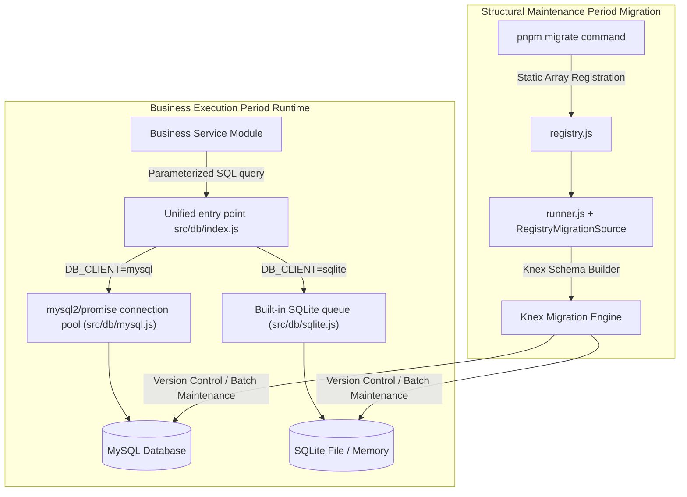
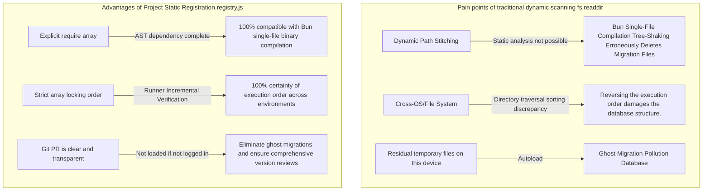

# 4. Database and Migration

This document fully describes the architectural design, configuration management, connection pool/concurrency control, transaction security rules of the project's dual database engines (MySQL and SQLite), as well as the static registration Knex Migration system for cross-platform and Bun binary packaging.

---

## 1. Dual-engine architecture and design philosophy

### 1. Native parameterized SQL and Knex Migration separatism (Dual Approach)

This project adopts a clear **Separation of Responsibilities Architecture** in database operations:



- **Daily database operations**: All Services are unified through the parameterized query interface provided by [`src/db/index.js`](../../src/db/index.js), and the corresponding database implementation is selected according to `DB_CLIENT`:
  - `mysql`: Use [`mysql2/promise`](../../src/db/mysql.js) connection pool to manage database connections.
  - `sqlite`: Use Node.js `node:sqlite` or Bun `bun:sqlite`e depending on the execution environment, and ensure the order of operations through the serialization queue.
- **Database structure version management**: Let `Knex.js` manage database migration full-time, use Knex Schema Builder to define the data table structure, and use `knex_migrations` record version and `knex_migrations_lock` to prevent parallel execution conflicts and ensure that structural changes can be tracked and rolled back.

---

### 2. MySQL and SQLite features and selection comparison

The project supports two database engines, MySQL and SQLite, which can be switched through the DB_CLIENT setting to adapt to different development and deployment needs:

|Assessment Dimensions|MySQL mode (`DB_CLIENT=mysql`)|SQLite mode (`DB_CLIENT=sqlite`)|
| :--- | :--- | :--- |
|**Applicable situations**|**Production environment, high concurrency and multi-service deployment**|**Native development, lightweight services and single-file deployment**|
|**Connection and Concurrency Model**|Use connection pool to support parallel reading and writing of multiple connections|A single connection with a serialization queue (Queue) ensures that there are no write conflicts in a single file|
|**Storage Format**|Dedicated database server|Local database file or memory `:memory:`|
|**Underlying driver**| `mysql2/promise` |  `node:sqlite` / `bun:sqlite` |
|**Trade Lock Mode**|InnoDB row-level locks and transaction isolation|WAL mode with BEGIN IMMEDIATE, allowing only one write transaction at a time|
|**DDL Trading Behavior**|Most DDL triggers implicit commit|SQLite 3.x supports most DDL transactions, but has limited syntax|
|**Dependencies and Packaging**|Requires additional deployment and maintenance of MySQL services|No independent database service required, can be deployed with Bun package|

---

### 3. General data sheet design specifications and conventions

To ensure consistency and scalability across database structures, all domain data tables follow the following design specifications:

|project|normative standards|Instructions and Knex definition examples|
| :--- | :--- | :--- |
|**Primary Key Convention**|`id` (self-increasing integer)|Use table.increments("id").primary() uniformly, and the database will automatically generate the primary key.|
|**Timestamp**| `created_at`、`updated_at` |The creation time is filled in by default in the database, and the update time is maintained by the application.|
|**Character sets and ordering**| `utf8mb4_unicode_ci`、`UTF-8` |MySQL uses `utf8mb4` (supports Emoji and multiple languages); SQLite uses `UTF-8` by default.|
|**Unique Constraint**| UNIQUE KEY |Use unique indexes to avoid duplicate data, and uniformly convert to HTTP 409 when constraints are violated.|
|**Foreign Keys and Associations**|Application layer logical association|Determine whether to establish database foreign keys and cascade deletion rules based on business needs.|
|**Default Value Principle**|Explicit default value|The string field defaults to the empty string `""`, and the numeric field defaults to `0`; if MySQL's `TEXT` field is set to the default value, use `DEFAULT ('')` (MySQL 8.0.13+ is required).|

---

### 4. Naming style conversion and smart asset protection

1. **Naming style conversion (snake_case ➔ camelCase)**:
   - **Database Layer**: Strictly follow **`snake_case`** (e.g. `user_id`, `created_at`, `cover_image`).
   - **Application and API Layer**: Strictly follow **`camelCase`** (e.g. `userId`, `createdAt`, `passwordHash`, `coverImage`).
   - **Layered boundary**: Each domain Service is responsible for conversion mapping (Mapping) to ensure that the internal database entity structure is decoupled from the external API contract, and the original field names of the database are not exposed on the front end.
2. **Smart Information Security Code**:
   - The password field only stores secure hashes (such as bcrypt hash), and absolutely no plain text. It must be actively removed at the Service layer when responding to external requests, and cannot appear in `data` in the query results.
3. **Storage Principles for Large Multimedia Objects**:
   - Only relative paths or public URLs (such as `/uploads/posts/abc.jpg`) are stored for images, videos or uploaded files. **Storing large files directly in binary blob format in the database is strictly prohibited**.

---

### 5. Knex internal management table

When Knex performs structure version maintenance, it will automatically create and maintain two system-specific data tables in the database:

|Management information table|Core functions|
| :--- | :--- |
| `knex_migrations` |Record the successfully executed migration file identification name, execution batch number (batch) and application time as a basis for upgrade and rollback.|
| `knex_migrations_lock` |The single-column exclusive lock mechanism checks and locks (`is_locked = 1`) before each migration is performed to prevent structural deadlock from cluster startup or multiple processes applying migration at the same time.|

---

## 2. In-depth analysis of MySQL schema

MySQL related configuration and implementation are located at [`src/config/db.js`](../../src/config/db.js) and [`src/db/mysql.js`](../../src/db/mysql.js).

### 1. Environment variable configuration items

When `.env` sets `DB_CLIENT=mysql`, the system reads the following environment variables:

|environmental variables|default value|type|illustrate|
| :--- | :--- | :--- | :--- |
| `DB_CLIENT` | `mysql` |String|Set to `mysql` to enable MySQL connection pool mode|
| `MYSQL_HOST` | `127.0.0.1` |String|MySQL server host name or IP address|
| `MYSQL_PORT` | `3306` |number|MySQL server connection port|
| `MYSQL_USER` | `root` |String|Database user account|
| `MYSQL_PASSWORD` | `""` |String|Database user password|
| `MYSQL_DATABASE` | `nodejs_base` |String|Target database name|
| `MYSQL_CONNECTION_LIMIT` | `10` |number|Maximum number of connections in the connection pool (adjusted according to server load)|

---

### 2. Connection Pool architecture and life cycle

The project uses `mysql2/promise` to create a global connection pool instance to avoid the expensive overhead of frequently establishing and releasing TCP connections:

```javascript
const pool = mysql.createPool({
    ...config,
    waitForConnections: true, // When the number of connections reaches the limit, it will queue instead of immediately throwing an error.
    queueLimit: 0,            // Unlimited queue waiting (0 means unlimited)
    dateStrings: true,        // Return DATETIME/TIMESTAMP as a string to prevent JavaScript Date timezone conversion errors.
    decimalNumbers: true,     // Automatically convert MySQL DECIMAL fields to JavaScript Number
});
```

#### Connection pool operation mechanism and concurrency adjustment
1. **Connection reuse and queuing**: When a request comes in, the connection pool gives priority to using idle connections. If the current number of connections has reached `MYSQL_CONNECTION_LIMIT`, subsequent requests will safely enter the waiting queue (`queueLimit: 0`) and will be processed immediately after the previous request is completed and the connection is released.
2. **PM2 Cluster connection number calculation**:
   - The total number of connections to MySQL from the entire server is: `PM2 實例數 × MYSQL_CONNECTION_LIMIT`.
   - For example, if a 4-core PM2 cluster is used and each program is set to `MYSQL_CONNECTION_LIMIT=10`, a maximum of 40 MySQL connections will be occupied during peak periods. Be sure to ensure that the `max_connections` setting of the MySQL server is greater than the upper limit of the entire cluster.
3. **Graceful shutdown**: When the application stops, calling `db.close()` will execute `pool.end()` to ensure that the connection is closed safely after the unfinished queries in the connection pool are executed.

---

### 3. Time zone lightning protection and precise value setting

- **`dateStrings: true` (Key Time Zone Protection)**:
  - By default, the Node.js driver will convert MySQL's `DATETIME` into the Node.js's `Date` object. At this time, the deviation conversion will be based on the host's local time zone, which can easily cause a bug with an 8-hour time difference between the front and back ends.
  - After `dateStrings: true` is turned on, the time string retrieved by MySQL is `YYYY-MM-DD HH:mm:ss`, which can be directly passed to the front end without loss or used with `dayjs` for time zone formatting.
- **`decimalNumbers: true`**：
  - Automatically convert MySQL's `DECIMAL` / `NUMERIC` fields into JavaScript's `Number` to facilitate daily business logic operations.
  - *Note: If the system involves microsecond-level high-precision financial or cryptocurrency calculations, large number accuracy issues should be evaluated. *

---

### 4. Character set and collation (Collation)

When the project automatically creates a database (for example, `freshDatabase`), specify:
- **Character set**: `utf8mb4`
- **Sequencing**: `utf8mb4_unicode_ci`

This ensures that 4-byte Unicode content (including national characters, special symbols, and mobile phone native Emoji stickers) can be written correctly, eliminating `Incorrect string value` errors.

---

## 3. In-depth analysis of SQLite mode

SQLite is an ideal engine for development and testing of projects, local installation-free database environments, and when paired with Bun single-file binary delivery (such as desktop applications or standalone services). The relevant configuration and implementation are located at [`src/config/db.js`](../../src/config/db.js), [`src/db/sqlite.js`](../../src/db/sqlite.js) and [`src/db/sqliteNative.js`](../../src/db/sqliteNative.js).

### 1. Environment variable configuration items

When `.env` sets `DB_CLIENT=sqlite`, the system reads the following environment variables:

|environmental variables|default value|type|illustrate|
| :--- | :--- | :--- | :--- |
| `DB_CLIENT` | `sqlite` |String|Set to `sqlite` to enable native SQLite mode|
| `SQLITE_FILE` | `storage/database/database.sqlite` |String|SQLite database file path, supports relative path, absolute path or `:memory:`|

- **Automatic directory creation**: When the system is connected, it will automatically detect and create the upper-level directory structure through `fs.mkdirSync(path.dirname(filename), { recursive: true })`.
- **Memory Mode**: If set to `:memory:`, the data is completely saved in the memory, suitable for high-speed unit testing (Note: Memory mode does not support `pnpm migrate:fresh`).

---

### 2. Cross-execution native driver compatibility (Zero External Dependency)

This project does not use a third-party SQLite package that requires a C++ compiler (node-gyp), and directly implements seamless compatibility through the native API of the execution environment:
- **Node.js environment**: Use the official built-in `node:sqlite` (`DatabaseSync`).
- **Bun environment**: Use Bun's native and extremely fast `bun:sqlite` (`Database`).
- **Automatic judgment**: The system automatically switches the driver according to `process.versions.bun`, ensuring that it can be started directly under Node.js and Bun without installing any external compilation tools.

---

### 3. Single-line serialization queue (Queue) and concurrency control

SQLite is essentially an embedded database based on a single file. If multiple asynchronous operations write to the same connection at the same time, it is easy to cause database lock (Database Locked). This project solves this problem through **Promise serialization queue** in [`src/db/sqlite.js`](../../src/db/sqlite.js):

```javascript
let queue = Promise.resolve();

const serialize = (operation) => {
    const result = queue.then(operation);
    queue = result.catch(() => {}); // Even if the previous operation throws an error, the queue can still continue to execute.
    return result;
};
```

All daily queries (`query`) and transactions (`transaction`) enter this queue sequentially and are digested sequentially by a single connection, ensuring that file locks are fully controlled under multiple requests.

---

### 4. Performance and Reliability PRAGMA Settings

When a connection is made to the database, the following core PRAGMA settings are automatically enabled:

```javascript
database.exec("PRAGMA journal_mode = WAL");       // Enable Write-Ahead Logging
database.exec("PRAGMA synchronous = NORMAL");     // Balancing write performance and power-loss data security
database.exec("PRAGMA busy_timeout = 5000");      // Wait up to 5 seconds when encountering a concurrent lock
database.exec("PRAGMA foreign_keys = ON");        // Enable foreign key constraint checks
```

- **WAL mode (write-ahead log)**: Greatly improves read and write parallel performance, and read operations will not be blocked by write operations.
- **Busy Timeout (5000ms)**: When multiple processes or background operations access files at the same time, the driver will automatically retry and wait for up to 5 seconds, greatly reducing the occurrence of `SQLITE_BUSY`.

---

## 4. Unified data access interface and transaction mechanism (Runtime API)

### 1. Unified entrance and abstract isolation

Business modules are always imported from [`src/db/index.js`](../../src/db/index.js) into the database interface:

```javascript
const db = require("@src/db/index.js");
```

The interface provides four completely consistent APIs for MySQL and SQLite:
1. `query(sql, values)`: Execute parameterized SQL.
2. `transaction(callback)`: Execute ACID guaranteed transactions.
3. `testConnection()`: Test connection availability (execute `SELECT 1 AS connected`).
4. `close()`: Release the connection pool or close the database connection.

---

### 2. Parameterized query `query(sql, values)`

All project data access is unified using parameterized query:
- MySQL executes `pool.execute(sql, values)` through the connection pool.
- SQLite parses and executes `statement.all()` or `statement.run()` through native syntax.

```javascript
// Correct example: Use the placeholder ? to pass parameters.
const rows = await db.query(
    "SELECT id, title, status FROM posts WHERE user_id = ? AND status = ? ORDER BY id DESC LIMIT ?",
    [userId, "published", 20]
);
```

#### Unified return specifications
In order to allow the upper-layer business logic to completely switch the underlying database without any sense, the return objects of the write operations (`INSERT` / `UPDATE` / `DELETE`) are all uniformly formatted as:
- **`insertId`**: Auto-increment primary key ID (numeric type).
- **`affectedRows`**: Number of affected data columns.

> [!IMPORTANT]
> **The iron law to eliminate SQL Injection**:
> 1. **Always pass external user input (Body, Query, Params) through `?` placeholders and the `values` array**, letting the driver bind the values.
> 2. **String splicing SQL** is strictly prohibited, for example: `"WHERE user_id = " + req.query.id` is an absolutely prohibited and high-risk behavior.

---

### 3. Dynamic fields and whitelist filtering rules

The placeholder `?` can only be used for SQL **Values** and cannot be used for table names, column names or the sort direction of `ORDER BY` (`ASC` / `DESC`).

If dynamic sorting or dynamic filtering is required, a **strict whitelist** comparison must be defined in the program:

```javascript
// Correct example: Whitelist filtering of dynamic fields
const ALLOWED_SORT_FIELDS = {
    createdAt: "posts.created_at",
    title: "posts.title",
    id: "posts.id",
};

const sortField = ALLOWED_SORT_FIELDS[req.query.sort] ?? "posts.id";
const sortOrder = req.query.order?.toUpperCase() === "ASC" ? "ASC" : "DESC";

const sql = `SELECT * FROM posts ORDER BY ${sortField} ${sortOrder} LIMIT ?`;
const rows = await db.query(sql, [limit]);
```

---

### 4. Comparison between transaction mechanism `transaction(callback)` and engine implementation

Database transactions must be used to ensure atomicity when multiple associated writes are involved. `db.transaction()` encapsulates the same call interface for both databases, but the underlying implementation has different characteristics:

|engine|The underlying transaction implementation mechanism|life cycle management|
| :--- | :--- | :--- |
| **MySQL** |Borrow the exclusive connection from the connection pool, execute `beginTransaction()`, `commit()` after completion, and `rollback()` after failure.|In the `finally` block, it is guaranteed to call `connection.release()` to return the connection to the connection pool to prevent connection leakage.|
| **SQLite** |Queue a single connection, execute `BEGIN IMMEDIATE` (immediate exclusive lock), `COMMIT` on completion, `ROLLBACK` on failure.|The callback function obtains a dedicated query method and executes it directly on the connection without requeuing to avoid its own deadlock.|

#### Correct usage examples
The transaction callback function receives a dedicated query function `transactionQuery`:

```javascript
const db = require("@src/db/index.js");

const newPost = await db.transaction(async (transactionQuery) => {
    // Step 1: Write the article
    const insertResult = await transactionQuery(
        "INSERT INTO posts (title, content, status, user_id) VALUES (?, ?, ?, ?)",
        [title, content, "published", userId]
    );

    // Step 2: Use the auto-incremented ID that was just generated to perform association operations
    const postId = insertResult.insertId;
    await transactionQuery(
        "INSERT INTO post_tags (post_id, tag_id) VALUES (?, ?)",
        [postId, tagId]
    );

    // Step 3: Return the result (the content returned here is the return value of transaction())
    return { postId };
});
```

#### Two fatal trading traps
1. **Trap 1: Misuse of global `db.query()` within a transaction**
   - **Under MySQL**: `db.query()` will borrow an independent connection from the connection pool, causing the SQL to not be under transaction protection and cannot be rolled back with the transaction.
   - **Under SQLite**: `db.query()` will retry to queue a single connection, but the connection is currently in a transaction lock, causing mutual waiting and causing the program to permanently freeze and deadlock!
   - **Iron rule: All SQL within the transaction must use the `transactionQuery` passed in the callback! **
2. **Trap 2: Swallowing exceptions leads to no rollback**
   - Both databases require errors to be thrown from the transaction callback in order to trigger rollback.
   - If `try/catch` is written inside the transaction Callback but the error is eaten (for example, `null` is returned), `transaction()` will mistakenly think that the operation is successful and execute `commit()`.
   - **Iron rule: When a transaction fails, an error (`throw error`) must be thrown upward to trigger an automatic rollback. **

---

## 5. Statically Registered Migration System

### 1. Why use "static registration" instead of traditional dynamic directory scanning?

The reason why this project does not use the general framework of directory dynamic scanning (`fs.readdir`), but uses [`src/migrate/registry.js`](../../src/migrate/registry.js) explicit static registration, solves three core problems:



1. **Bun single-file binary compilation compatibility (the most critical)**:
   - The project supports compiling the system into a single executable file (such as `app.exe`). The packager relies on static AST semantic analysis to track dependencies. If dynamic directory scanning is used, the compiler will determine that all migration files do not reference dead code and eliminate it.
   - When a single file is deployed in a production environment, there is no `migrations/` source code folder at all. Dynamically reading the directory will immediately cause `ENOENT` to crash.
2. **Absolute certainty of execution order across platforms**:
   - The sorting of `fs.readdir` depends on the underlying file system (the sorting rules of Windows NTFS and Linux ext4 are different), and the migration order is easily reversed.
   - Static arrays are ordered at the code level and are strictly timestamp incremented by the Runner.
3. **Version Control Auditing and Anti-Ghost Migration**:
   - Temporary files that were not committed or backed up during development will not be accidentally loaded.
   - When reviewing Git PR, you can clearly confirm the migration project of this change by directly viewing `registry.js`.

---

### 2. Migration file specifications and DDL implicit commit analysis

Each migration file must export four standard properties:

```javascript
const name = "20261012173000_add_post_tags_table";

const up = (knex) => knex.schema.createTable("post_tags", (table) => {
    table.increments("id").primary();
    table.integer("post_id").unsigned().notNullable();
    table.integer("tag_id").unsigned().notNullable();
});

const down = (knex) => knex.schema.dropTable("post_tags");

module.exports = { name, transaction: false, up, down };
```

|Export properties|type|Specification|
| :--- | :--- | :--- |
| `name` | `string` |A unique incrementing string in the format `<14位時間戳記>_<snake_case>`, Knex will write this name into `knex_migrations`.|
| `transaction` | `boolean` |**Must be explicitly set to `false`**, see below for in-depth analysis.|
| `up` | `function` |Upgrade the migration function, receive `knex` instance, return or `await` Promise.|
| `down` | `function` |The rollback migration function receives a `knex` instance and performs the exact opposite structural restore operation.|

#### Why must `transaction` be set to `false`? (MySQL DDL implicit commit feature)
In a relational database:
- **MySQL's DDL feature**: MySQL will forcefully trigger **Implicit Commit** when executing any structure change instructions (such as `CREATE TABLE`, `ALTER TABLE`, `DROP TABLE`). Even if the DDL is wrapped in `START TRANSACTION`, MySQL will automatically commit the transaction the moment the DDL is executed and cannot be rolled back! If the outer layer of Knex tries to manage transactions, it is easy to cause unexpected exceptions due to state conflicts.
- **SQLite compatibility considerations**: Although SQLite supports some DDL transactions, in order to maintain cross-database consistency and predictability, all migration files declare `transaction: false`. When migration fails midway, developers and maintenance personnel should check the database and perform standard troubleshooting.

---

### 3. Runner execution integrity protection

In [`src/migrate/core/runner.js`](../../src/migrate/core/runner.js), `validateRegistry()` is forced to be called for a safety check before any migration is performed:
1. **Interface integrity**: Verify that each migration object contains `name`, `up`, `down`, and `transaction` is a Boolean value.
2. **Name Uniqueness**: Check `registry.js` for duplicate `name`.
3. **Strictly incremental**: Compare the names of adjacent migrations to ensure `current.name > previous.name`. If the order of the array is reversed, it will immediately interrupt and throw an error, eliminating structural pollution caused by version number disorder.

---

## 6. End-to-end Migration development and cross-library compatibility practice

When you need to add or change the data table structure, please follow the standard 4 steps:

### Step 1: Instructions to generate template files
Use special commands to create a migration file skeleton with standard naming (the name must be `camelCase`):
```bash
pnpm migrate:create addPostCategory
```
The system will automatically generate the file using the current year, month, day, hour, minute and second (14 digits):
`src/migrate/migrations/m20261012173500AddPostCategory.js`。

### Step 2: Implement cross-database compatible Schema logic
Edit the migration file and write specific structural operations:

```javascript
const name = "20261012173500_add_post_category";

const up = (knex) => knex.schema.alterTable("posts", (table) => {
    table.string("category", 100).nullable();
});

const down = (knex) => knex.schema.alterTable("posts", (table) => {
    table.dropColumn("category");
});

module.exports = { name, transaction: false, up, down };
```

#### Cross-library syntax considerations
- **Field position**: MySQL supports `.after("field")`, but SQLite does not. In order to be compatible with dual databases, please avoid specifying field placement in the migration script.
- **Dialect branch processing**: If you encounter a specific database-specific syntax, you can use `knex.client.dialect` to perform conditional judgment:
  ```javascript
  const isMysql = knex.client.dialect === "mysql" || knex.client.dialect === "mysql2";
  ```

### Step 3: Register in registry.js
Open [`src/migrate/registry.js`](../../src/migrate/registry.js), introduce a new file and append it to the end of the array:

```javascript
// ...both existing and newly introduced
const addPostCategory = require("@src/migrate/migrations/m20261012173500AddPostCategory.js");

module.exports = [
    // ...Existing Migration List
    addPostCategory, // Make sure it's placed last in chronological order.
];
```

### Step 4: Perform the upgrade and verify
Execute the migration application in the terminal:
```bash
pnpm migrate
```
The system will compare the `knex_migrations` of the target database, execute only newly added migrations, and record the execution time in a dedicated log.

---

## 7. Complete CLI command set and safety safeguards

The project packages the Knex migration engine through a customized [`scripts/migrate.js`](../../scripts/migrate.js):

### 1. Instruction list and parameter specifications

|instruction|underlying execution action|Usage scenarios and key options|
| :--- | :--- | :--- |
| `pnpm migrate` |Execute `scripts/migrate.js up`|Apply all migrations that have not yet been executed, no manual confirmation is required, and batch execution is performed automatically.|
| `pnpm migrate:rollback` |Execute `scripts/migrate.js rollback`|To roll back the **last batch** migration, you need to type `yes` to confirm by default, and support `--yes` for automatic confirmation.|
| `pnpm migrate:rollback -- --step=N` |Additional `--step=N` parameter|**Transaction-by-transaction rollback** Specify the number of migrations (can span batches), `--step=N` must be an integer greater than 0.|
| `pnpm migrate:unlock` |Execute `scripts/migrate.js unlock`|Forced release of migration lock (Free Migration Lock), used to manually unlock the lock after abnormal program interruption.|
| `pnpm migrate:fresh` |Execute `scripts/migrate.js fresh`|**Delete the selected database and re-create it, perform all migrations**, `debug`/`test` mode only.|
| `pnpm migrate:create <name>` |Execute `scripts/createMigration.js`|Create a migration file skeleton with standard naming (`<name>` must be camelCase, and you need to manually register it in `registry.js` after creation).|

> [!TIP]
> **Automated execution**: If you need to skip the terminal interactive confirmation during the CI/CD automated build process, you can append the `--yes` parameter (for example, `pnpm migrate:rollback -- --step=1 --yes`).

---

### 2. Security protection and implementation of `fresh` instruction in dual databases

`pnpm migrate:fresh` will completely clear and rebuild the target database:
- **MySQL mode**: Execute `DROP DATABASE IF EXISTS`, then rebuild a new database with `utf8mb4`.
- **SQLite mode**: Physically delete the database file itself and its temporary archives (`.sqlite`, `-wal`, `-shm`).

#### Double fool-proof safety blocking
1. **Environment mode hard blocking**:
   - The program internally checks `appConfig.mode` forcibly.
   - **If it is not `debug` or `test` mode, the program will immediately throw an error and refuse to execute**. Even if the `--yes` parameter is provided, it cannot be bypassed to prevent the disaster of the production data being cleared.
2. **Name verification and interactive confirmation**:
   - MySQL mode enforces the check `MYSQL_DATABASE` to only allow alphanumeric characters and underscores to prevent SQL injection.
   - SQLite memory mode (`:memory:`) does not support `fresh`.
   - The terminal default will require manual input of `yes` for confirmation before execution.

---

### 3. Migration Lock stuck and troubleshooting SOP

When an unexpected situation occurs during the migration process (such as network disconnection, server restart, manual Ctrl+C interruption), the `is_locked` field in the `knex_migrations_lock` table may remain `1`.

Any subsequent execution of `pnpm migrate` will throw a `Migration table is already locked` error.

**Security Check Standard Process**:
1. **Confirm No Parallel Processes**: First confirm that no other engineers, programs, or CI/CD schedules are currently migrating the database.
2. **Manual unlock**: When `pnpm migrate:unlock` is executed, the Runner will call the Knex native method to force `is_locked` to `0`.
3. **Check the current status of the structure**: Do not rerun blindly after unlocking. Please check the migration record and actual data table of the database first to confirm whether the last migration is only half executed, and then re-execute `pnpm migrate` after manual correction.

---

## 8. Operation and maintenance logs and production environment upgrade SOP

### 1. Exclusive log channel and natural exit design of Event Loop

Migration has an independent log channel: `storage/log/migrate-YYYY-MM-DD.log` (the instance is located at [`src/logger/instance/migrateLogger.js`](../../src/logger/instance/migrateLogger.js)):
- Permanently record the Migration name and precise execution time (`executionMs`) of each upgrade and rollback.
- **Key Architecture Design**: Set `watchLog: false` and disable the underlying `fs.watch` file monitoring Handle in the transient CLI tool to ensure that Node.js can exit the program smoothly after the command is executed and will not hang in the terminal.

---

### 2. Production environment structure upgrade standard operating procedure (Production SOP)

When deploying a new version containing table changes in the production environment, please strictly adhere to the following process:

```
[1. 預先備份] ➔ [2. 評估向下相容性] ➔ [3. 部署程式] ➔ [4. 執行遷移] ➔ [5. 驗證服務]
```

#### Step 1: Full database backup (per engine)
- **MySQL environment**: Use `mysqldump` to generate timestamp backup files:
  ```bash
  mysqldump -u root -p nodejs_base > backup_$(date +%Y%m%d_%H%M%S).sql
  ```
- **SQLite environment**: **All services accessing the database must be stopped first**, and then copy and back up the `.sqlite` itself and the `-wal` and `-shm` files in the same directory.

#### Step 2: Evaluate backward compatibility
- Try to adopt "expansion changes" (adding new fields, adding new tables) and avoid directly deleting or renaming fields in production.
- If it is necessary to delete an old field, the release should be in two stages: first disable access to the field by the old program, and then perform a migration to delete the field in the next release.

#### Step 3: Deploy the new version archive
- Update the backend code or copy the new Bun binary executable file to the release directory.

#### Step 4: Execute migration instructions
```bash
# Load the production .env file in the production environment and apply it upwards.
node --env-file=.env scripts/migrate.js up
```
*(If delivered using Bun single file, execute the corresponding compiled CLI tool)*

#### Step 5: Inspection Log and Acceptance
1. Check `storage/log/migrate-*.log` to confirm that all migrations are marked "Migration Execution Complete".
2. Restart or reload the PM2 backend service:
   ```bash
   pm2 reload ecosystem.config.js
   ```
3. Test whether core business APIs are functioning properly.
