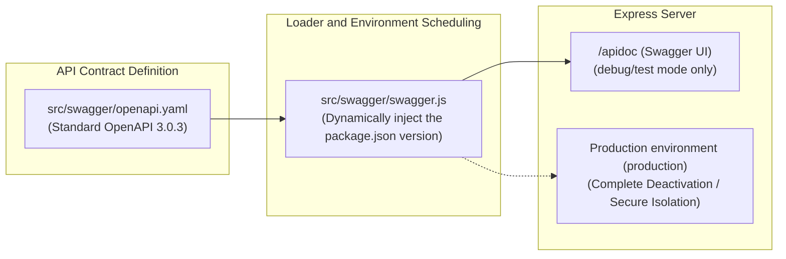
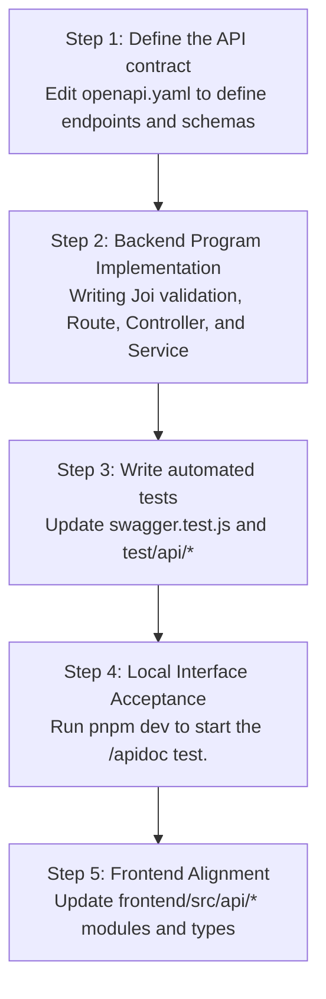

# 5. Swagger and API contract

This document describes the OpenAPI 3.0 specification architecture of this project, the operating mechanism of Swagger UI interactive documents, the testing operation of dual-track authentication in the interface, the reuse principles of document common components, and the end-to-end API contract maintenance and development process.

---

## 1. API Contract Core Architecture and Design Philosophy

### 1. Independently maintain the openapi.yaml file

The API file of this project directly maintains the file **[src/swagger/openapi.yaml](../../src/swagger/openapi.yaml)** and follows the standard OpenAPI 3.0 specification.



**Development Specifications**: Do not write Swagger JSDoc annotations in the program code. All endpoint paths, parameters, RequestBody and response formats must be added and modified directly in `src/swagger/openapi.yaml`.

---

### 2. Swagger loader mechanism ([src/swagger/swagger.js](../../src/swagger/swagger.js))

The loader is responsible for reading and assembling the OpenAPI specification when the application starts:

```javascript
const fs = require("fs");
const YAML = require("yaml");
const { resolveAppPath } = require("@src/helper/file.js");
const { version } = require("@src/config/app.js");

const loadOpenApiDocument = () => {
    if (process.versions?.bun) {
        try {
            return require("./openapi.yaml"); // Bun natively supports static bundling of YAML
        } catch {
            // Fallback to file read
        }
    }
    const openApiPath = resolveAppPath("src", "swagger", "openapi.yaml");
    return YAML.parse(fs.readFileSync(openApiPath, "utf8"));
};

const openApiDocument = loadOpenApiDocument();
openApiDocument.info = openApiDocument.info || {};
openApiDocument.info.version = version; // Automatically overwrite with the version number in package.json

module.exports = { openApiDocument };
```

- **Automatic version linkage**: `info.version` in the specifications will be automatically and dynamically overwritten with `version` in [package.json](../../package.json) during the startup period, ensuring that the system release version is 100% consistent with the API file version, and there is no need to manually maintain version numbers in two places.
- **Taking into account dual execution environments**:
  - **Node.js mode**: During execution, the entity file is read through the `yaml` parser.
  - **Bun compilation single file mode**: Give priority to using `require("./openapi.yaml")`, allowing the Bun packager to "statically embed" the specification content directly into the binary execution file during compilation.

---

### 3. Production environment security isolation strategy (Production Security Boundary)

In [src/http/route/index.js](../../src/http/route/index.js), the mounting of Swagger UI has strict environment mode judgment:

```javascript
// API interaction documentation is only available in debug or test mode.
if (["debug", "test"].includes(mode)) {
    app.use("/apidoc", swaggerUi.serve, swaggerUi.setup(openApiDocument));
}
```

> [!IMPORTANT]
> **Security Defense Principles**:
> When `APP_MODE=production` (production environment), the backend ** does not mount the `/apidoc` route at all ** and the request will directly respond with 404.

---

## 2. Access Swagger UI and interface operations

### 1. Access paths and environmental requirements

- **Access URL**: `http://127.0.0.1:3000/apidoc` (the communication port is determined by `APP_PORT` of `.env`).
- **Available environments**: Only available under `APP_MODE=debug` or `APP_MODE=test`.
- **Global prefix**: All business APIs are prefixed with `/api` (such as `/api/health`, `/api/auth/login`), and the default Swagger internal server address is `/api`.

---

### 2. Test operation of dual-track authentication in Swagger UI

The project supports **Cookie Session** and **Bearer JWT** dual-track authentication. The test operations of the two in Swagger UI are as follows:

```
+--------------------------------------------------------------+
| Swagger UI 介面右上角  [ 🔓 Authorize ] 按鈕                  |
+--------------------------------------------------------------+
| 1. cookieAuth (apiKey in cookie: token)                      |
|    - 瀏覽器同源自動攜帶：                                      |
|      最方便的做法是直接開啟前端登入頁完成登入，                  |
|      瀏覽器即具備 Session Cookie，回到本頁即可直接測試。        |
|                                                              |
| 2. bearerAuth (http, bearerFormat: JWT)                      |
|    - 手動授權：                                               |
|      先呼叫 Bearer 登入端點取得 token 字串，                   |
|      點擊 Authorize 按鈕並貼上 Token，                        |
|      Swagger UI 後續會在請求標頭自動附加：                     |
|      Authorization: Bearer <token>                           |
+--------------------------------------------------------------+
```

1. **Cookie authentication mode (the browser is native and the fastest method is recommended)**:
   - **Quick test shortcut**: Open the front-end login page (`http://127.0.0.1:3000/app/login`) directly in the browser to complete the login. Since the front-end SPA and Swagger UI have the same origin, the browser will automatically write the Session Cookie after successful login.
   - **Return to Swagger UI**: After logging in, switch directly back to `/apidoc`. At this time, the browser is already logged in, and all protected APIs can be tested directly on Swagger UI, **without the need to manually enter or paste any Token**.
   - *(`POST /api/auth/session/login` can also be executed directly in Swagger UI, and the backend will also be written to the browser through `Set-Cookie`.)*

2. **Bearer Token mode (recommended for cross-origin/APP mode)**:
   - Execute `POST /api/auth/login` in Swagger UI and copy the Token string in `data.token` in the response data.
   - Click the green **Authorize** button in the upper right corner of Swagger UI.
   - Paste the Token in the `bearerAuth` field and click OK (there is no need to manually enter the `Bearer ` prefix, the UI will automatically combine it).
   - Afterwards, all protected APIs marked with a lock icon will automatically carry the `Authorization: Bearer <token>` header when executing tests.

---

### 3. Try it out real-time testing and side effect warnings

> [!WARNING]
> The **Try it out** button on the Swagger UI makes a **real HTTP network request**!
> Performing add, modify or delete operations will directly change the contents of the database connected to the current server. When testing or displaying, please make sure you are connected to a development or test database to avoid irreversible damage to the official data.

---

## 3. OpenAPI 3.0 specification structure and Components reuse

In order to keep the specification simple and follow the DRY (Don't Repeat Yourself) principle, all common response structures and common parameters are defined in `components` for reference by each endpoint:

### 1. Common response structures (Components Schemas)

Following the project specifications in Chapter 3, all API response Body always maintains the `{ message, data }` structure:

```yaml
components:
  schemas:
    # Successful Response Base
    SuccessResponse:
      type: object
      required: [message, data]
      properties:
        message:
          type: string
          example: 操作成功
        data:
          type: object

    # Error Response Base
    ErrorResponse:
      allOf:
        - $ref: "#/components/schemas/SuccessResponse"

    # 422 Field Validation Error Response
    ValidationErrorResponse:
      allOf:
        - $ref: "#/components/schemas/ErrorResponse"
        - type: object
          properties:
            data:
              type: object
              properties:
                errors:
                  type: array
                  items:
                    type: object
                    properties:
                      name:
                        type: string
                        example: email
                      message:
                        type: string
                        example: 電子郵件格式不正確
```

---

### 2. Commonly used HTTP error response templates (Components Responses)

The endpoint can directly reference the predefined standard error response through `$ref`, without repeating the error structure:

|Component name|HTTP status code|business implication|Reference path|
| :--- | :---: | :--- | :--- |
| `ValidationError` | **422** |Input field validation failed| `#/components/responses/ValidationError` |
| `Unauthorized` | **401** |Not logged in or Token has expired| `#/components/responses/Unauthorized` |
| `Forbidden` | **403** |No operation permission or CSRF failed| `#/components/responses/Forbidden` |
| `NotFound` | **404** |The specified data or route cannot be found| `#/components/responses/NotFound` |
| `Conflict` | **409** |Data duplication conflicts (such as unique key violations)| `#/components/responses/Conflict` |

---

### 3. General paging parameters and paging objects (Pagination)

The project standard paging specification has been abstracted into shared Parameters and Schema:

```yaml
components:
  parameters:
    Page:
      name: page
      in: query
      description: 當前頁碼（預設為 1）
      schema:
        type: integer
        minimum: 1
        default: 1
    PerPage:
      name: perPage
      in: query
      description: 每頁筆數（預設 100，最大上限 100）
      schema:
        type: integer
        minimum: 1
        maximum: 100
        default: 100

  schemas:
    Pagination:
      type: object
      required: [total, perPage, currentPage, lastPage]
      properties:
        total:
          type: integer
          description: 資料總筆數
        perPage:
          type: integer
          description: 每頁筆數
        currentPage:
          type: integer
          description: 當前頁碼
        lastPage:
          type: integer
          description: 最後一頁頁碼
```

---

## 4. End-to-end API contract maintenance and development process

When the project needs to add a new API or modify the behavior of an existing endpoint, please follow the standard 5-step life cycle:



### 1. Endpoint writing standard YAML template

When adding an endpoint in `openapi.yaml`, it must include the complete summary, parameters, RequestBody (if any), 200/201 success response and possible error code:

```yaml
paths:
  /posts:
    post:
      tags: [Posts]
      summary: 建立新文章
      description: 需登入。支援 Cookie Session 或 Bearer Token。
      security:
        - cookieAuth: []
        - bearerAuth: []
      requestBody:
        required: true
        content:
          application/json:
            schema:
              $ref: "#/components/schemas/PostInput"
      responses:
        "201":
          description: 建立成功
          content:
            application/json:
              schema:
                $ref: "#/components/schemas/PostResponse"
        "401":
          $ref: "#/components/responses/Unauthorized"
        "422":
          $ref: "#/components/responses/ValidationError"
```

### 2. Contract maintenance regulations and rules

1. **Naming Consistency**:
   - JSON transmission fields always follow **`camelCase`** (such as `authorName`, `coverImage`, `perPage`).
   - The description text, Summary and Description should all be in **Traditional Chinese** with a clear structure.
2. **Example authenticity**:
   - Please provide reasonable fake data (such as test mailbox, reasonable title length) for sample data to facilitate reference by front-end engineers and intuitive display of the interface.
3. **Reuse first**:
   - As long as the data type or wrong structure appears more than twice, it must be converged to `components/schemas` to avoid future maintenance omissions caused by copying and pasting the same structure in multiple places.

---

## 5. Multi-execution environment compatibility and packaging mechanism

### 1. Node.js execution period

In a normal development or PM2 running environment, `src/swagger/swagger.js` will instantly read `src/swagger/openapi.yaml` on the disk and parse it into a JavaScript object when loading.
- **Hot reloading behavior description**: In `pnpm dev` development mode, PM2 watch has covered the `src/` directory (including `openapi.yaml`). After modifying the archive, PM2 will **automatically restart the backend service** to re-read the latest specifications; after the restart is completed, you can see the latest files by refreshing (F5) the Swagger UI page in the browser (only in non-watch modes such as native `pnpm start:node`, you need to manually restart the process).

### 2. Bun binary single file embedded mechanism

When executing `pnpm build:bun` to produce a single executable file:
- Bun natively supports YAML/JSON files as modules and is directly packaged into binary files.
- Bun can statically resolve `require("./openapi.yaml")` in the loader and bundle it into the executable. Therefore, `/apidoc` works with a single-file executable **without shipping any external YAML source files**.

---

## 6. Automated contract testing and continuous integration

The project established a double verification mechanism in the test system to ensure that the code implementation will not be out of touch with the API files:

### 1. Unit test contract verification ([test/unit/swagger.test.js](../../test/unit/swagger.test.js))

Unit tests directly verify the core contract of the Swagger assembly module:

```javascript
describe("OpenAPI 文件", () => {
    test("包含基礎 API 並使用 package.json 版本", () => {
        expect(openApiDocument.info.version).toBe(packageJson.version);
        expect(openApiDocument.paths).toEqual(
            expect.objectContaining({
                "/health": expect.any(Object),
                "/auth/register": expect.any(Object),
                "/auth/login": expect.any(Object),
                "/auth/me": expect.any(Object),
                "/posts": expect.any(Object),
                "/posts/{id}": expect.any(Object),
            }),
        );
    });
});
```

- Verify that `info.version` is faithfully synchronized with `package.json`.
- Check whether the core domain endpoint paths (`/health`, `/auth/*`, `/posts/*`) are completely registered in the specifications.

### 2. Integrated test two-way verification (`test/api/`)

In the API integration test, Supertest is used to simulate real HTTP requests to verify whether the returned HTTP status codes and JSON fields (`message`, `data`, `data.errors`) strictly comply with the Schema specifications defined by `openapi.yaml`.
