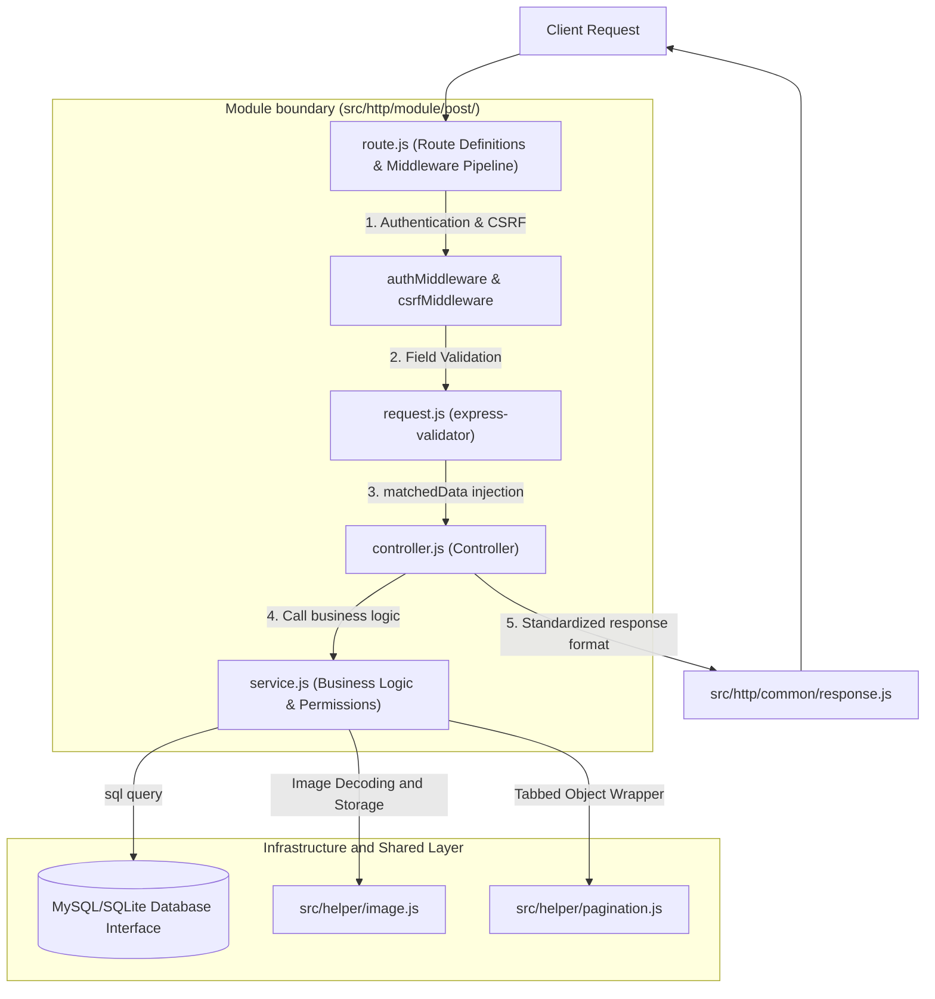
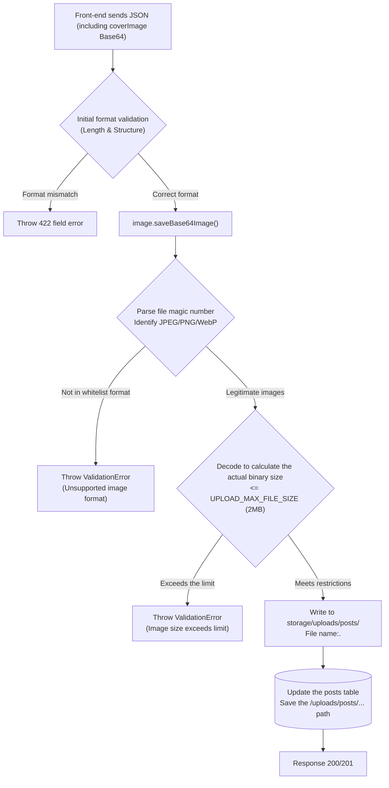

# 7. Backend module and image storage

This article uses the article post module as an example to explain the four-layer hierarchical architecture, input verification, author permission protection, paging processing and Base64 cover image storage mechanism of the project back-end business module.

---

## 1. Back-end module hierarchical architecture and responsibility boundaries

The back-end business functions are concentrated in the `src/http/module/<moduleName>/` directory and follow the **four-layer division of labor architecture** with high cohesion and low coupling:

### 1.1 Module hierarchical calling flow chart



### 1.2 Four levels of core file responsibilities

|File name|Core Responsibilities and Norms|
| :--- | :--- |
| `route.js` |Define HTTP Method, URL path and Middleware execution sequence. **Only responsible for assembling routes and exporting Express Router, not writing business logic**.|
| `request.js` |Define validation rules, transformation (Sanitizer) and error prompts for request input fields based on `express-validator`.|
| `controller.js` |**Receive the verified data (`req.validated`)**, call the corresponding Service method, capture the exception and hand it over to `next(error)`, and use `response.success()` to output a unified response. **Direct writing of SQL statements is strictly prohibited**.|
| `service.js` |**Pure business logic and data access core**, perform author identity and permission check, call database interface query, domain object conversion (snake_case to camelCase), call image storage, **Operation of Express `req` or `res` objects** is strictly prohibited.|

### 1.3 Naming Standards and Shared Helper Principles

- **CamelCase**: All JavaScript file names, function names, and JSON fields in API responses use `camelCase`.
- **Database naming conversion**: MySQL and SQLite data table fields use `snake_case`. In `service.js`, bidirectional translation of fields must be completed to maintain consistency between the Controller and external output.
- **Path Alias**: All projects use `@src/*` to introduce modules to maintain simplicity and cross-environment compatibility.
- **Priority to use shared Helper**:
  - Database access: `@src/db/index.js`
  - Image processing: `@src/helper/image.js`
  - File operation: `@src/helper/file.js`
  - Paging processing: `@src/helper/pagination.js`
  - Asynchronous link tracing: `@src/helper/requestContext.js`

---

## 2. Input validation and Controller specification

### 2.1 Verification of middleware and security value (`req.validated`)

In order to prevent unverified malicious parameters from penetrating into the business logic layer, the project strictly implements whitelist verification:

1. `request.js` defines the inspection rule array for each endpoint (can be combined with `idParam` and `paginationQuery` provided by `@src/http/common/request.js`).
2. Global `validateMiddleware` unified processing verification results:
   - Verification failed: `ValidationError` (HTTP 422) is thrown and detailed error information of each field is returned.
   - Verification successful: Use `matchedData(req)` to retrieve the whitelist fields that meet the verification rules and store them in `req.validated` to prevent undefined fields from entering the business logic. .
3. `controller.js` uniformly obtains verified whitelist data from `req.validated` to prevent unauthorized fields from being written and reduce the risk of Mass Assignment vulnerabilities.

### 2.2 Identity and permission value principles (trust `req.user.id`)

- **Single Source of Trust**: In the protected endpoint, the current user's ID is always obtained from `req.user.id` (injected after verifying the JWT by `authMiddleware`).
- **Strictly Prohibited Vulnerabilities**: **Absolutely prohibited** from reading the current user's identity from `req.body.userId`, `req.query.userId` or URL parameters to prevent identity forgery (BOLA/IDOR).

### 2.3 The middleware pipeline for writing routes (Middleware Pipeline)

For protected routes involving writes (POST/PUT/DELETE), the middleware mounting order must be strictly maintained:

```javascript
router.post(
    "/posts",
    authMiddleware,       // 1. Authentication (JWT signature and expiration check)
    csrfMiddleware,       // 2. CSRF Protection (Origin/Referer Source Comparison)
    createPostRequest,    // 3. express-validator field rules
    validateMiddleware,   // 4. Validation execution (throw 422 on failure, inject req.validated on success)
    controller.create,    // 5. Controller operation
);
```

---

## 3. Isolation of article endpoints and author permissions

### 3.1 Endpoint Contract and Permission Matrix

|endpoint| Method |Certification requirements|Permissions and filtering behavior|success status code|
| :--- | :--- | :---: | :--- | :---: |
| `/api/posts` | `GET` |public|Fixed querying only published articles.| 200 |
| `/api/posts/:id` | `GET` |public|Query a single article. If the article is a draft or does not exist, 404 will be returned.| 200 |
| `/api/posts/mine` | `GET` |Login required|Only queries all articles created by the current logged-in user, including drafts and published ones.| 200 |
| `/api/posts/mine/:id` | `GET` |Login required|Query the specific articles of the current logged-in user. If the user is not the author or does not exist, a 404 will be returned.| 200 |
| `/api/posts` | `POST` |Login required|Create a new article and automatically bind `author_id` to the current `req.user.id`.| 201 |
| `/api/posts/:id` | `PUT` |Login required|Completely update the article, the article does not exist and returns 404, non-author returns 403 Forbidden.| 200 |
| `/api/posts/:id` | `DELETE` |Login required|Delete the article, the article does not exist and will return 404, non-author will return 403 Forbidden.| 200 |

### 3.2 Route announcement order protection

In Express route comparison, static specific paths must be declared before dynamic parameter paths:

```javascript
// Correct: Register the exclusive path for mine first.
router.get("/posts/mine", authMiddleware, controller.listMine);
router.get("/posts/mine/:id", authMiddleware, controller.getMineById);

// Register the generic dynamic parameter path again to prevent "mine" from being mistakenly identified as an article ID query.
router.get("/posts/:id", controller.getById);
```

### 3.3 Resource modification permission inspection (Service layer defense line)

In `service.update()` and `service.delete()`, you must first query the database to obtain existing records and compare the author ID:

```javascript
const post = await getPostById(postId);
if (!post) throw new NotFoundError("找不到文章");
if (post.authorId !== currentUserId) throw new ForbiddenError("您無權操作此文章");
```

---

## 4. Paging mechanism and query specifications

### 4.1 Paging parameters and default values

The project provides standard universal paging validation rules (`@src/http/common/request.js`’s `paginationQuery`):

|parameter|type|default value|Description and limitations|
| :--- | :--- | :---: | :--- |
| `page` | `integer` | `1` |Page number, must be an integer greater than or equal to 1.|
| `perPage` | `integer` | `100` |Number of pens per page, limited between 1 and 100.|

### 4.2 Paging return structure

The list API always uses `@src/helper/pagination.js` and `format()` to generate standard paging wrapper objects:

```json
{
  "message": "取得文章列表成功",
  "data": {
    "posts": [
      {
        "id": 1,
        "title": "範例文章",
        "coverImage": "/uploads/posts/uuid-string.png",
        "status": "published",
        "createdAt": "2026-01-01 00:00:00"
      }
    ],
    "pagination": {
      "total": 42,
      "perPage": 12,
      "currentPage": 1,
      "lastPage": 4
    }
  }
}
```


---

## 5. Image storage and life cycle management

### 5.1 `src/config/upload.js` settings and image storage location

The article cover image receives Base64 data through coverImage, and is stored uniformly in `storage/uploads/posts/`** in the **program root directory, and is named with a UUID. The extension name is determined by the actual format of the image (`.jpg`, `.png` or `.webp`).

The database `posts.cover_image` stores the public path of `/uploads/posts/<UUID>.<ext>`, not the absolute path of the disk. Express maps `/uploads/*` to `storage/uploads/*` to provide image access.

Root directory and deployment management:
- **Node.js/Bun normal execution**: Use the working directory when the program is started as the root directory.
- **Bun independent executable file**: The directory where the executable file is located is the root directory.
The root directory is uniformly resolved by resolveAppPath(). `storage/uploads/` must be retained during deployment, update and backup to avoid loss of image data.

Image upload settings are uniformly managed by [`src/config/upload.js`](../../src/config/upload.js), including storage path, supported formats and file size limits:
```js
module.exports = {
    storageDir: "storage/uploads",
    publicUrlPrefix: "/uploads",
    allowedMimeTypes: ["image/jpeg", "image/png", "image/webp"],
    maxFileSizeBytes: Number(process.env.UPLOAD_MAX_FILE_SIZE ?? 2 * 1024 * 1024), // Default 2MB
    jsonLimit: process.env.UPLOAD_JSON_LIMIT ?? "10mb",
};
```

Among them, `storageDir` determines the root directory of the disk storage. When the article module calls the image helper, it adds the `posts` subdirectory under it, so it is actually stored in `storage/uploads/posts/`. `publicUrlPrefix` determines the beginning of the image public URL. When paired with the same subdirectory, `/uploads/posts/<UUID>.<ext>` is formed.

|Set fields|default value|use|
| :--- | :--- | :--- |
| `storageDir` |  `storage/uploads` |The image entity is stored in the root directory, and the article cover is stored in `posts/` under it.|
| `publicUrlPrefix` |  `/uploads` |The static public URL prefix also serves as the path prefix for database storage.|
| `allowedMimeTypes` |  JPEG、PNG、WebP |Limit the image formats allowed to be uploaded and verify them through file signatures.|
| `maxFileSizeBytes` | 2 MiB |The upper limit of the decoded size of a single image can be adjusted through UPLOAD_MAX_FILE_SIZE.|
| `jsonLimit` | 10mb |The upper limit of HTTP request text size can be adjusted through UPLOAD_JSON_LIMIT.|

Setting notes:
- `storageDir`, `publicUrlPrefix` and `allowedMimeTypes` are fixed settings of the program and do not provide modifications to `.env`. Image storage, static routing and existing database paths must be confirmed simultaneously during adjustment.
- Base64 encoding increases the request text size, so jsonLimit should be higher than the expected image transfer size.
- If using Nginx reverse proxy, make sure client_max_body_size is enough to accommodate the request text.

### 5.2 Base64 image processing flow chart



### 5.3 Safety inspection mechanism

The image storage logic is encapsulated in [`src/helper/image.js`](../../src/helper/image.js) and has multiple layers of defense:

1. **File Features Signature Inspection (Magic Number)**:
   - Refuse to rely on file extensions or Content-Type declarations and read the decoded binary Buffer leading bytes directly.
   - Only legal **JPEG (`0xFFD8FF`)**, **PNG (`0x89504E47`)** and **WebP (`RIFF....WEBP`)** are allowed.
2. **Real volume check after decoding**:
   - The Base64 string will be approximately 33% larger than the original image. The system strictly checks whether it exceeds `UPLOAD_MAX_FILE_SIZE` (default 2 MiB) after decoding and restoring it to Buffer.
3. **Random UUID file name isolation**:
   - The file name is completely regenerated by the system through `crypto.randomUUID()`, and the file extension is automatically completed based on the characteristic signature, completely eliminating path traversal and file name overwriting attacks.

### 5.4 Image life cycle (add, update and delete)

|Operation scenario|`coverImage` incoming value|System execution action|
| :--- | :--- | :--- |
|**New article**|Legal Base64|Decode and store the new image, and write the path to DB.|
|**New article**|`null` / Not provided|The field is stored in `null`.|
|**UPDATE ARTICLE**|This field is not provided|Leave the original cover path unchanged.|
|**UPDATE ARTICLE**|New Base64|Save the new image and **try to delete the old local image** after the DB update is successful.|
|**UPDATE ARTICLE**|`null` or empty string|Clear the cover field and **try to delete the old local image** after the DB update is successful.|
|**Delete article**| — |After deleting the DB article record, if the article has local images (starting with `/uploads/`), try to delete them from the disk as well.|

---

## 6. New business module standard operating procedures (New Module SOP)

If the project needs to expand new business field modules (such as the product `product` module):

1. **Data table definition**: Add a new migration file in `src/migrate/migrations/` and log it in `registry.js` (see [Part 4](4-database-and-migration.md)).
2. **Create module directory**: Create `src/http/module/<moduleName>/`.
3. **Implement four core files**:
   - `request.js`: Define field validation rules.
   - `service.js`: Implement business and database CRUD.
   - `controller.js`: Call service and output in `response.success` format.
   - `route.js`: Concatenate authentication, CSRF, verification and Controller.
4. **Main Router Mount**: Mount the module Router in `src/http/route/apiRoute.js` to `/api`.
5. **API Documentation and Test Contract**:
   - Supplement the API specification of this module in `src/swagger/openapi.yaml` (see [Part 5](5-swagger-and-api-contract.md)).
   - Write corresponding unit tests (`test/unit/`) and API contract tests (`test/api/`) (see [Part 8](8-testing-guide.md)).
6. **Compliance Check**: Execute `pnpm check` to confirm JS syntax and naming compliance.
