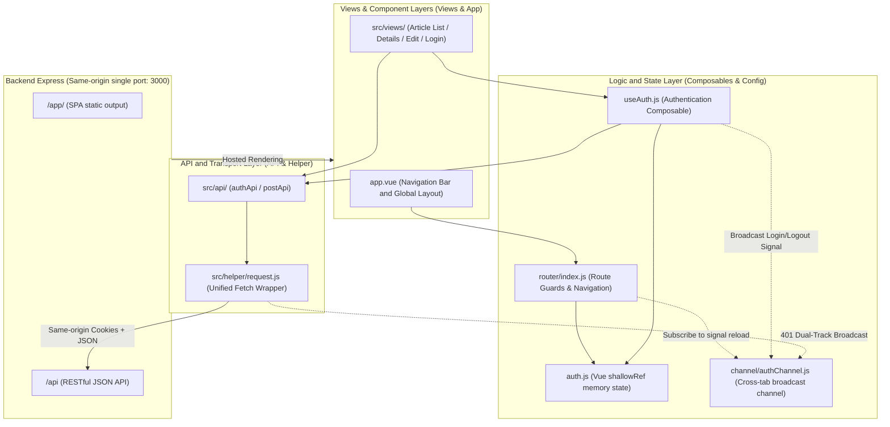
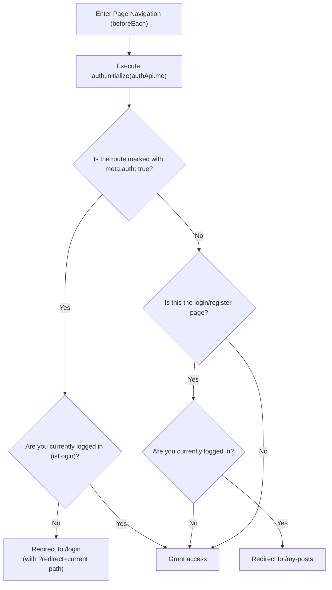

# 9. Front-end development

This article explains the technology selection, directory structure, same-origin port integration architecture, shared HTTP request encapsulation (`request.js`), login status management, and route navigation guard mechanism of the project front-end.

---

## 1. Front-end system architecture and hierarchical responsibilities

The front-end uses **Vue 3 (Composition API) + Vue Router + Vite**. The source code is located in the `frontend/` directory. The back-end `Express` is responsible for static file hosting and API services.

### 1.1 Front-end layered architecture diagram



### 1.2 Directory structure and module responsibilities

The front-end adopts a modular architecture to separate pages, routing, API requests, settings and status management, ensuring that the program code has good maintainability and scalability.

|Directory/Archives|Module Responsibilities Description|
| :--- | :--- |
| `src/main.js`、`src/app.vue` |Start the Vue application, mount routing, and provide global Navbar navigation and layout skeleton.|
| `src/views/` |Page-level components: manage page components such as article list, details, add/edit, login, registration, and 404.|
| `src/router/index.js` |Centrally manage routing, login verification guard (`meta.auth`), page scrolling, cross-page reload monitoring and authentication expiration events.|
| `src/channel/authChannel.js` |Cross-page broadcast channel: encapsulates the native BroadcastChannel and is responsible for full-page real-time notification and automatic refresh of login, logout, and expiration events.|
| `src/api/` |Encapsulate the API endpoints and call interfaces of each business module.|
| `src/helper/request.js` |Unified processing of HTTP requests, cookie carrying, authentication expiration 401 events, field validation error 422 events and timeout control.|
| `src/config/config.js` |Front-end public setting center (API base path, paging settings, image size limit and request timeout settings).|
| `src/config/auth.js` |Centrally maintain the user authentication status (`shallowRef(null)`) and anti-shake initialization logic in the memory.|
| `src/composables/useAuth.js` |Provides shared functionality such as login, logout, and user-responsive status.|

> [!IMPORTANT]
> **Development Standards and Principles**: All screen components must initiate requests through the `src/api/` module. It is strictly prohibited to call native `fetch` or other packages within the component. Cross-page shared status and logic should be converged to the existing config or composable first.

---

## 2. Integration of same-origin architecture

### 2.1 Routing prefix and path division

The frontend and backend **share the same HTTP port** (default `:3000`), with responsibilities separated by route prefixes:

|routing prefix|Service type|Processing subject and description|
| :--- | :--- | :--- |
| `/app/` |Front-end SPA page|Express hosts the front-end static resources. When the specific file is not compared, the fallback returns to `index.html`.|
| `/api/` |Business logic API|Express RESTful API responds to the unified `{ message, data }` JSON structure.|
| `/uploads/` |User uploads assets|Server local image file storage directory (see [Part 7](7-backend-modules-and-image-storage.md)).|
| `/apidoc/` |Interactive API documentation|Swagger UI file interface (only available in `debug` / `test` mode).|

### 2.2 Hot loading process (`pnpm dev`)

When executing `pnpm dev`, the system will connect the front-end and back-end development programs in series:

1. **Frontend build first**: Execute a frontend build first to produce the initial product.
2. **Backend PM2 guard**: Start PM2 and monitor the backend `src/` file changes, and automatically restart the backend process.
3. **Front-end continuous monitoring**: `vite build --watch` is executed in the front-end, and it is recompiled to `frontend/dist/` in seconds when the file is changed.
4. **Browser access**: Engineers can directly open `http://127.0.0.1:3000/app/` to debug. After modifying the front-end, refresh the browser to load the latest product.

### 2.3 Express SPA fallback hosting mechanism

- **Routing base prefix**: `vite.config.js` sets `base: "/app/"`, and the front-end Vue Router configures `createWebHistory(config.url.view)`, so the article route is defined as `/posts/:id` in Vue, and the actual browser URL is `/app/posts/:id`.
- **Deep routing support**: When Express encounters a GET request that starts with `/app` and does not contain an extension (extension check protection), it will automatically return `index.html` and return routing control to the front-end Vue Router.
- **Safety Isolation**: Missing assets, inconsistent file extensions, or non-HTML requests will never fallback to prevent static 404 errors or masking API errors.

---

## 3. Shared HTTP request tool (`src/helper/request.js`)

The front-end encapsulates the lightweight, robust and highly aggregated [`frontend/src/helper/request.js`](../../frontend/src/helper/request.js), which uniformly handles the HTTP communication of the entire site.

### 3.1 Core interface specifications

```javascript
request(method, path, data = null, options = {})
```

- **Auto-complete API path**: The incoming relative path (such as `posts` or `/auth/me`) will automatically be followed by `config.url.api` (default `/api`).
- **Automatic carrying of same-origin cookies**: `credentials: "include"` is enabled by default, and the browser will automatically carry the Session Cookie of `HttpOnly` without manually setting the Authorization header.
- **Default Header**: Automatically set `Accept: application/json`.

### 3.2 Parameter processing and serialization specifications

|HTTP Method / Data Type|Data processing practices|Content-Type handling|
| :--- | :--- | :--- |
|`GET` / `HEAD` (object)|Automatically convert `appendQuery` to a URL Query String. Automatically filter `null`, `undefined` and empty strings, and expand the array with duplicate keys.|No Request Body.|
|`POST` / `PUT` / `PATCH` (general objects)|Automatically serialize to JSON string with `JSON.stringify(data)`.|Automatically set to `application/json`.|
| `POST` / `PUT` / `PATCH`（`FormData`） |Directly transparently transmit the `FormData` object.|**Actively remove** `Content-Type` and let the browser automatically calculate the header containing `boundary`.|

### 3.3 401 authentication expiration and cross-page synchronization mechanism

When the backend returns HTTP 401, the frontend will automatically clear the login status and ensure that the authentication status of all pages is consistent through event notification and BroadcastChannel:

1. **Clear login status**: If the front end is currently logged in (`auth.isLogin()` is true), immediately call `auth.clearUser()` to clear the user information in the memory. The backend has been determined to be expired, but the frontend memory still retains the old login information, so only the frontend that was originally logged in needs to be cleared and jump back to the login page.
2. **Cross-pagination and authentication expiration notification**: Call `broadcastAuthSignal(AuthSignal.EXPIRED, true)` via [`src/channel/authChannel.js`](../../frontend/src/channel/authChannel.js):
   - **Other tabs**: Receive notifications through the browser `BroadcastChannel` and reload the page to synchronize the latest certification status.
   - **Current paging**: The `auth-expired` event is triggered, and the Router handles page guidance.
3. **Routing real-time guidance**: [`src/router/index.js`](../../frontend/src/router/index.js) After listening to the `auth-expired` event, if the current page is not the login page, it will immediately use SPA to smoothly direct the login page and carry the jump parameters:
```javascript
router.push({
    name: "login",
    query: { redirect: currentPath, expired: "1" },
});
```
4. **Cross-page login/logout synchronization**: When the user actively logs in, registers or logs out on any page, [`src/composables/useAuth.js`](../../frontend/src/composables/useAuth.js) will call `broadcastAuthSignal(AuthSignal.REFRESH)` to notify other pages to automatically reload and seamlessly switch to logged in or guest status.
5. **Exception handling**: If a specific request does not want to trigger global 401 expiration processing (for example, when the login API itself is entered incorrectly), the caller can pass in `{ handleAuthError: false }` to turn off this behavior.

### 3.4 422 field validation error analysis

When the back-end field validation fails, a 422 error structure containing the `data.errors` array will be returned, and the front-end helper will automatically flatten it into a key-value dictionary (`fields`):

```javascript
// Backend format: { errors: [{ name: "email", message: "Invalid email format" }] }
// Thrown Error Object:
error.fields = { email: "電子郵件格式不正確" };
```

This allows the Vue form component to directly obtain the error message through `fieldErrors.email` and display it below the corresponding input box.

### 3.5 Timeout control and request cancellation

```javascript
const timeoutSignal = AbortSignal.timeout(options.timeout ?? config.requestTimeoutMs);
const signal = options.signal ? AbortSignal.any([options.signal, timeoutSignal]) : timeoutSignal;
```

- **Automatic timeout interrupt**: The default timeout is 8000 ms (defined by `config.requestTimeoutMs`), and `error.type = "timeout"` is automatically thrown when the timeout occurs.
- **Active cancellation support**: The `options.signal` that can be passed in to the caller can be automatically merged with the timeout signal using `AbortSignal.any()`. `error.type = "cancelled"` will be thrown when the user leaves the page to cancel the request.
- **Network disconnection classification**: `error.type = "network"` is thrown when unable to connect, so that the UI can present precise error prompts.

---

## 4. Login status management and routing navigation guard

### 4.1 Memory certification status (`src/config/auth.js`)

Following the project's architecture, the JWT is stored in an `HttpOnly` Cookie issued by the backend. Frontend JavaScript cannot access the Token and **never uses `localStorage` or `sessionStorage` to store login credentials**:

- **Responsive state**: Use Vue's `user = shallowRef(null)` to save the current user object.
- **Status Management Method**:
  - `auth.setUser(nextUser)`: Write user data and mark initialization completed.
  - `auth.clearUser()`: Clear user data (set to `null`) and mark initialization complete.
  - `auth.isLogin()`: Use `Boolean(user.value)` to determine whether you are logged in.
- **Anti-shake initialization (Promise Cache)**: `auth.initialize(fetchUser)` internally maintains `initializePromise` and shares the same Promise when called multiple times in the same page life cycle, completely eliminating the problem of multiple routing guards calling `/api/auth/me` in parallel.

### 4.2 Route guard decision-making flow chart



### 4.3 Guard execution logic

Define the global front guard in [`frontend/src/router/index.js`](../../frontend/src/router/index.js):

```javascript
router.beforeEach(async (to) => {
    // 1. First, confirm the login status (if it has been initialized, it will return directly within seconds).
    await auth.initialize(authApi.me);

    // 2. Protected routes: Routes that require login to access
    if (to.meta.auth && !auth.isLogin()) {
        return { name: "login", query: { redirect: to.fullPath } };
    }

    // 3. Already logged in – Redirected to the login/registration page to prevent duplicate visits
    if ((to.name === "login" || to.name === "register") && auth.isLogin()) {
        return { name: "myPosts" };
    }
});
```

- **State Restoration**: When the user presses F5 to refresh the browser, the routing guard automatically checks the backend `/api/auth/me` to confirm whether the cookie is valid. If valid, the login status will be seamlessly restored without the user having to log in again.
- **Offline and network error prevention**: If the initial load fails (network interruption or cookie invalidation), the system will be deemed not logged in by default.

### 4.4 Cross-page status automatic synchronization mechanism (BroadcastChannel)

In order to avoid inconsistent authentication status in different browser pages (for example, page A is logged out, but page B still displays logged in), the system implements cross-page event notification through [`src/channel/authChannel.js`](../../frontend/src/channel/authChannel.js) to ensure that when login, logout, and authentication expires, each page can update the status synchronously:

#### 1. Zero-Payload Signaling
* **Cookie sharing**: The `HttpOnly` cookie issued by the backend is shared instantly by the browser across pages. Any external request from the page will automatically carry the latest cookie.
* **Single Source of Truth (SSOT)**: The source of the authentication status is always the backend and Cookie. The broadcast channel ** does not transmit any user data or Token** at all, and only sends pure action signals (`AUTH_REFRESH`, `AUTH_EXPIRED`), completely eliminating the risk of data disconnection and security leakage.

#### 2. Dual-track event processing mechanism
* **Other pagination**: After receiving the signal through `subscribeAuthSignal(() => window.location.reload())`, the entire page is reloaded cleanly. Reload the existing `router.beforeEach` in the startup life cycle and execute `auth.initialize(authApi.me)`, automatically calibrate the latest login or guest identity, and automatically jump according to routing permissions.
* **Current paging (trigger end)**: When the authentication expires (401), the `auth-expired` event is sent through `broadcastAuthSignal(AuthSignal.EXPIRED, true)`. The sending end performs SPA smooth guidance (`router.push`) through local event publishing to avoid forced reloading of the white screen interrupting the user's visual experience.

---

## 5. Front-end settings and environmental variable specifications

### 5.1 Static build and configuration file (`src/config/config.js`)

SPA front-end built products are purely static files (HTML/JS/CSS), and **cannot dynamically read the server's `.env` file** when running in the production environment:

* The official default values ​​are always written into the fallback default value of [`src/config/config.js`](../../frontend/src/config/config.js).
* Even if the server provides no environment variables at all, the front-end product can still run normally with the default settings.

### 5.2 `VITE_*` Environmental Variable Safety Specification

|variable name|default value|Purpose and instructions|
| :--- | :--- | :--- |
| `VITE_APP_NAME` | `"Nodejs Base"` |Front-end application title and page title.|
| `VITE_API_BASE_URL` | `"/api"` |Backend API root path (default origin `/api`).|

> [!CAUTION]
> **Front-end environment variable security ban**: All environment variables starting with `VITE_*` will be **statically embedded (Inlined)** into the JavaScript source code when executing the build. Any user can directly view it through the browser developer tools. **It is strictly prohibited to place database passwords, private keys, JWT Secrets or third-party API Secrets in any front-end files or `VITE_*`! **

---

## 6. Build, Type Checks, and Deployment Verification

### 6.1 Front-end command list

All commands are executed in the project root directory:

```powershell
# 1. Perform front-end Vue/TypeScript static type checking (no files generated)
pnpm --dir frontend check

# 2. Execute the official Vite build (output artifacts to frontend/dist/)
pnpm build:frontend

# 3. This machine only monitors front-end changes and automatically recompiles (requires running with the back-end Express).
pnpm dev:frontend
```

### 6.2 Online acceptance check list

After the front-end file is updated, please perform the following acceptance checks in order:

1. **Original origin and SPA routing verification**: Visit the homepage (`/app/`) and click on each page, manually refresh the browser in the deep path (such as `/app/posts/1`), and confirm that the page can be displayed normally without 404.
2. **Authentication status restoration**: Refresh the browser after logging in to confirm that the user information can be restored normally from `/api/auth/me` without crashing back to the login page.
3. **Automatic jump after expiration**: Initiate an operation after the cookie expires or is cleared, and confirm the global jump to `/app/login?expired=1`.
4. **Form and image verification**: Test the newly added article to confirm that the upload preview of the cover image is normal, and the 422 prompt can be accurately displayed in the corresponding field when the field format is incorrect.
5. **Cross-page status synchronization verification**: open two pages at the same time, log in or out on page A, page B should automatically reload and seamlessly switch login/guest status; when page A encounters 401 expiration, page B should automatically reorganize and redirect to the login page.
6. **Deployment file integrity and cache verification**:
   - **Bun single file deployment mode**: The front-end resources have been fully embedded in the executable file (`app.exe` / `app`) during compilation. The target host does not need to publish the `dist/` directory to ensure the integrity and atomicity of the static resources; only when "external `dist/` directory hot repair override" is enabled, the integrity of the external file needs to be ensured.
   - **Node.js traditional deployment/Nginx independent static hosting**: Be sure to ensure that `index.html` and `assets/` under `frontend/dist/` are fully released, and confirm that the reverse proxy has set `index.html` to not be cached (`no-cache`) to prevent the browser cache from referencing the expired Hash file to the expired Hash file, causing loading failure.
